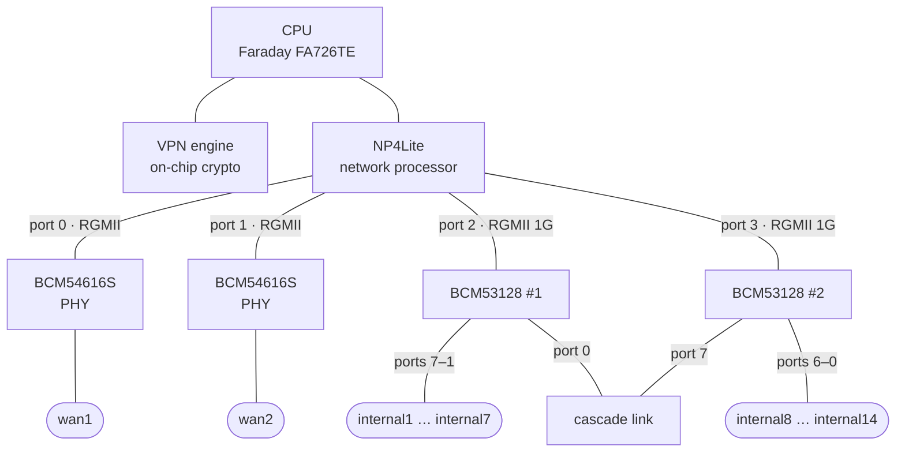
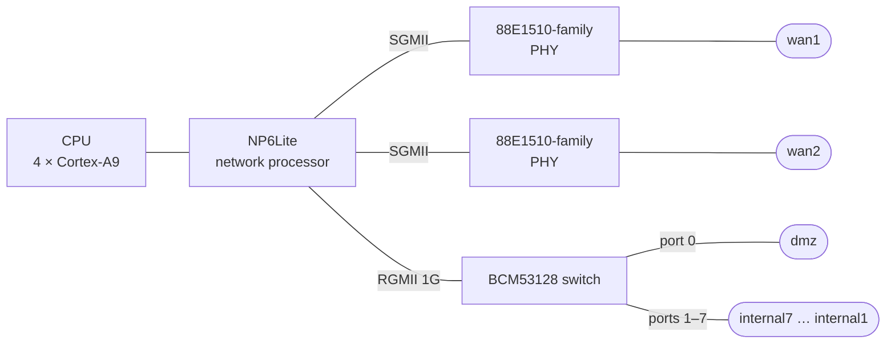

<h1 align="center">
  
</h1>

<p align="center">OpenWrt for decommissioned Fortinet FortiGate appliances, with their network and crypto accelerators</p>

> [!CAUTION]
> **Experimental software. Use at your own risk.**
>
> - This project is **very young** and still needs **a lot of testing**. Expect bugs.
> - A large part of the code was **written with the help of an LLM-based coding assistant**.
> - There is **no warranty** of any kind: it may not work on your unit, and it may leave it unable to boot.
> - Installing writes to the **internal boot disk** of the appliance (its boot sector and one firmware slot).
>   **Before you start, back up the configuration of the stock firmware and keep an official firmware image
>   (`.out`) for your model at hand**, so that you can reinstall the stock firmware if anything goes wrong.

*fgtWRT is not affiliated with or endorsed by Fortinet, Inc. or by the OpenWrt project.
Fortinet and FortiGate are trademarks of Fortinet, Inc.; they are used here only to name the hardware this project runs on.*

---

## Contents

- [About](#about)
- [Supported devices](#supported-devices)
- [Hardware acceleration](#hardware-acceleration)
- [Getting started](#getting-started)
- [Devices](#devices)
- [Known limitations](#known-limitations)
- [Benchmark methodology](#benchmark-methodology)
- [Contributing](#contributing)
- [License and credits](#license-and-credits)

## About

fgtWRT ports [OpenWrt](https://openwrt.org) to FortiGate appliances that have reached the end of their
service life. Its goal is to run a standard OpenWrt and still use **as much of the hardware as possible**:

- the **network processor** of the SoC, which forwards routed and NATed flows in hardware
  (NPLite, NP4Lite, NP6Lite) and, on the NP4Lite, encrypts outbound IPsec traffic;
- the **crypto engines** (VPN_LITE on SoC1, the VPN engine integrated in SoC2), exposed to the
  Linux crypto API (used by IPsec, for instance);
- the switches, PHYs, LEDs, buttons, RTC and storage of each board.

It adds a `fortisoc` target[^fortisoc-name] to OpenWrt for the Fortinet **FortiSOC** family of SoCs:

| SoC | CPU | CPU clock | Network processor | Crypto |
|---|---|---|---|---|
| SoC1 (FS1) | Faraday FA626TE (ARMv5) | 525 MHz (60C) | NPLite | VPN_LITE |
| SoC2 | Faraday FA726TE (ARMv5TE) | 800 MHz (60D), 900 MHz (90D) | NP4Lite | on-chip VPN engine |
| SoC3 | 4 × ARM Cortex-A9 (VFPv3-D16, no NEON) | about 1 GHz (60E) | NP6Lite | on-chip engine (no driver) |

The CPU clock depends on the model: the 60D and the 90D share the same SoC2 but run at different clocks.

[^fortisoc-name]: The target name `fortisoc` and its subtargets (`fsoc1`, `fsoc2`, `fsoc3`) are historical,
    taken from the marking of the Fortinet ASICs; they have no connection with the Fortinet product currently
    sold under the FortiSOC name.

**How it works.**

1. The OpenWrt image is first **booted from RAM** through the stock boot loader (TFTP). Nothing is written,
   so you can try OpenWrt without touching the appliance.
2. From that RAM system, **`sysupgrade` installs the same image** into a firmware slot of the internal boot
   disk. The target slot becomes the default one and the rest of the slot is kept as persistent storage
   (overlay), on the 60D, the 90D and the 60E alike.
3. The stock firmware stays in its other slot. The boot loader menu (**[B]**) switches between slots at any
   time, so you can always go back to it.

The running kernel keeps the boot disk **read-only**, except for write windows declared in the device tree:
the persistent storage area, which the kernel keeps writable at all times, and the target slot plus
a few listed bytes of the boot sector, which the installer opens for the duration of the installation only.

## Supported devices

| Model | SoC | CPU clock | Network processor | Crypto | Switch | Status |
|---|---|---|---|---|---|---|
| FortiGate 60D | SoC2 | 800 MHz | NP4Lite | on-chip VPN engine | BCM53128 | ✅ **Available** |
| FortiGate 90D | SoC2 | 900 MHz | NP4Lite | on-chip VPN engine | 2 × BCM53128 | ✅ **Available** |
| FortiGate 60E | SoC3 | about 1 GHz | NP6Lite | on-chip engine (no driver) | BCM53128 | ✅ **Available** |
| FortiGate 60C | SoC1 (FS1) | 525 MHz | NPLite | VPN_LITE | Marvell 88E6161 | 📋 **Planned** |
| FortiGate 100D | x86 PC (no Fortinet SoC) | 1.8 GHz | none | CP8 (no driver) | BCM53314 | 🚧 **Work in progress** |

- **Available**: image built from this repository, installable with persistent storage (60D, 90D, 60E).
  The published 60E image is built from revision `r37685-db82bd67325` of the `fgtwrt` branch; the
  published 60D and 90D images from revision `r37432-59b1585d5e1` (commit `59b1585d5e1`). Read
  [Known limitations](#known-limitations) before building a 60D or 90D image from a later revision.
- **Planned**: no OpenWrt profile in the tree yet.
- **Work in progress**: hardware bring-up in progress, no OpenWrt image yet.

## Hardware acceleration

Driver support for each accelerator, as implemented in this repository. The NPLite and VPN_LITE columns
describe the kernel drivers only: the 60C has no OpenWrt image yet (see [Supported devices](#supported-devices)).

**Legend.**
✅ supported and validated ·
🧪 implemented, validation in progress ·
❌ the hardware can do it, the driver does not (yet), or the feature is not enabled in the published images ·
— the hardware cannot do it.

Hardware flow offload uses the standard OpenWrt setting: *Network → Firewall → General Settings →
Routing/NAT Offloading → Hardware flow offloading* (`flow_offloading_hw` in `/etc/config/firewall`).

### Network processors

| Feature | NPLite<br>(SoC1) | NP4Lite<br>(SoC2) | NP6Lite<br>(SoC3) | Notes |
|---|:---:|:---:|:---:|---|
| **Routing / NAT offload** | | | | |
| IPv4 routing, TCP and UDP | 🧪 | ✅ | ✅ | line rate on the 60D and the 60E (see [Benchmarks](#benchmarks)). NP6Lite: UDP flows are offloaded by default |
| IPv4 SNAT / DNAT, with port translation | 🧪 | ✅ | 🧪 | |
| IPv6 routing, TCP and UDP | — | — | 🧪 | NPLite and NP4Lite flow entries are IPv4 only: IPv6 is always forwarded by the CPU. NP6Lite: line rate measured on an earlier 60E image |
| IPv6 NAT | — | — | ❌ | NP6Lite: not offloaded, the driver refuses IPv6 address rewriting; NAT66 works in software |
| ICMP | ❌ | ❌ | ❌ | handled by the CPU; NP6Lite hardware support not established |
| GRE | — | — | ❌ | handled by the CPU; NP6Lite hardware support not established |
| 802.1Q VLAN (one tag) | 🧪 | 🧪 | 🧪 | NP4Lite: needs `rx-vlan-offload` and `tx-vlan-offload`, off by default |
| QinQ / 802.1ad | — | — | ❌ | NPLite / NP4Lite flow entries carry a single tag. NP6Lite: hardware support not established |
| PPPoE | — | — | ❌ | NP6Lite: hardware support not established |
| Flows through the ports of the switch | ❌ | ✅ | 🧪 | NP4Lite: one logical interface per switch port in the device tree, validated on the 60D and the 90D; frames from the CPU to the switch ports are dropped when offloaded traffic saturates the NP–switch link (see [Known limitations](#known-limitations)). NP6Lite: `dmz`, single switch ports, bonds of switch ports and bridged switch ports; `dmz` and a bridge over `dmz` validated on the 60E image, the other cases on test kernels and earlier images |
| Link aggregation (bonding) endpoints | ❌ | 🧪 | 🧪 | no aggregation in the NP itself: the bond is handled by the driver. NPLite: driver code, not tested. NP4Lite: active-backup, balance-xor, 802.3ad; the switch chips aggregate their own ports (90D: groups within one switch chip, two groups at most for both chips). NP6Lite: bonds of switch ports |
| Offloaded connections | 8192 flows | **4096 connections** (8192 flow entries, one per direction) | 65536 connections | driver limit; further connections stay on the CPU. NP6Lite: also the default conntrack limit of OpenWrt |
| Per-flow byte / packet counters | 🧪 | 🧪 | ❌ | NPLite: about a hundred counters only. NP4Lite: limited number of counters. NP6Lite: activity only |
| L2 bridge / FDB offload in the NP | — | — | ❌ | bridging is done by the switch chip |
| QoS / shaping offload | ❌ | ❌ | ❌ | |
| **Inline IPsec (ESP) in the NP** | | | | |
| ESP tunnel mode, IPv4 in IPv4 | — | ✅ | ❌ | NPLite: IPsec goes through VPN_LITE (see below). NP4Lite: **outbound** packets are encrypted by the NP; **inbound** packets are decrypted by the NP and then forwarded by the CPU. Package `kmod-fortinet-np4lite-ipsec`, in the 60D and 90D images; validated on both |
| ESP ciphers | — | AES-CBC 128/192/256, 3DES-CBC | ❌ | as implemented in the NP4Lite driver; measured with AES-128-CBC |
| ESP integrity | — | HMAC-MD5-96, HMAC-SHA1-96, HMAC-SHA256-128 | ❌ | as implemented in the NP4Lite driver; measured with HMAC-SHA1-96 |
| ESN, NAT-T, transport mode | — | ❌ | ❌ | handled in software |
| IPsec over IPv6 | — | — | ❌ | NP4Lite: software only (works, see [Benchmarks](#benchmarks)) |
| **Host interface** | | | | |
| RX/TX checksum offload | 🧪 | 🧪 | 🧪 | NPLite / NP4Lite: IPv4 TCP/UDP, off by default (NP4Lite: with scatter-gather). NP6Lite: IPv4/IPv6 TCP/UDP |
| TSO | ❌ | ❌ | ❌ | NPLite / NP4Lite: hardware support not established |

NPLite and NP4Lite share one driver, but they are different chips:
the NP4Lite adds inline IPsec and switch-port offload. The IPsec limitations are listed in
[Known limitations](#known-limitations).

### Crypto engines

| Feature (Linux crypto API) | VPN_LITE<br>(SoC1) | VPN engine<br>(SoC2) | SoC3<br>(no driver) | Notes |
|---|:---:|:---:|:---:|---|
| `cbc(aes)` 128/192/256 | 🧪 | ✅ | ❌ | requests under 256 bytes go to software |
| `cbc(des3_ede)`, `cbc(des)` | 🧪 | 🧪 | ❌ | |
| `authenc(hmac(sha1\|md5),cbc(aes\|des3_ede))` | 🧪 | ✅ | ❌ | 96-bit ICV; SoC2: used by software IPsec with AES-128-CBC + HMAC-SHA1 |
| `authenc(hmac(sha256),…)`, `authenc(hmac(sha512),…)` | — | 🧪 | ❌ | 128-bit and 256-bit ICV |
| HMAC-SHA384 | — | ❌ | ❌ | SoC2: wrong ICVs in our tests, left to software |
| AES-GCM, AES-CTR, AES-ECB, ChaCha20-Poly1305 | — | — | ❌ | software (generic C code); SoC3: hardware support not established |
| Hash only (ahash) | ❌ | ❌ | ❌ | hardware support not established |

**Notes.**

- The Linux crypto driver is called `fortinet-cp7` (algorithms `*-cp7`); it drives the VPN_LITE engine
  of SoC1 and the VPN engine integrated in SoC2 (both possibly derived from Fortinet's CP7 design; no CP7 was
  available for comparison, so this is not confirmed).
- **SoC3** (60E) has an on-chip crypto engine, but no driver yet.
- **WireGuard** and **OpenVPN** have no hardware acceleration and run on the CPU. OpenVPN uses its kernel
  data channel (DCO, the mainline `ovpn` module) when the cipher allows it, ChaCha20-Poly1305 for instance;
  AES-256-CBC stays in user space.

## Getting started

The exact steps depend on the model: the boot loader menus and their keys differ between BIOS versions.
The procedure below is the common outline; read the **installation notes** of your model in
[Devices](#devices) before you start. The notes for the 60D, the 90D and the 60E describe the validated
path; for the other models they are _to be completed_.

### Requirements

- A **serial console** cable for the CONSOLE port, set to **9600 8N1**.
- A **TFTP server** on a computer wired to the appliance.
- The **official firmware image (`.out`)** for your model, and a **backup of the configuration of the stock firmware**.
- A Linux build host for OpenWrt (see the
  [OpenWrt build system documentation](https://openwrt.org/docs/guide-developer/toolchain/install-buildsystem)).

### 1. Build the image

```sh
git clone https://github.com/Radeon24/fgtwrt.git
cd fgtwrt
git checkout fgtwrt
./scripts/feeds update -a
./scripts/feeds install -a
make menuconfig
```

In `make menuconfig`, select:

| Option | FortiGate 60D | FortiGate 90D | FortiGate 60E |
|---|---|---|---|
| Target System | `Fortinet FortiSOC` | `Fortinet FortiSOC` | `Fortinet FortiSOC` |
| Subtarget | `FortiSOC2` | `FortiSOC2` | `FortiSOC3` |
| Target Profile | `FortiGate 60D` | `FortiGate 90D` | `FortiGate 60E` |

The device profile brings the drivers, the firewall with hardware flow offload, IPsec (IPv4 and IPv6, with
the NP4Lite offload on the 60D and the 90D) and the installer. It also **includes** the web interface and
the VPN packages, so that the profile alone builds the image that was measured; nothing else has to be
selected:

| Package (included in the 60D, 90D and 60E profiles) | For |
|---|---|
| `luci` | web interface |
| `kmod-wireguard`, `wireguard-tools` | WireGuard |
| `openvpn-openssl`, `kmod-ovpn-backports` | OpenVPN, with its kernel data channel (DCO) |
| `openssl-util` | the `openssl` command line tool |

On FortiSOC2, the ramdisk compression also defaults to gzip, which the boot loader requires (see
[Image layout](#image-layout)) and which the build checks. All the measurements below were made with these
packages built in.

Then build:

```sh
make -j"$(nproc)"
```

The image is `bin/targets/fortisoc/<subtarget>/openwrt-fortisoc-<subtarget>-<device>-initramfs-kernel.bin`;
for the 60D, `bin/targets/fortisoc/fsoc2/openwrt-fortisoc-fsoc2-fortinet_fg-60d-initramfs-kernel.bin`
(90D: `…-fortinet_fg-90d-initramfs-kernel.bin`; 60E:
`bin/targets/fortisoc/fsoc3/openwrt-fortisoc-fsoc3-fortinet_fg-60e-initramfs-kernel.bin`).

This **single file** is used for both steps: the TFTP boot to RAM and the installation with `sysupgrade`.
On the 60D and the 90D, the build refuses a kernel file too large for the boot loader (see the 60D section).

Pre-built images may be published later; until then, build from source.

### 2. Boot OpenWrt from RAM (test, nothing written)

1. Put the image on your TFTP server.
2. Connect the serial console, power the appliance on and interrupt the boot to enter the boot loader menu.
3. Set the TFTP server address, the local address and the image file name, then start the image boot.
   The menu keys and the Ethernet port used for TFTP differ between models and boot loader versions:
   see the installation notes of your model.
4. OpenWrt boots from RAM. Default network setup:

   | Interface | Ports | Setting |
   |---|---|---|
   | LAN | the `internal*` ports, bridged | `192.168.1.1`, DHCP server |
   | WAN | `wan1` | DHCP client |
   | — | `dmz`, `wan2` | not configured |

   Log in with `ssh root@192.168.1.1`, or with the web interface at `http://192.168.1.1` (LuCI is in the
   device profiles).

Everything runs in RAM: **nothing is written to the appliance**, and all changes are lost at the next reboot.
This is the recommended way to check that your unit works before installing.

### 3. Install with `sysupgrade` (persistent)

From OpenWrt running in RAM, copy the **same image** to the appliance and run `sysupgrade -n`:

```sh
scp -O openwrt-fortisoc-fsoc2-fortinet_fg-60d-initramfs-kernel.bin root@192.168.1.1:/tmp/
ssh root@192.168.1.1 sysupgrade -n /tmp/openwrt-fortisoc-fsoc2-fortinet_fg-60d-initramfs-kernel.bin
```

On every model the image goes into the OpenWrt firmware slot, which becomes the default boot, and the rest
of the slot becomes persistent storage (overlay); the stock firmware stays in the other slot, and **[B]** in
the boot loader menu switches between slots. The OpenWrt slot depends on the model: see its installation
notes.

**What the installer checks.** It refuses to write anything, with a message, unless:

- the boot disk is the expected internal disk: on USB boot disks, its vendor, model and size are checked;
  on eMMC, the expected devices must be present;
- the boot sector carries the stock header, and the **target partition** matches its MBR entry and the
  expected start and size;
- the write windows reported by the kernel match the expected ones;
- the slot it would overwrite is not a stock firmware set as the default boot, and the other slot still
  holds a firmware that **[B]** can bring back.

<details>
<summary><b>What it writes, in this order</b></summary>

1. **The firmware container** into the target slot. Only the start of the slot is used.
2. **The head of the persistent area**, the rest of the same slot: either your configuration archive, or a
   marker that asks for a clean format.
3. **A few bytes of the boot sector**: the image name and build number of that slot, and the boot flags
   that make it the default one. Every other byte is checked to be unchanged.

</details>

Each step is read back and verified. The write windows are then closed again, and the appliance reboots into
OpenWrt. On the first boot the persistent area is formatted (ext4) and your configuration is restored.

### 4. Update

Run `sysupgrade` again from the installed OpenWrt, with a newer image built the same way:

- `sysupgrade -n <image>` starts from a clean configuration — this is the path used for every reference
  image so far;
- `sysupgrade <image>` keeps the configuration: it is saved as an archive, the persistent area is
  formatted again, and the archive is restored at the first boot. As usual with OpenWrt, packages installed
  after the build are not kept. It has been exercised from an image to itself only (on the 60E, with an
  earlier image).

### 5. Go back to the stock firmware

- **Stock firmware still in its slot.** In the boot loader menu, choose **[B]** to switch the default
  boot partition back to it, then restore your configuration backup if needed.
- **Otherwise.** Reinstall the official `.out` image with the Fortinet procedure for your model, then
  restore your configuration backup.

---

## Devices

<details open>
<summary><b>FortiGate 60D</b> — SoC2 · NP4Lite · on-chip VPN engine — ✅ Available</summary>

### Specifications

| Item | Value |
|---|---|
| SoC | SoC2 |
| CPU | Faraday FA726TE (ARMv5TE) @ 800 MHz, L2 cache enabled |
| RAM | 2 GiB (1813.7 MiB seen by the kernel) |
| Network processor | NP4Lite, 4 RGMII ports |
| Crypto | on-chip VPN engine |
| Switch | Broadcom BCM53128 |
| WAN PHYs | 2 × Broadcom BCM54612E |
| Ethernet ports | 10 × 1 GbE: `wan1`, `wan2`, `dmz`, `internal1`…`internal7` |
| Boot disk | internal USB flash disk, 4 GB |
| Other storage | second internal USB flash disk, 8 GB |
| Boot flash | SPI NOR Winbond W25X40CL, 512 KiB (read-only; holds the base MAC address) |
| USB | rear USB-A (host), rear MGMT (device) |
| Console | RJ-45 serial, 9600 8N1 |
| LEDs | STATUS and HA (bicolour); WAN link/activity and speed (driven by the PHYs) |
| Buttons | reset |
| RTC | on-chip |
| Power | 12 V DC input; about 11 W (see [Benchmarks](#benchmarks)) |

### Hardware topology


**Hardware offload scope.** Each switch port (`dmz`, `internal1`…`internal7`) has its own logical interface
on the NP, so hardware flow offload covers flows between `wan1`, `wan2` and the switch ports, bonds of switch
ports included. The offloaded directions through the switch ports follow the `switch_offload` parameter of
the NP driver (`full`, the default: both directions); see [Known limitations](#known-limitations) for the
behaviour when offloaded traffic saturates the link between the NP and the switch.

### Image layout

The boot loader of the 60D reads two files from the ext2 container of the firmware slot:

- the **kernel file**, which holds the compressed kernel and its device tree. The boot loader decompresses it
  at a fixed low address; a decompressed payload larger than about **7.76 MiB** overwrites the stack of the
  boot loader itself, and the appliance does not boot. The build refuses a kernel file above **7 MiB**;
- the **ramdisk file** (`rootfs.gz`), which the boot loader loads unchanged at 16 MiB.

An OpenWrt kernel with its root file system built in does not fit under that limit once LuCI and the VPN
packages are added. fgtWRT therefore builds the kernel and its device tree alone (about 3.2 MB), and ships
the OpenWrt root file system as a **separate ramdisk** in `rootfs.gz` (about 7.4 MB with the packages listed
above). Its address and size are written into the `/chosen` node of the device tree at build time
(`linux,initrd-start`, `linux,initrd-end`), since the boot loader passes no boot arguments; the build also
checks that the decompressed kernel stays below the ramdisk.

### Benchmarks

Measured on our test setup in October 2026, on lab images equivalent to the published profile (same kernel
drivers and packages), plus the early debug console of the kernel and a few test tools, which are not expected
to affect the throughputs (see [Benchmark methodology](#benchmark-methodology)).

**Firewall modes.** *hw*: hardware flow offloading (`flow_offloading_hw=1`, the default of our
configuration); *sw*: software flow offloading only (`flow_offloading=1`); *none*: no flow offloading.
**Directions.** *fwd*: from the `wan1` side to the `wan2` side; *rev*: the opposite (`iperf3 -R`).
For tunnels the appliance is a tunnel end point: *in* = the appliance receives and decrypts,
*out* = it encrypts and sends. Throughputs are TCP goodput in Mbit/s, median of 3 runs of 10 s,
one TCP stream unless noted. The CPU is at 100 % on every software path.

#### Routing and NAT, IPv4

| Test | hw (fwd / rev) | sw (fwd / rev) | none (fwd / rev) |
|---|---|---|---|
| Routing, TCP, 1 stream | **941.3 / 941.4** (CPU ≤ 0.7 %) | 356.2 / 287.5 | 292.6 / 213.3 |
| Routing, TCP, 8 streams | **941.0 / 941.1** | 338.9 / 274.0 | 265.2 / 189.2 |
| Routing, UDP, 940 Mbit/s offered | **940 / 940**, no loss | 374.1 / 371.6, 59.4 % / 58.5 % lost | 340.4 / 336.9, 63.1 % / 62.0 % lost |
| SNAT (masquerade), TCP | **941.3 / 941.4** | 352.2 / 283.1 | 287.4 / 208.2 |
| DNAT (port forward), TCP | **941.4 / 941.4** | 351.9 / 282.5 | 283.9 / 205.8 |

Through the switch ports, *hw* mode: routing between `wan2` and a two-port LACP bond of switch ports
(`internal1` + `internal2`), TCP, one stream, **939 / 939** Mbit/s, CPU about 99 % idle (30 s runs).

#### Routing and NAT, IPv6

The NP4Lite cannot offload IPv6: in *hw* mode, IPv6 flows use the software flowtable.

| Test | hw (fwd / rev) | sw (fwd / rev) | none (fwd / rev) |
|---|---|---|---|
| Routing, TCP, 1 stream | 353.9 / 289.7 | 351.2 / 286.2 | 289.1 / 213.8 |
| Routing, TCP, 8 streams | 337.5 / 276.3 | 334.1 / 274.1 | 258.8 / 192.4 |
| Routing, UDP, 940 Mbit/s offered | 388.9 / 387.2, 58.2 % / 57.0 % lost | 386.9 / 384.8, 58.0 % / 57.2 % lost | 365.3 / 363.2, 60.7 % / 59.4 % lost |
| SNAT (masquerade), TCP | 346.3 / 282.5 | 341.6 / 278.4 | 284.2 / 207.2 |

#### Packet rate, IPv4 routing

Highest lossless rate (kernel `pktgen`, binary search, one run), kpps (Mbit/s):

| Frame size | Line rate | hw | sw | none |
|---|---|---|---|---|
| 64 B | 1488.1 | **750.4** (384.2), CPU 0.3 % | 54.7 (28.0) | 53.3 (27.3) |
| 128 B | 844.6 | 706.2 (723.1) | 51.3 (52.5) | 49.6 (50.8) |
| 256 B | 452.9 | **452.9, line rate** (927.5) | 47.8 (97.8) | 46.0 (94.2) |
| 512 B | 235.0 | line rate (962.4) | 40.3 (165.1) | 39.4 (161.3) |
| 1518 B | 81.3 | line rate (987.0) | 32.4 (392.9) | 30.5 (370.1) |
| IMIX 7:4:1 | 332.6 | 133.1 (378.9) | 38.6 (109.8) | 30.8 (87.6) |

#### Latency through the appliance

`ping` at 10 ms interval through the appliance, p50 / p99, IPv4:

| Load | hw | sw | none |
|---|---|---|---|
| idle | 0.4 / 1.0 ms | 0.4 / 1.0 ms | 0.4 / 1.0 ms |
| saturated by one TCP stream | **1.6 / 2.3 ms** (941 Mbit/s) | 20.5 / 50.2 ms (353 Mbit/s) | 21.5 / 51.0 ms (297 Mbit/s) |

#### Connections

New TCP connections per second (8 client threads, 10 s, no failure; CPU at 100 % in every mode):

| Test | hw (IPv4 / IPv6) | sw (IPv4 / IPv6) | none (IPv4 / IPv6) |
|---|---|---|---|
| Routed | 2232 / 2857 | 3589 / 3544 | 3342 / 3330 |
| With SNAT (mean of 3) | 2143 / 2401 | 3354 / 2831 | 3186 / 2614 |

Highest number of concurrent NATed TCP connections held open without failure (the connection tracking table
holds 65536 entries):

| Mode | IPv4 | IPv6 | Of which offloaded to the NP |
|---|---|---|---|
| hw | 16384 | 16384 | **4096** at most (IPv4 only) |
| sw | 50386 (table limit) | 32768 | — |
| none | 32768 | 28627 (table limit) | — |

#### IPsec, IPv4, tunnel mode

| Cipher | Path | in / out (Mbit/s) | CPU |
|---|---|---|---|
| AES-128-CBC + HMAC-SHA1 | **NP offload** | 396.2 / **883.3** | in 100 %, out about 91 % |
| AES-128-CBC + HMAC-SHA1 | software, VPN engine (`fortinet-cp7`) | 123.2 / 105.0 | 100 % |
| AES-128-GCM | software (generic) | 41.3 / 35.1 | 100 % |
| ChaCha20-Poly1305 | software (generic) | 94.4 / 70.1 | 100 % |

Transport mode, software: AES-128-CBC + HMAC-SHA1 118.0 / 111.8, AES-128-GCM 39.3 / 41.8,
ChaCha20-Poly1305 91.6 / 87.9 Mbit/s. In the NP offload, AES-GCM and ChaCha20-Poly1305 tunnel tests, a counter on
the host saw no clear-text packet of the protected flows leave the appliance.

#### IPsec, IPv6, software

| Cipher | tunnel, in / out | transport, in / out |
|---|---|---|
| AES-128-CBC + HMAC-SHA1 | 96.9 / 81.0 | 72.9 / 59.8 |
| AES-128-GCM | 35.8 / 31.2 | 32.6 / 28.5 |
| ChaCha20-Poly1305 | 78.0 / 57.6 | 62.1 / 49.9 |

#### WireGuard and OpenVPN (appliance as tunnel end point)

| Tunnel | Outer IP | 1 stream, in / out | 8 streams, in / out |
|---|---|---|---|
| WireGuard | IPv4 | 69.4 / 53.8 | 64.9 / 52.3 |
| WireGuard | IPv6 | 68.6 / 52.6 | 63.5 / 50.8 |
| OpenVPN, ChaCha20-Poly1305, kernel data channel (DCO) | IPv4 | 78.5 / 56.2 | 74.6 / 54.3 |
| OpenVPN, ChaCha20-Poly1305, DCO | IPv6 | 76.6 / 53.9 | 70.7 / 52.2 |
| OpenVPN, AES-256-CBC + HMAC-SHA256, user space | IPv4 | 18.3 / 16.6 | 17.2 / 16.1 |
| OpenVPN, AES-256-CBC + HMAC-SHA256, user space | IPv6 | 16.8 / 14.7 | 15.5 / 14.2 |

CPU at 100 % in every case. The peer runs OpenVPN without DCO.

#### System

| Metric | Result |
|---|---|
| Power, idle | 11 W |
| Power, offloaded load (≈ 900 Mbit/s both ways) | 11 W |
| Power-on to first LuCI response | 71.6 s (one cold boot) |
| Kernel start to `/init` | 1.58 s |
| Available RAM after boot | 1707.6 MiB of 1813.7 MiB |

Power is read from a smart plug with a 1 W resolution: an order of magnitude only. About 58 s of the boot time
is spent in the boot loader, which reads the image from the boot disk with a 9600 baud console.

### OpenWrt features

| Feature | Status |
|---|---|
| All Ethernet ports (link, traffic) | ✅ Validated: all 10 ports, over RAM boots, cold boots and reboots |
| Switch bridging (`br-lan`) | 🧪 Partial: bridge on `internal1`–`internal7` by default; the bridge itself is never offloaded, and a fully loaded bridge has not been measured |
| VLANs on switch ports | ✅ Validated on a bond of switch ports (802.1Q) |
| Link aggregation (LACP) on switch ports (BCM53128 trunk) | ✅ Validated |
| Hardware flow offload (`wan1` ↔ `wan2`), IPv4 routing, SNAT, DNAT | ✅ Validated |
| Hardware flow offload through the switch ports (`dmz`, `internal*`, bonds of switch ports) | ✅ Validated, with the limitation under saturation listed in [Known limitations](#known-limitations) |
| IPsec offload in the NP (IPv4 tunnel mode) | ✅ Validated |
| IPsec in software (IPv4 and IPv6, tunnel and transport) | ✅ Validated |
| `fortinet-cp7` crypto | ✅ Validated with software IPsec (AES-CBC + HMAC-SHA1) |
| WireGuard, OpenVPN (with DCO) | ✅ Validated (packages included in the 60D profile) |
| STATUS LED (boot / running / upgrade) | 🧪 Partial: LED aliases declared and boot LED observed; the full cycle has not been re-tested |
| WAN speed and activity LEDs | ✅ Validated |
| Reset button / failsafe | ❓ Not tested |
| RTC | 🧪 Partial: driver in the image, not re-tested under OpenWrt |
| Rear USB-A port | ❓ Not tested under OpenWrt (works under earlier test kernels) |
| Persistent storage (overlay) | ✅ Validated: survives reboots and power cuts (a change saved with `sync` before the cut is kept) |
| `sysupgrade` (keep / `-n`) | 🧪 Partial: `-n` validated; keep exercised from an image to itself only |
| Back to stock with [B] | ✅ Validated |

### Installation notes

> [!WARNING]
> On the 60D, OpenWrt is always installed into **partition 1** (firmware image 0) of the internal boot disk,
> which then becomes the default boot partition. **Before installing, make sure the stock firmware runs from
> partition 2**: if needed, use **[B]** in the boot loader menu to switch to it, and check that it boots.
> Anything in partition 1 is overwritten.

- In the boot loader menu, **[R]** boots the image from RAM over TFTP and **[B]** switches the default
  boot partition; the other entries are left alone.
- Persistent storage is the rest of the 256 MiB firmware slot (about 240 MiB, ext4).

</details>

<details>
<summary><b>FortiGate 90D</b> — SoC2 · NP4Lite · on-chip VPN engine — ✅ Available</summary>

### Specifications

| Item | Value |
|---|---|
| SoC | SoC2 |
| CPU | Faraday FA726TE (ARMv5TE) @ 900 MHz, L2 cache enabled |
| RAM | 2 GiB (1813.7 MiB seen by the kernel) |
| Network processor | NP4Lite, 4 RGMII ports |
| Crypto | on-chip VPN engine |
| Switches | 2 × Broadcom BCM53128, cascaded, one DSA tree |
| WAN PHYs | 2 × Broadcom BCM54616S |
| Ethernet ports | 16 × 1 GbE: `wan1`, `wan2`, `internal1`…`internal14` |
| Boot disk | internal USB flash disk, 8 GB |
| Other storage | 32 GB disk-on-module in a mini-PCIe slot (PCIe-to-SATA bridge on the module); not usable yet: no driver for the SoC2 PCIe host |
| Boot flash | SPI NOR, 512 KiB (read-only; holds the base MAC address) |
| Console | RJ-45 serial, 9600 8N1 |
| LEDs / buttons | none supported yet |
| Power | 12 V DC input; to be measured |

### Hardware topology



**Hardware offload scope.** As on the 60D, each switch port has its own logical interface on the NP, so
hardware flow offload covers flows between `wan1`, `wan2` and the `internal*` ports of both switch chips,
bonds of switch ports included; each switch chip has its own link to the NP. The `switch_offload`
parameter and the limitation under saturation are the same as on the 60D (see
[Known limitations](#known-limitations)).

**Link aggregation.** A bond of ports of **one** switch chip is aggregated by that chip and can be bridged;
the two chips share two hardware aggregation groups. A bond spanning the two chips works as a routed
interface only: it is refused as a bridge port.

### Image layout

Same boot loader family and same image layout as the 60D (kernel file with its device tree, separate
`rootfs.gz` ramdisk loaded at 16 MiB, 7 MiB limit on the kernel file kept by the build): see the 60D section.

### Benchmarks

Measured on our test setup in October 2026, with the same protocol as the 60D, on lab images equivalent to
the published profile (see [Benchmark methodology](#benchmark-methodology)). Throughputs are TCP goodput in
Mbit/s, one stream, median of 3 runs; *fwd* / *rev* and *in* / *out* as for the 60D.

| Test | Result | CPU |
|---|---|---|
| Routing `wan1` ↔ `wan2`, hw (fwd / rev) | **941 / 941** | about 99 % idle |
| Bridged bond of switch ports (3 ports of one chip + 1 port of the other chip), switched by the chips | **941 / 941** | about 99 % idle |
| Routing through a two-port LACP bond of switch ports, hw | 937–940 | |
| IPsec, AES-128-CBC + HMAC-SHA1, NP offload (in / out) | 445.5 / **891.4** | in 100 %, out about 83 % |
| WireGuard (in / out) | 76.6 / 59.2 | 100 % |
| OpenVPN, ChaCha20-Poly1305, kernel data channel (DCO) (in / out) | 86.3 / 61.4 | 100 % |
| OpenVPN, ChaCha20-Poly1305, user space (in / out) | 27.8 / 27.8 | 100 % |
| OpenVPN, AES-256-CBC + HMAC-SHA256, user space (in / out) | 19.9 / 17.8 | 100 % |
| Power-on to first LuCI response | about 70 s (70 and 71 s, two cold boots) | |

The software paths scale with the CPU clock (900 / 800 MHz) against the 60D. Enabling the L2 cache of the
90D brought the IPsec offload from 278 / 664 to 423 / 894 Mbit/s (in / out, same test kernel, three
streams) and cut the fork/exec time by about a third.

### OpenWrt features

| Feature | Status |
|---|---|
| Ethernet ports (link, traffic) | ✅ Validated on the ports wired in our setup (`wan1`, `wan2`, 10 of the 14 `internal*` ports, on both chips) |
| Switch bridging (`br-lan`) over the two chips | 🧪 Partial: bridge on `internal1`–`internal14` by default; measured with earlier images only |
| VLANs | ✅ Validated: on `wan2` (offloaded) and on a bond of switch ports (802.1Q) |
| Link aggregation (LACP), ports of one switch chip | ✅ Validated, routed and bridged |
| Link aggregation spanning the two switch chips | 🧪 Routed only, in software; never bridged |
| Hardware flow offload (`wan1` ↔ `wan2`), IPv4 routing, SNAT, DNAT | ✅ Validated |
| Hardware flow offload through the switch ports | ✅ Validated, with the limitation under saturation listed in [Known limitations](#known-limitations) |
| IPsec offload in the NP (IPv4 tunnel mode) | ✅ Validated |
| WireGuard, OpenVPN (with DCO) | ✅ Validated (packages included in the 90D profile) |
| Persistent storage (overlay) | ✅ Validated: survives reboots and power cuts |
| `sysupgrade` (keep / `-n`), `sysupgrade -b`, `firstboot` | ✅ Validated (keep exercised from an image to itself only) |
| Back to stock with [B] | ✅ Validated: the overlay is left intact |
| LEDs, buttons | ❌ none described yet |
| RTC, rear USB-A port | ❓ Not tested on this model |
| PCIe disk-on-module | ❌ no PCIe host driver yet |

### Installation notes

> [!WARNING]
> On the 90D, OpenWrt is always installed into **partition 2** (firmware image 1) of the internal boot disk,
> which then becomes the default boot partition. **Before installing, make sure the stock firmware runs from
> partition 1**: if needed, use **[B]** in the boot loader menu to switch to it, and check that it boots.
> Anything in partition 2 is overwritten.

- In the boot loader menu, **[R]** boots the image from RAM over TFTP (through `wan1`) and **[B]** switches
  the default boot partition; the other entries are left alone.
- Install from OpenWrt booted from RAM with `sysupgrade -n` (see [Getting started](#getting-started)). The
  installer refuses to write if partition 2 is the default boot and does not hold OpenWrt, or if
  partition 1 holds no firmware.
- Persistent storage is the rest of the 256 MiB firmware slot (240 MiB, ext4).
- To go back to the stock firmware, choose **[B]** in the boot loader menu: OpenWrt and its overlay stay in
  partition 2, and **[B]** again brings them back.

</details>

<details>
<summary><b>FortiGate 60E</b> — SoC3 · NP6Lite — ✅ Available</summary>

### Specifications

| Item | Value |
|---|---|
| SoC | SoC3 |
| CPU | 4 × ARM Cortex-A9 @ 1008 MHz (measured), VFPv3-D16 (no NEON), 1 MiB L2 cache |
| RAM | 2 GiB (1862 MiB seen by the kernel) |
| Network processor | NP6Lite |
| Crypto | no driver yet |
| Switch | Broadcom BCM53128 |
| WAN PHYs | 2 × Marvell, 88E1510 family (SGMII) |
| Ethernet ports | 10 × 1 GbE: `wan1`, `wan2`, `dmz`, `internal1`…`internal7` |
| Boot disk | internal eMMC (Micron), 3.56 GiB: two firmware slots and a data partition |
| Boot flash | SPI NOR Macronix, 2 MiB (read-only; holds the base MAC address) |
| USB | none usable yet |
| Console | RJ-45 serial, 9600 8N1 |
| RTC | on-chip, battery-backed |
| LEDs / buttons | none supported yet |
| Power | 12 V DC input; about 9 W, idle and under load (smart plug, 1 W resolution) |

### Hardware topology



**Hardware offload scope.** Flows between `wan1`, `wan2` and the switch side are offloaded: `dmz`, a single
switch port, a bond of switch ports, or a bridge of switch ports (frames between the ports of a bridge are
switched by the BCM53128 itself). All switch ports share the one 1 Gbit/s link between the NP6Lite and the
switch. UDP flows are offloaded by default (`ft_udp` parameter of the `fortinet_np6lite` module).

With firewall4, only the ports of the **networks** of a zone are put in its flow table: a port listed as a
`device` of a zone is routed by the CPU, without any message. Declare the interface in the `network` list of
the zone.

### Image layout

The image is one container written into partition 2 of the eMMC (256 MiB slot): the kernel file with its
device tree, and a separate `rootfs.gz` ramdisk that the boot loader loads at 416 MiB. The container fills
the first 16 MiB of the slot; the rest of the slot (240 MiB) is the persistent storage, formatted as ext4 at
the first boot.

### Benchmarks

Measured on our test setup in October 2026, with the same protocol as the 60D (see
[Benchmark methodology](#benchmark-methodology)). Throughputs are TCP goodput in Mbit/s, one stream,
median of 3 runs. *Image*: **current** = lab image of the published revision (with the lab overlay and
test tools); **earlier** = earlier OpenWrt lab image of the 60E, before the dmz and bridge offload.

| Test | Result | CPU | Image |
|---|---|---|---|
| Routing `wan1` ↔ `wan2`, IPv4, hw (fwd / rev) | **941 / 941** | about 99.7 % idle | current, 3 boots |
| Routing `dmz` ↔ `wan2`, hw (fwd / rev) | **939 / 939** | about 0 % | current, 3 boots |
| Bridge over `dmz` ↔ `wan2`, hw | **939** | | current, 1 boot |
| Routing `wan1` ↔ `wan2`, IPv4, software flow offload | 941 / 941 | one core busy | earlier |
| Routing `wan1` ↔ `wan2`, IPv4, no offload | 940 / 772 | | earlier |
| Routing `wan1` ↔ `wan2`, IPv6, hw | **928 / 928** | about 0 % | earlier |
| Routing through an LACP bond of switch ports, hw | 939 | | earlier |
| VLAN on a bond of switch ports, hw | 936 / 937 | | earlier |
| Latency through the appliance, idle / line saturated | 0.28 / 1.5–1.9 ms | | earlier |
| New connections per second, software flow offload (IPv4 / IPv6) | 8499 / 7872 | | earlier |
| Power-on to first LuCI response | 33–34 s (two cold boots) | | earlier |
| Power | about 9 W, idle and under load (1 W resolution) | | test kernel |

IPsec, WireGuard and OpenVPN have not been measured on the 60E yet.

### OpenWrt features

| Feature | Status |
|---|---|
| Ethernet ports `wan1`, `wan2`, `dmz` (link, traffic) | ✅ Validated |
| Ethernet ports `internal1`…`internal7` | 🧪 Partial: used in bonds of switch ports on an earlier image; a single port offloaded on test kernels only |
| Hardware flow offload (`wan1` ↔ `wan2`), IPv4 routing | ✅ Validated |
| SNAT, DNAT offloaded | 🧪 Partial: exercised on an earlier image, not re-tested on the current one |
| IPv6 offload | 🧪 Partial: validated on an earlier image, not re-tested on the current one |
| Hardware flow offload through `dmz` | ✅ Validated |
| Switch bridging (`br-lan`) offloaded | 🧪 Partial: a bridge over `dmz` validated; `dmz` + one internal port on test kernels; the default bridge over `internal1`–`internal7` not measured |
| VLANs, link aggregation (LACP, BCM53128 trunk) | 🧪 Partial: validated on an earlier image |
| UDP offload (default) | ⚠️ Partial: validated on test kernels booted from RAM; rare freezes of offloaded UDP flows seen on the lab unit, cause not found (see [Known limitations](#known-limitations)) |
| NAT66 | in software only |
| Persistent storage (overlay) | ✅ Validated: survives reboots and power cuts |
| `sysupgrade -n` | ✅ Validated |
| `sysupgrade` (keep), `sysupgrade -b`, `firstboot` | 🧪 Partial: validated on an earlier image |
| Back to stock with [B] and back to OpenWrt | 🧪 Partial: validated on an earlier image |
| LEDs, buttons | ❌ not described yet |
| USB, crypto engine, watchdog | ❌ no driver yet |
| RTC | ❓ read only, not re-tested under OpenWrt |

### Installation notes

> [!WARNING]
> On the 60E, OpenWrt is always installed into **partition 2** (firmware image 1) of the internal eMMC,
> which then becomes the default boot partition. **Before installing, make sure the stock firmware runs from
> partition 1**: if needed, use **[B]** in the boot loader menu to switch to it, and check that it boots.
> Anything in partition 2 is overwritten.

- In the boot loader menu, **[R]** boots the image from RAM over TFTP (through `wan1`) and **[B]** switches
  the default boot partition; the other entries are left alone.
- Install from OpenWrt booted from RAM with `sysupgrade -n` (see [Getting started](#getting-started)). The
  installer refuses to write if partition 2 is the default boot and does not hold OpenWrt, or if
  partition 1 holds no firmware.
- Once partition 2 holds OpenWrt, do not boot an OpenWrt image from RAM with **[R]** any more: it would
  mount and change the persistent storage of partition 2. Update from the installed OpenWrt with
  `sysupgrade`.
- Persistent storage is the rest of the 256 MiB firmware slot (240 MiB, ext4).
- To go back to the stock firmware, choose **[B]** in the boot loader menu: OpenWrt and its overlay stay in
  partition 2, and **[B]** again brings them back.

</details>

<details>
<summary><b>FortiGate 60C</b> — SoC1 (FS1) · NPLite · VPN_LITE — 📋 Planned</summary>

### Specifications

| Item | Value |
|---|---|
| SoC | SoC1 (FS1) |
| CPU | Faraday FA626TE (ARMv5) @ 525 MHz |
| RAM | 1 GiB |
| Network processor | NPLite (first generation) |
| Crypto | VPN_LITE engine |
| Switch | Marvell 88E6161 |
| Ethernet ports | `wan1`, `wan2`, `dmz`, `lan1`…`lan5` |
| Boot disk | internal disk on module, behind a USB 2.0 hub |
| USB | front USB port, ExpressCard slot (USB side), through the same hub |
| LEDs | STATUS, ALARM (bicolour); WAN1, WAN2, DMZ speed (100 / 1000) |
| Buttons | reset |
| RTC | on-chip |
| Power | 12 V DC input; to be measured |

### Hardware topology


### Benchmarks

_To be measured._

### OpenWrt features

Not started: no profile in the tree yet.

### Installation notes

_To be completed._

</details>

<details>
<summary><b>FortiGate 100D</b> — x86 PC · no network processor — 🚧 Work in progress</summary>

An x86 PC rather than a Fortinet SoC appliance.

### Specifications

| Item | Value |
|---|---|
| Platform | x86 PC, Intel ICH8M chipset (no Fortinet SoC); no ACPI, no device tree |
| CPU | Intel Atom D525 (x86-64, 2 cores / 4 threads) @ 1.8 GHz |
| RAM | 4 GiB |
| Network processor | none |
| Crypto | Fortinet CP8 (PCI); no driver |
| Switch | Broadcom BCM53314 (PCI), 20 ports; needs a custom driver, not supported yet |
| Direct NICs | 4 × Intel 82574L (`e1000e`): `wan1`, `dmz`, and two that are probably the links to the switch |
| Ethernet ports | 22 × 1 GbE: `wan1`, `dmz` (Intel NICs); `wan2`, `mgmt`, `ha1`, `ha2`, `port1`…`port16` (switch) |
| Boot disk | internal SATA SSD, 16 GB |
| Boot flash | SPI flash, 512 KiB, holds the BIOS (read-only) |
| USB | chipset USB host controllers (driver loaded; no device tested) |
| Console | serial (COM1), 9600 8N1 |
| Hardware monitoring | Winbond W83627DHG-P super-IO: fan speed readable; the fan is regulated by the chip itself |
| LEDs / buttons | not identified yet |
| RTC | CMOS; not used by our kernels yet |
| Power | about 28–30 W under the stock firmware (smart plug reading) |

### Status

- **Mainline Linux boots in RAM** through the stock boot loader; nothing is written to the appliance.
- **Switch bring-up in progress**: no switch port carries traffic under our kernels yet.
- **No OpenWrt image yet**, and no code in this repository: the porting work is tracked separately.
- Routing, NAT and crypto would be software only, bounded by the CPU.

Benchmarks and installation notes: _to be completed_.

</details>

---

## Known limitations

**60D and 90D, network processor.**

- **At most 4096 connections are offloaded to the NP at a time** (8192 flow entries, one per direction).
  This is a limit of the driver, not of the hardware; further connections are forwarded by the CPU
  (software flowtable). Raising it is planned.
- **IPv6 is never offloaded**: the NP4Lite does not parse IPv6 headers. IPv6 routing and NAT run on the CPU
  (about 350 / 290 Mbit/s).
- **Switch port offload limitation (60D and 90D).** When offloaded traffic from the WAN ports to the built-in
  switch ports saturates the single 1 Gbit/s link between the NP4Lite and the switch, frames sent by the CPU
  to the switch ports share the same queue and are dropped (31–54 % in our tests: ping, ARP, LACPDUs). With a
  LACP partner using a short timeout, aggregated switch ports can then lose members (up to 5 times per 120 s
  at 960 Mbit/s UDP, gaps up to 3 s), and the failover of such a bond is slower: up to 1.4 s when a member
  goes down, one gap of 6.3 s in 5 tests when it comes back, and isolated gaps of about 0.5 s on a saturated
  offloaded bond. The NP rate limiter has no effect on this path, so this is a hardware architecture limit.
  Workaround: `echo oneway > /sys/module/fortinet_np4lite/parameters/switch_offload` keeps the switch → WAN
  direction offloaded and routes WAN → switch through the CPU (no CPU-frame loss, about 340 Mbit/s
  WAN → switch); it can be changed at run time.
  **On the 90D**, each switch chip has its own link to the NP, and the same behaviour was measured on the
  link of the second chip (`internal8`…`internal14`), with the L2 cache disabled: 30–54 % of the frames sent
  by the CPU lost, 23–49 % of the LACPDUs, up to 4 member losses per 120 s at 960 Mbit/s UDP, no loss in the
  switch → WAN direction; with `oneway`, about 280–300 Mbit/s WAN → switch and no CPU-frame loss.
- With hardware offload, fewer new connections per second are accepted than with software offload
  (about 2100–2300/s instead of 3300–3600/s), and the lossless IMIX rate (133 kpps) is below what the
  single-size results suggest. Both are being investigated.

**60D and 90D, IPsec offload.**

- IPv4 **tunnel mode only**, with the AES-CBC / 3DES-CBC and HMAC ciphers listed above. Transport mode,
  ESN, NAT-T, AES-GCM, ChaCha20-Poly1305 and all IPv6 IPsec run in software.
- **Inbound** traffic is decrypted by the NP but forwarded by the CPU: about 396 Mbit/s (60D) and
  445 Mbit/s (90D), against about 883 / 891 Mbit/s outbound.
- An ESP packet **fragmented on the outside** (an inner packet larger than the path MTU, encrypted by the
  peer and then fragmented) is dropped by the NP. The image clamps the TCP MSS of IPsec flows (1398 bytes) in
  the firewall, so TCP is not affected; large non-TCP packets can be lost.
- **Inbound anti-replay is disabled** on offloaded SAs.
- The NP checks that decrypted packets match the selector of their SA; an SA installed with an
  any-to-any (`0.0.0.0/0`) selector, as some IKE daemons do, is not restricted by this check.

**60D and 90D, other.**

- **WireGuard and OpenVPN run on the CPU** (about 50–90 Mbit/s). OpenVPN uses its kernel data channel for
  ChaCha20-Poly1305 only; AES-256-CBC stays in user space (about 17–20 Mbit/s).
- LuCI, WireGuard and OpenVPN are **in the default device profiles** of the 60D, the 90D and the 60E.
- **90D**: a bond spanning the two switch chips cannot be bridged (routed only), and the two chips share two
  hardware aggregation groups. LEDs, buttons and the PCIe disk-on-module are not supported yet.
- **Clock**: without a reachable NTP server, the clock was found days behind after reboots; the RTC driver
  has not been re-tested under OpenWrt. Keep NTP (the OpenWrt default) enabled, and check the time before
  relying on certificates.
- **Boot time**: about 70 s from power-on to the web interface, most of it in the boot loader (60D and 90D).

**60D and 90D, revisions.**

- The published 60D and 90D images (revision `r37432-59b1585d5e1`) are built from the device profile alone and
  **have not been booted yet** on our units; the lab images validated on both models differ from them by
  their debug console and test tools, and on the 60D by the L2 cache and cross-chip aggregation code, which
  stays inactive on that model.
- Later revisions of the `fgtwrt` branch are rebased on a newer OpenWrt. They also change the user space
  shared by all models (installer, overlay driver) and bring an upstream change to the DSA core of the kernel
  (police flow actions), which is built for the 60D and the 90D. Neither has been validated on these two models
  yet: until it is, build them from commit `59b1585d5e1`.

**60E.**

- **Traffic sent by the appliance itself** (not routed) on `wan1` and on a bond of switch ports at the same
  time: `wan1` is limited to about 210 Mbit/s, with many retransmissions, while the CPU core that handles both
  outputs is fully busy. Alone, `wan1` reaches 911–934 Mbit/s. Routed and offloaded traffic is not affected.
- UDP flows are offloaded by default. **Possible instability**: on the lab unit, offloaded UDP flows stopped
  being forwarded in rare power cycles (all freezes seen within 1 of 11 observed power cycles), on test kernels
  and under OpenWrt alike; the cause is not found yet. If UDP traffic stalls, keep UDP on the CPU:
  `echo 0 > /sys/module/fortinet_np6lite/parameters/ft_udp`.
- IPv6 NAT (NAT66) is not offloaded; IPv6 routing is.
- The behaviour under saturation of the link between the NP6Lite and the switch, described above for the 60D
  and the 90D, has not been measured on the 60E yet.
- LEDs, buttons, USB, the crypto engine and the watchdog are not supported yet; IPsec runs in software.
- **Boot time**: about 33–34 s from power-on to the web interface (earlier image).

**Other models.** The 60C and the 100D have no OpenWrt image.

## Benchmark methodology

The same protocol is used on every model, so that results can be compared. It runs on a home-grown
harness: the numbers in [Devices](#devices) come from it.

**Test setup.**

- **One Linux host** with gigabit NICs, wired to the appliance on both sides: a separate network
  namespace plays the second host. CPU and NIC are therefore shared — fine at 1 Gbit/s, but it has to be
  kept in mind when reading software-path numbers.
- The appliance runs a build of this repository with the packages of the device profile and a test network
  configuration (static addresses, no DHCP); each test then sets only what it needs, without saving it, and
  restores the configuration afterwards.
- Each test is run **three times**, and the median is reported, unless noted otherwise.
- The measured images were built with the low-level early debug console of the kernel enabled (`DEBUG_LL`,
  `EARLY_PRINTK`, options of the local build configuration), and with a few test tools from the same
  configuration (`iperf3`, the `devmem`, `blockdev` and `od` applets of BusyBox, `/dev/mem`). That console only
  prints boot messages before the serial driver starts; no effect on the throughputs is expected. The published
  image is built from the device profile alone: it has neither that console nor these tools (the generic
  `earlycon` of the kernel command line is the same in both).
- Model caveat: on the 60D, the benchmark tables are measured between `wan1` and `wan2`; flows through the
  switch ports are offloaded too (one bond measurement is given); on the 90D, the same tests were run on a
  subset (routing, bonds of switch ports, IPsec offload, VPN); on the 60E, the switch side is `dmz`, a
  bridge or a bond of switch ports, and some results come from an earlier image (marked in its table).

| Test | Tool / method | Variants |
|---|---|---|
| Throughput | `iperf3`, 10 s | TCP (1 and 8 streams) and UDP, both directions |
| Packet rate | kernel `pktgen`, lossless rate search | 64 to 1518-byte frames, plus IMIX |
| Routing vs NAT | firewall zone with and without masquerade, port forward | IPv4 and IPv6 |
| Hardware vs software | `flow_offloading_hw` / `flow_offloading` / no offloading | same traffic |
| New connections per second | home-grown connection sink, many short TCP connections | routed, with SNAT |
| Max concurrent connections | connection sink, rising steps until a step fails; counts conntrack and hardware-offloaded entries | TCP, with SNAT |
| IPsec | manual-keyed SAs, `iperf3` through the tunnel; a counter on the host checks that no clear-text packet of the protected flows leaves the appliance | AES-128-CBC + HMAC-SHA1, AES-GCM, ChaCha20-Poly1305; tunnel and transport; NP offload or software |
| WireGuard, OpenVPN | appliance as tunnel end point, `iperf3` through the tunnel | 1 and 8 streams, IPv4 and IPv6 outer |
| Latency under load | `ping` at 10 ms interval, percentiles, while the line is saturated | |
| CPU load | two `/proc/stat` reads around each measurement | |
| Power | smart plug — **order of magnitude only**, no calibrated meter | idle, full routing load |
| System | time from power-on to the first ping, SSH and LuCI response; free RAM after boot | |

## Contributing

Feedback is very welcome:

- **Report problems and suggestions** in the [GitHub issues](https://github.com/Radeon24/fgtwrt/issues).
  Please include:
  - the model;
  - the image version;
  - the serial console log;
  - the output of `logread` and `dmesg`.
- **Other FortiGate models** built on **SoC1, SoC2 or SoC3** are good candidates: if you own
  one, open an issue with its model name and boot log.
- **SoC4-based models** have not been tested at all yet.
- **x86-based FortiGates** need hands-on access to the hardware; proposals are welcome and will be studied
  case by case.
- **Help with models built on different hardware** is welcome too: get in touch through an issue.

Please never post serial numbers, MAC addresses or real configurations in public issues.

## License and credits

fgtWRT is based on [OpenWrt](https://openwrt.org), and is distributed under the same terms: GPL-2.0 for the
OpenWrt build system and for the code added by this project, unless a file states otherwise. The fgtWRT logos
in `docs/` are licensed under CC BY-SA 4.0.

Many thanks to the OpenWrt and Linux kernel communities, whose work this project builds on.
