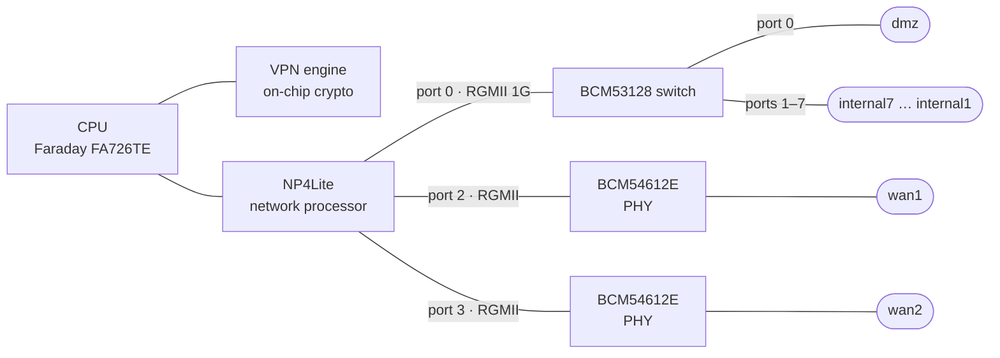
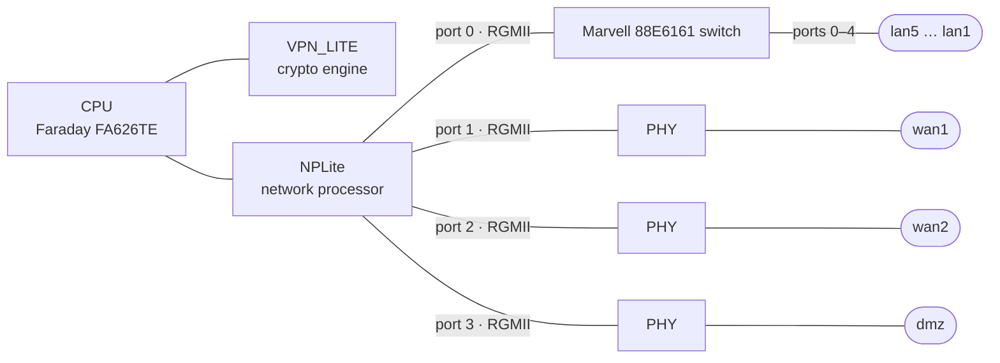
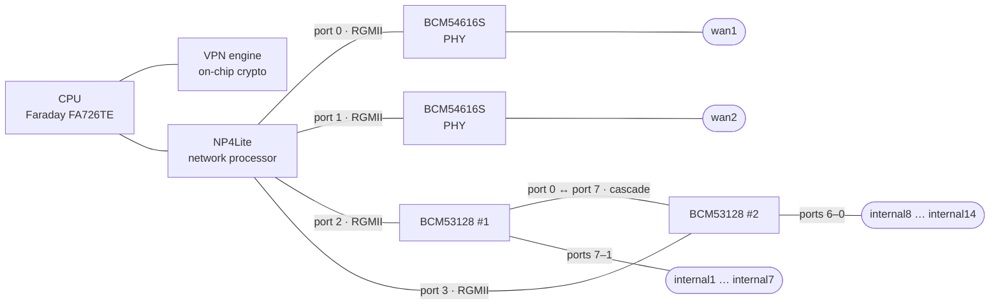
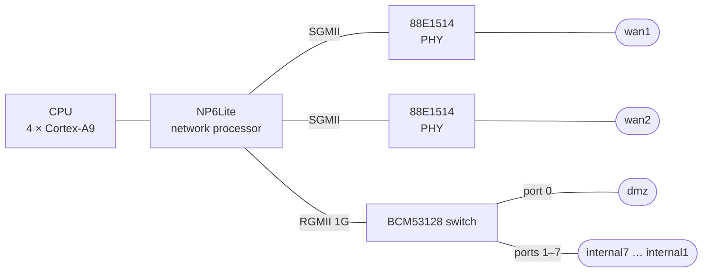

<h1 align="center">
  
</h1>

<p align="center">OpenWrt for decommissioned Fortinet FortiGate appliances, with their network and crypto accelerators</p>

> [!CAUTION]
> **Experimental software. Use at your own risk.**
>
> - This project is **very young** and still needs **a lot of testing**. Expect bugs.
> - A large part of the code was **written with the help of an LLM-based coding assistant**.
> - There is **no warranty** of any kind: it may not work on your unit, and it may leave it unable to boot.
> - Installing writes to the **internal boot disk** of the appliance (its boot sector and one firmware slot).
>   **Before you start, back up the configuration of the stock firmware and keep an official firmware image
>   (`.out`) for your model at hand**, so that you can reinstall the stock firmware if anything goes wrong.

*fgtWRT is not affiliated with or endorsed by Fortinet, Inc. or by the OpenWrt project.
Fortinet and FortiGate are trademarks of Fortinet, Inc.; they are used here only to name the hardware this project runs on.*

---

## Contents

- [About](#about)
- [Supported devices](#supported-devices)
- [Hardware acceleration](#hardware-acceleration)
- [Getting started](#getting-started)
- [Devices](#devices)
- [Known limitations](#known-limitations)
- [Benchmark methodology](#benchmark-methodology)
- [Contributing](#contributing)
- [License and credits](#license-and-credits)

## About

fgtWRT ports [OpenWrt](https://openwrt.org) to FortiGate appliances that have reached the end of their
service life. Its goal is to run a standard OpenWrt and still use **as much of the hardware as possible**:

- the **network processor** of the SoC, which forwards routed and NATed flows in hardware
  (NPLite, NP4Lite, NP6Lite) and, on the NP4Lite, encrypts outbound IPsec traffic;
- the **crypto engines** (VPN_LITE on SoC1, the VPN engine integrated in SoC2), exposed to the
  Linux crypto API (used by IPsec, for instance);
- the switches, PHYs, LEDs, buttons, RTC and storage of each board.

It adds a `fortisoc` target[^fortisoc-name] to OpenWrt for the Fortinet **FortiSOC** family of SoCs:

| SoC | CPU | CPU clock | Network processor | Crypto |
|---|---|---|---|---|
| SoC1 (FS1) | Faraday FA626TE (ARMv5) | 525 MHz (60C) | NPLite | VPN_LITE |
| SoC2 | Faraday FA726TE (ARMv5TE) | 800 MHz (60D), 900 MHz (90D) | NP4Lite | on-chip VPN engine |
| SoC3 | 4 × ARM Cortex-A9 (VFPv3-D16, no NEON) | about 1 GHz (60E) | NP6Lite | on-chip engine (no driver) |

The CPU clock depends on the model: the 60D and the 90D share the same SoC2 but run at different clocks.

[^fortisoc-name]: The target name `fortisoc` and its subtargets (`fsoc1`, `fsoc2`, `fsoc3`) are historical,
    taken from the marking of the Fortinet ASICs; they have no connection with the Fortinet product currently
    sold under the FortiSOC name.

**How it works.**

1. The OpenWrt image is first **booted from RAM** through the stock boot loader (TFTP). Nothing is written,
   so you can try OpenWrt without touching the appliance.
2. From that RAM system, **`sysupgrade` installs the same image** into a firmware slot of the internal boot
   disk. On the **60D**, the target slot becomes the default one and the rest of the slot is kept as
   persistent storage (overlay). On the **90D** and the **60E**, the image goes into the **non-default**
   slot only (`sysupgrade -n`), with nothing kept: the stock firmware stays the default boot.
3. The stock firmware stays in its other slot. The boot loader menu (**[B]**) switches between slots at any
   time, so you can always go back to it.

The running kernel keeps the boot disk **read-only**, except for write windows declared in the device tree:
the persistent storage area (60D), which the kernel keeps writable at all times, and the target slot plus
a few listed bytes of the boot sector, which the installer opens for the duration of the installation only.

## Supported devices

| Model | SoC | CPU clock | Network processor | Crypto | Switch | Status |
|---|---|---|---|---|---|---|
| FortiGate 60D | SoC2 | 800 MHz | NP4Lite | on-chip VPN engine | BCM53128 | ✅ **Available** |
| FortiGate 60C | SoC1 (FS1) | 525 MHz | NPLite | VPN_LITE | Marvell 88E6161 | 📋 **Planned** |
| FortiGate 90D | SoC2 | 900 MHz | NP4Lite | on-chip VPN engine | 2 × BCM53128 | 🔜 **Coming soon** |
| FortiGate 60E | SoC3 | about 1 GHz | NP6Lite | on-chip engine (no driver) | BCM53128 | 🔜 **Coming soon** |
| FortiGate 100D | x86 PC (no Fortinet SoC) | 1.8 GHz | none | CP8 (no driver) | BCM53314 | 🚧 **Work in progress** |

- **Available**: image built from this repository, installable with persistent storage (60D). The 60D
  reference build is revision `r37420-313a83071a5`.
- **Coming soon**: OpenWrt runs in our lab, installed into the **non-default** firmware slot without
  persistent storage; LEDs, storage and other items are still to be done. Not published as supported yet.
- **Planned**: no OpenWrt profile in the tree yet.
- **Work in progress**: hardware bring-up in progress, no OpenWrt image yet.

## Hardware acceleration

Driver support for each accelerator, as implemented in this repository. The NPLite and VPN_LITE columns
describe the kernel drivers only: the 60C has no OpenWrt image yet (see [Supported devices](#supported-devices)).

**Legend.**
✅ supported and validated ·
🧪 implemented, validation in progress ·
❌ the hardware can do it, the driver does not (yet), or the feature is not enabled in the published images ·
— the hardware cannot do it.

Hardware flow offload uses the standard OpenWrt setting: *Network → Firewall → General Settings →
Routing/NAT Offloading → Hardware flow offloading* (`flow_offloading_hw` in `/etc/config/firewall`).

### Network processors

| Feature | NPLite<br>(SoC1) | NP4Lite<br>(SoC2) | NP6Lite<br>(SoC3) | Notes |
|---|:---:|:---:|:---:|---|
| **Routing / NAT offload** | | | | |
| IPv4 routing, TCP and UDP | 🧪 | ✅ | 🧪 | NP4Lite: line rate on the 60D (see [Benchmarks](#benchmarks)) |
| IPv4 SNAT / DNAT, with port translation | 🧪 | ✅ | 🧪 | |
| IPv6 routing, TCP and UDP | — | — | 🧪 | NPLite and NP4Lite flow entries are IPv4 only: IPv6 is always forwarded by the CPU |
| IPv6 NAT | — | — | ❌ | NP6Lite: never tried; whether the hardware can do it is not established |
| ICMP | ❌ | ❌ | ❌ | handled by the CPU; NP6Lite hardware support not established |
| GRE | — | — | ❌ | handled by the CPU; NP6Lite hardware support not established |
| 802.1Q VLAN (one tag) | 🧪 | 🧪 | 🧪 | NP4Lite: needs `rx-vlan-offload` and `tx-vlan-offload`, off by default |
| QinQ / 802.1ad | — | — | ❌ | NPLite / NP4Lite flow entries carry a single tag. NP6Lite: hardware support not established |
| PPPoE | — | — | ❌ | NP6Lite: hardware support not established |
| Flows through the ports of the switch | ❌ | 🧪 | 🧪 | NP4Lite: needs one logical interface per switch port in the device tree — enabled on the 90D, left out of the current 60D device tree (see [Known limitations](#known-limitations)). NP6Lite: through a bond of switch ports only |
| Link aggregation (bonding) endpoints | ❌ | 🧪 | 🧪 | no aggregation in the NP itself: the bond is handled by the driver. NPLite: driver code, not tested. NP4Lite: active-backup, balance-xor, 802.3ad. NP6Lite: bonds of switch ports |
| Offloaded connections | 8192 flows | **4096 connections** (8192 flow entries, one per direction) | 8192 flows | driver limit; further connections stay on the CPU |
| Per-flow byte / packet counters | 🧪 | 🧪 | ❌ | NPLite: about a hundred counters only. NP4Lite: limited number of counters. NP6Lite: activity only |
| L2 bridge / FDB offload in the NP | — | — | ❌ | bridging is done by the switch chip |
| QoS / shaping offload | ❌ | ❌ | ❌ | |
| **Inline IPsec (ESP) in the NP** | | | | |
| ESP tunnel mode, IPv4 in IPv4 | — | ✅ | ❌ | NPLite: IPsec goes through VPN_LITE (see below). NP4Lite: **outbound** packets are encrypted by the NP; **inbound** packets are decrypted by the NP and then forwarded by the CPU. Package `kmod-fortinet-np4lite-ipsec`, in the 60D and 90D images; validated on the 60D only |
| ESP ciphers | — | AES-CBC 128/192/256, 3DES-CBC | ❌ | as implemented in the NP4Lite driver; measured with AES-128-CBC |
| ESP integrity | — | HMAC-MD5-96, HMAC-SHA1-96, HMAC-SHA256-128 | ❌ | as implemented in the NP4Lite driver; measured with HMAC-SHA1-96 |
| ESN, NAT-T, transport mode | — | ❌ | ❌ | handled in software |
| IPsec over IPv6 | — | — | ❌ | NP4Lite: software only (works, see [Benchmarks](#benchmarks)) |
| **Host interface** | | | | |
| RX/TX checksum offload | 🧪 | 🧪 | 🧪 | NPLite / NP4Lite: IPv4 TCP/UDP, off by default (NP4Lite: with scatter-gather). NP6Lite: IPv4/IPv6 TCP/UDP |
| TSO | ❌ | ❌ | ❌ | NPLite / NP4Lite: hardware support not established |

NPLite and NP4Lite share one driver, but they are different chips:
the NP4Lite adds inline IPsec and switch-port offload. The IPsec limitations are listed in
[Known limitations](#known-limitations).

### Crypto engines

| Feature (Linux crypto API) | VPN_LITE<br>(SoC1) | VPN engine<br>(SoC2) | SoC3<br>(no driver) | Notes |
|---|:---:|:---:|:---:|---|
| `cbc(aes)` 128/192/256 | 🧪 | ✅ | ❌ | requests under 256 bytes go to software |
| `cbc(des3_ede)`, `cbc(des)` | 🧪 | 🧪 | ❌ | |
| `authenc(hmac(sha1\|md5),cbc(aes\|des3_ede))` | 🧪 | ✅ | ❌ | 96-bit ICV; SoC2: used by software IPsec with AES-128-CBC + HMAC-SHA1 |
| `authenc(hmac(sha256),…)`, `authenc(hmac(sha512),…)` | — | 🧪 | ❌ | 128-bit and 256-bit ICV |
| HMAC-SHA384 | — | ❌ | ❌ | SoC2: wrong ICVs in our tests, left to software |
| AES-GCM, AES-CTR, AES-ECB, ChaCha20-Poly1305 | — | — | ❌ | software (generic C code); SoC3: hardware support not established |
| Hash only (ahash) | ❌ | ❌ | ❌ | hardware support not established |

**Notes.**

- The Linux crypto driver is called `fortinet-cp7` (algorithms `*-cp7`); it drives the VPN_LITE engine
  of SoC1 and the VPN engine integrated in SoC2 (both possibly derived from Fortinet's CP7 design; no CP7 was
  available for comparison, so this is not confirmed).
- **SoC3** (60E) has an on-chip crypto engine, but no driver yet.
- **WireGuard** and **OpenVPN** have no hardware acceleration and run on the CPU. OpenVPN uses its kernel
  data channel (DCO, the mainline `ovpn` module) when the cipher allows it, ChaCha20-Poly1305 for instance;
  AES-256-CBC stays in user space.

## Getting started

The exact steps depend on the model: the boot loader menus and their keys differ between BIOS versions.
The procedure below is the common outline; read the **installation notes** of your model in
[Devices](#devices) before you start. The notes for the 60D describe the validated path; for the other
models they are _to be completed_.

### Requirements

- A **serial console** cable for the CONSOLE port, set to **9600 8N1**.
- A **TFTP server** on a computer wired to the appliance.
- The **official firmware image (`.out`)** for your model, and a **backup of the configuration of the stock firmware**.
- A Linux build host for OpenWrt (see the
  [OpenWrt build system documentation](https://openwrt.org/docs/guide-developer/toolchain/install-buildsystem)).

### 1. Build the image

```sh
git clone https://github.com/Radeon24/fgtwrt.git
cd fgtwrt
git checkout fgtwrt
./scripts/feeds update -a
./scripts/feeds install -a
make menuconfig
```

In `make menuconfig`, select:

| Option | FortiGate 60D |
|---|---|
| Target System | `Fortinet FortiSOC` |
| Subtarget | `FortiSOC2` |
| Target Profile | `FortiGate 60D` |

The device profile brings the drivers, the firewall with hardware flow offload, IPsec (IPv4 and IPv6, with
the NP4Lite offload) and the installer. It does **not** select a web interface or VPN packages; add the
ones you want as built-in (`*`), for instance:

| Package | For |
|---|---|
| `luci` (LuCI → Collections) | web interface |
| `kmod-wireguard`, `wireguard-tools` | WireGuard |
| `openvpn-openssl`, `kmod-ovpn-backports` | OpenVPN, with its kernel data channel (DCO) |

All the measurements below were made with these packages built in.

Then build:

```sh
make -j"$(nproc)"
```

The image is `bin/targets/fortisoc/<subtarget>/openwrt-fortisoc-<subtarget>-<device>-initramfs-kernel.bin`;
for the 60D, `bin/targets/fortisoc/fsoc2/openwrt-fortisoc-fsoc2-fortinet_fg-60d-initramfs-kernel.bin`.

This **single file** is used for both steps: the TFTP boot to RAM and the installation with `sysupgrade`.
On the 60D, the build refuses a kernel file too large for the boot loader (see the 60D section).

Pre-built images may be published later; until then, build from source.

### 2. Boot OpenWrt from RAM (test, nothing written)

1. Put the image on your TFTP server.
2. Connect the serial console, power the appliance on and interrupt the boot to enter the boot loader menu.
3. Set the TFTP server address, the local address and the image file name, then start the image boot.
   The menu keys and the Ethernet port used for TFTP differ between models and boot loader versions:
   see the installation notes of your model.
4. OpenWrt boots from RAM. Default network setup:

   | Interface | Ports | Setting |
   |---|---|---|
   | LAN | the `internal*` ports, bridged | `192.168.1.1`, DHCP server |
   | WAN | `wan1` | DHCP client |
   | — | `dmz`, `wan2` | not configured |

   Log in with `ssh root@192.168.1.1`, or at `http://192.168.1.1` if you built LuCI in.

Everything runs in RAM: **nothing is written to the appliance**, and all changes are lost at the next reboot.
This is the recommended way to check that your unit works before installing.

### 3. Install with `sysupgrade` (persistent)

From OpenWrt running in RAM, copy the **same image** to the appliance and run `sysupgrade -n`:

```sh
scp -O openwrt-fortisoc-fsoc2-fortinet_fg-60d-initramfs-kernel.bin root@192.168.1.1:/tmp/
ssh root@192.168.1.1 sysupgrade -n /tmp/openwrt-fortisoc-fsoc2-fortinet_fg-60d-initramfs-kernel.bin
```

The installation differs by model: on the **60D** the image goes into the default firmware slot, which
becomes the default boot, and the rest of the slot becomes persistent storage (overlay); on the **90D**
and the **60E** it goes into the **non-default** slot only, and the stock firmware stays the default
boot (**[B]** in the boot loader menu switches between slots).

**What the installer checks.** It refuses to write anything, with a message, unless:

- the boot disk is the expected internal disk: on USB boot disks, its vendor, model and size are checked;
  on eMMC, the expected devices must be present;
- the boot sector carries the stock header, and the **target partition** matches its MBR entry and the
  expected start and size;
- the write windows reported by the kernel match the expected ones;
- on the 60D, the slot it would overwrite is not a stock firmware set as the default boot.

<details>
<summary><b>What it writes, in this order</b></summary>

1. **The firmware container** into the target slot. Only the start of the slot is used.
2. On the **60D** only, **the head of the persistent area**, the rest of the same slot: either your
   configuration archive, or a marker that asks for a clean format.
3. **A few bytes of the boot sector**: the image name and build number of that slot, and on the 60D the
   boot flags that make it the default one. Every other byte is checked to be unchanged.

</details>

Each step is read back and verified. The write windows are then closed again, and the appliance reboots into
OpenWrt. On the 60D, on the first boot the persistent area is formatted (ext4) and your configuration is
restored.

### 4. Update

Run `sysupgrade` again from the installed OpenWrt, with a newer image built the same way:

- `sysupgrade -n <image>` starts from a clean configuration — this is the path used for every reference
  image so far;
- `sysupgrade <image>` (60D only) keeps the configuration: it is saved as an archive, the persistent area is
  formatted again, and the archive is restored at the first boot. As usual with OpenWrt, packages installed
  after the build are not kept. It has been exercised from an image to itself only. On models without
  persistent storage, the installer refuses `sysupgrade` without `-n`.

### 5. Go back to the stock firmware

- **Stock firmware still in its slot.** In the boot loader menu, choose **[B]** to switch the default
  boot partition back to it, then restore your configuration backup if needed.
- **Otherwise.** Reinstall the official `.out` image with the Fortinet procedure for your model, then
  restore your configuration backup.

---

## Devices

<details open>
<summary><b>FortiGate 60D</b> — SoC2 · NP4Lite · on-chip VPN engine — ✅ Available</summary>

### Specifications

| Item | Value |
|---|---|
| SoC | SoC2 |
| CPU | Faraday FA726TE (ARMv5TE) @ 800 MHz, L2 cache enabled |
| RAM | 2 GiB (1813.7 MiB seen by the kernel) |
| Network processor | NP4Lite, 4 RGMII ports |
| Crypto | on-chip VPN engine |
| Switch | Broadcom BCM53128 |
| WAN PHYs | 2 × Broadcom BCM54612E |
| Ethernet ports | 10 × 1 GbE: `wan1`, `wan2`, `dmz`, `internal1`…`internal7` |
| Boot disk | internal USB flash disk, 4 GB |
| Other storage | second internal USB flash disk, 8 GB |
| Boot flash | SPI NOR Winbond W25X40CL, 512 KiB (read-only; holds the base MAC address) |
| USB | rear USB-A (host), rear MGMT (device) |
| Console | RJ-45 serial, 9600 8N1 |
| LEDs | STATUS and HA (bicolour); WAN link/activity and speed (driven by the PHYs) |
| Buttons | reset |
| RTC | on-chip |
| Power | 12 V DC input; about 11 W (see [Benchmarks](#benchmarks)) |

### Hardware topology



**Hardware offload scope in the current device tree.** The switch ports have no logical interface of their
own on the NP. Hardware flow offload therefore covers flows between `wan1` and `wan2`. Flows through the
switch (`internal*`, `dmz`) are forwarded by the CPU.

### Image layout

The boot loader of the 60D reads two files from the ext2 container of the firmware slot:

- the **kernel file**, which holds the compressed kernel and its device tree. The boot loader decompresses it
  at a fixed low address; a decompressed payload larger than about **7.76 MiB** overwrites the stack of the
  boot loader itself, and the appliance does not boot. The build refuses a kernel file above **7 MiB**;
- the **ramdisk file** (`rootfs.gz`), which the boot loader loads unchanged at 16 MiB.

An OpenWrt kernel with its root file system built in does not fit under that limit once LuCI and the VPN
packages are added. fgtWRT therefore builds the kernel and its device tree alone (about 3.2 MB), and ships
the OpenWrt root file system as a **separate ramdisk** in `rootfs.gz` (about 7.4 MB with the packages listed
above). Its address and size are written into the `/chosen` node of the device tree at build time
(`linux,initrd-start`, `linux,initrd-end`), since the boot loader passes no boot arguments; the build also
checks that the decompressed kernel stays below the ramdisk.

### Benchmarks

Measured on our test setup (see [Benchmark methodology](#benchmark-methodology)), October 2026, on builds of
this repository with the packages listed in [Build the image](#1-build-the-image). Four successive builds were
measured, with the same kernel drivers; each result names its build:

| Build | Difference with the previous one |
|---|---|
| `r37414-9c0e40af727` | — |
| `r37415-31e908332c2` | adds `kmod-crypto-seqiv` (needed by AES-GCM ESP) |
| `r37418-cf62d2e7dc2` | separate ramdisk (see [Image layout](#image-layout)); adds WireGuard, OpenVPN and ChaCha20-Poly1305 |
| `r37420-313a83071a5` | adds `kmod-ipsec6` (IPv6 IPsec); current reference build |

**Firewall modes.** *hw*: hardware flow offloading (`flow_offloading_hw=1`, the default of our
configuration); *sw*: software flow offloading only (`flow_offloading=1`); *none*: no flow offloading.
**Directions.** *fwd*: from the `wan1` side to the `wan2` side; *rev*: the opposite (`iperf3 -R`).
For tunnels the appliance is a tunnel end point: *in* = the appliance receives and decrypts,
*out* = it encrypts and sends. Throughputs are TCP goodput in Mbit/s, median of 3 runs of 10 s,
one TCP stream unless noted. The CPU is at 100 % on every software path.

#### Routing and NAT, IPv4 (`r37414-9c0e40af727`)

| Test | hw (fwd / rev) | sw (fwd / rev) | none (fwd / rev) |
|---|---|---|---|
| Routing, TCP, 1 stream | **941.4 / 941.4** (CPU ≤ 0.4 %) | 356.2 / 287.5 | 292.6 / 213.3 |
| Routing, TCP, 8 streams | **941.0 / 941.1** | 338.9 / 274.0 | 265.2 / 189.2 |
| Routing, UDP, 940 Mbit/s offered | **940 / 940**, no loss | 374.1 / 371.6, 59.4 % / 58.5 % lost | 340.4 / 336.9, 63.1 % / 62.0 % lost |
| SNAT (masquerade), TCP | **941.4 / 941.4** | 352.2 / 283.1 | 287.4 / 208.2 |
| DNAT (port forward), TCP | **941.4 / 941.4** | 351.9 / 282.5 | 283.9 / 205.8 |

Routing, SNAT and DNAT in *hw* mode measured again on `r37418-cf62d2e7dc2`: 941.3–941.4 Mbit/s in both
directions, CPU 0.1–0.7 %.

#### Routing and NAT, IPv6 (`r37414-9c0e40af727`)

The NP4Lite cannot offload IPv6: in *hw* mode, IPv6 flows use the software flowtable.

| Test | hw (fwd / rev) | sw (fwd / rev) | none (fwd / rev) |
|---|---|---|---|
| Routing, TCP, 1 stream | 353.9 / 289.7 | 351.2 / 286.2 | 289.1 / 213.8 |
| Routing, TCP, 8 streams | 337.5 / 276.3 | 334.1 / 274.1 | 258.8 / 192.4 |
| Routing, UDP, 940 Mbit/s offered | 388.9 / 387.2, 58.2 % / 57.0 % lost | 386.9 / 384.8, 58.0 % / 57.2 % lost | 365.3 / 363.2, 60.7 % / 59.4 % lost |
| SNAT (masquerade), TCP | 346.3 / 282.5 | 341.6 / 278.4 | 284.2 / 207.2 |

#### Packet rate, IPv4 routing (`r37414-9c0e40af727`)

Highest lossless rate (kernel `pktgen`, binary search, one run), kpps (Mbit/s):

| Frame size | Line rate | hw | sw | none |
|---|---|---|---|---|
| 64 B | 1488.1 | **750.4** (384.2), CPU 0.3 % | 54.7 (28.0) | 53.3 (27.3) |
| 128 B | 844.6 | 706.2 (723.1) | 51.3 (52.5) | 49.6 (50.8) |
| 256 B | 452.9 | **452.9, line rate** (927.5) | 47.8 (97.8) | 46.0 (94.2) |
| 512 B | 235.0 | line rate (962.4) | 40.3 (165.1) | 39.4 (161.3) |
| 1518 B | 81.3 | line rate (987.0) | 32.4 (392.9) | 30.5 (370.1) |
| IMIX 7:4:1 | 332.6 | 133.1 (378.9) | 38.6 (109.8) | 30.8 (87.6) |

#### Latency through the appliance (`r37414-9c0e40af727`)

`ping` at 10 ms interval through the appliance, p50 / p99, IPv4:

| Load | hw | sw | none |
|---|---|---|---|
| idle | 0.4 / 1.0 ms | 0.4 / 1.0 ms | 0.4 / 1.0 ms |
| saturated by one TCP stream | **1.6 / 2.3 ms** (941 Mbit/s) | 20.5 / 50.2 ms (353 Mbit/s) | 21.5 / 51.0 ms (297 Mbit/s) |

#### Connections

New TCP connections per second (8 client threads, 10 s, no failure; CPU at 100 % in every mode):

| Test | Build | hw (IPv4 / IPv6) | sw (IPv4 / IPv6) | none (IPv4 / IPv6) |
|---|---|---|---|---|
| Routed | `r37414-9c0e40af727` | 2232 / 2857 | 3589 / 3544 | 3342 / 3330 |
| With SNAT (mean of 3) | `r37420-313a83071a5` | 2143 / 2401 | 3354 / 2831 | 3186 / 2614 |

Highest number of concurrent NATed TCP connections held open without failure (`r37420-313a83071a5`; the
connection tracking table holds 65536 entries):

| Mode | IPv4 | IPv6 | Of which offloaded to the NP |
|---|---|---|---|
| hw | 16384 | 16384 | **4096** at most (IPv4 only) |
| sw | 50386 (table limit) | 32768 | — |
| none | 32768 | 28627 (table limit) | — |

The same *hw* test on `r37418-cf62d2e7dc2` held 32768 (IPv4) and 43464 (IPv6) connections; the cause of
the difference has not been established.

#### IPsec, IPv4, tunnel mode

| Cipher | Path | Build | in / out (Mbit/s) | CPU |
|---|---|---|---|---|
| AES-128-CBC + HMAC-SHA1 | **NP offload** | `r37414-9c0e40af727` | 388.6 / **883.3** | in 100 %, out 88–91 % |
| AES-128-CBC + HMAC-SHA1 | **NP offload** | `r37418-cf62d2e7dc2` | 405.1 / **883.5** | in 100 %, out 86–88 % |
| AES-128-CBC + HMAC-SHA1 | software, VPN engine (`fortinet-cp7`) | `r37414-9c0e40af727` | 123.2 / 105.0 | 100 % |
| AES-128-GCM | software (generic) | `r37415-31e908332c2` | 41.3 / 35.1 | 100 % |
| ChaCha20-Poly1305 | software (generic) | `r37418-cf62d2e7dc2` | 94.4 / 70.1 | 100 % |

Transport mode, software: AES-128-CBC + HMAC-SHA1 118.0 / 111.8, AES-128-GCM 39.3 / 41.8,
ChaCha20-Poly1305 91.6 / 87.9 Mbit/s. In the NP offload, AES-GCM and ChaCha20-Poly1305 tunnel tests, a counter on
the host saw no clear-text packet of the protected flows leave the appliance.

#### IPsec, IPv6, software (`r37420-313a83071a5`)

| Cipher | tunnel, in / out | transport, in / out |
|---|---|---|
| AES-128-CBC + HMAC-SHA1 | 96.9 / 81.0 | 72.9 / 59.8 |
| AES-128-GCM | 35.8 / 31.2 | 32.6 / 28.5 |
| ChaCha20-Poly1305 | 78.0 / 57.6 | 62.1 / 49.9 |

#### WireGuard and OpenVPN (appliance as tunnel end point)

| Tunnel | Outer IP | Build | 1 stream, in / out | 8 streams, in / out |
|---|---|---|---|---|
| WireGuard | IPv4 | `r37418-cf62d2e7dc2` | 69.4 / 53.8 | 64.9 / 52.3 |
| WireGuard | IPv6 | `r37420-313a83071a5` | 68.6 / 52.6 | 63.5 / 50.8 |
| OpenVPN, ChaCha20-Poly1305, kernel data channel (DCO) | IPv4 | `r37418-cf62d2e7dc2` | 78.5 / 56.2 | 74.6 / 54.3 |
| OpenVPN, ChaCha20-Poly1305, DCO | IPv6 | `r37418-cf62d2e7dc2` | 76.6 / 53.9 | 70.7 / 52.2 |
| OpenVPN, AES-256-CBC + HMAC-SHA256, user space | IPv4 | `r37418-cf62d2e7dc2` | 18.3 / 16.6 | 17.2 / 16.1 |
| OpenVPN, AES-256-CBC + HMAC-SHA256, user space | IPv6 | `r37418-cf62d2e7dc2` | 16.8 / 14.7 | 15.5 / 14.2 |

CPU at 100 % in every case. The peer runs OpenVPN without DCO.

#### System

| Metric | Result | Build |
|---|---|---|
| Power, idle | 11 W | `r37415-31e908332c2` |
| Power, offloaded load (≈ 900 Mbit/s both ways) | 11 W | `r37415-31e908332c2` |
| Power-on to first LuCI response | 63.5 s (median of 3 cold boots) | `r37415-31e908332c2` |
| Power-on to first LuCI response | 71.3 s / 71.4 s (one cold boot each) | `r37418-cf62d2e7dc2` / `r37420-313a83071a5` |
| Kernel start to `/init` | 3.47 s / 1.58 s | `r37415-31e908332c2` / `r37418-cf62d2e7dc2` |
| Available RAM after boot | 1725.5 MiB / 1707.6 MiB of 1813.7 MiB | `r37415-31e908332c2` / `r37418-cf62d2e7dc2` |

Power is read from a smart plug with a 1 W resolution: an order of magnitude only. About 58 s of the boot time
is spent in the boot loader, which reads the image from the boot disk with a 9600 baud console.

### OpenWrt features

| Feature | Status |
|---|---|
| All Ethernet ports (link, traffic) | ✅ Validated: all 10 ports, over RAM boots, cold boots and reboots |
| Switch bridging (`br-lan`) | 🧪 Partial: bridge on `internal1`–`internal7` by default; the bridge itself is never offloaded, and a fully loaded bridge has not been measured |
| VLANs on switch ports | ✅ Validated on a bond of switch ports (802.1Q) |
| Link aggregation (LACP) on switch ports (BCM53128 trunk) | ✅ Validated |
| Hardware flow offload (`wan1` ↔ `wan2`), IPv4 routing, SNAT, DNAT | ✅ Validated |
| IPsec offload in the NP (IPv4 tunnel mode) | ✅ Validated |
| IPsec in software (IPv4 and IPv6, tunnel and transport) | ✅ Validated |
| `fortinet-cp7` crypto | ✅ Validated with software IPsec (AES-CBC + HMAC-SHA1) |
| WireGuard, OpenVPN (with DCO) | ✅ Validated (packages to select at build time) |
| STATUS LED (boot / running / upgrade) | 🧪 Partial: LED aliases declared and boot LED observed; the full cycle has not been re-tested |
| WAN speed and activity LEDs | ✅ Validated |
| Reset button / failsafe | ❓ Not tested |
| RTC | 🧪 Partial: driver in the image, not re-tested under OpenWrt |
| Rear USB-A port | ❓ Not tested under OpenWrt (works under earlier test kernels) |
| Persistent storage (overlay) | ✅ Validated: survives reboots and power cuts (a change saved with `sync` before the cut is kept) |
| `sysupgrade` (keep / `-n`) | 🧪 Partial: `-n` validated; keep exercised from an image to itself only |
| Back to stock with [B] | ✅ Validated |

### Installation notes

> [!WARNING]
> On the 60D, OpenWrt is always installed into **partition 1** (firmware image 0) of the internal boot disk,
> which then becomes the default boot partition. **Before installing, make sure the stock firmware runs from
> partition 2**: if needed, use **[B]** in the boot loader menu to switch to it, and check that it boots.
> Anything in partition 1 is overwritten.

- In the boot loader menu, **[R]** boots the image from RAM over TFTP and **[B]** switches the default
  boot partition; the other entries are left alone.
- Persistent storage is the rest of the 256 MiB firmware slot (about 240 MiB, ext4).

</details>

<details>
<summary><b>FortiGate 60C</b> — SoC1 (FS1) · NPLite · VPN_LITE — 📋 Planned</summary>

### Specifications

| Item | Value |
|---|---|
| SoC | SoC1 (FS1) |
| CPU | Faraday FA626TE (ARMv5) @ 525 MHz |
| RAM | 1 GiB |
| Network processor | NPLite (first generation) |
| Crypto | VPN_LITE engine |
| Switch | Marvell 88E6161 |
| Ethernet ports | `wan1`, `wan2`, `dmz`, `lan1`…`lan5` |
| Boot disk | internal disk on module, behind a USB 2.0 hub |
| USB | front USB port, ExpressCard slot (USB side), through the same hub |
| LEDs | STATUS, ALARM (bicolour); WAN1, WAN2, DMZ speed (100 / 1000) |
| Buttons | reset |
| RTC | on-chip |
| Power | 12 V DC input; to be measured |

### Hardware topology



### Benchmarks

_To be measured._

### OpenWrt features

Not started: no profile in the tree yet.

### Installation notes

_To be completed._

</details>

<details>
<summary><b>FortiGate 90D</b> — SoC2 · NP4Lite · on-chip VPN engine — 🔜 Coming soon</summary>

### Specifications

| Item | Value |
|---|---|
| SoC | SoC2 |
| CPU | Faraday FA726TE (ARMv5TE) @ 900 MHz |
| RAM | 2 GiB |
| Network processor | NP4Lite, 4 RGMII ports |
| Crypto | on-chip VPN engine |
| Switches | 2 × Broadcom BCM53128, cascaded |
| WAN PHYs | 2 × Broadcom BCM54616S |
| Ethernet ports | 16 × 1 GbE: `wan1`, `wan2`, `internal1`…`internal14` |
| Boot disk | internal USB flash disk, 8 GB |
| Other storage | 32 GB disk-on-module in a mini-PCIe slot (PCIe-to-SATA bridge on the module); not usable yet: no driver for the SoC2 PCIe host |
| Boot flash | SPI NOR, 512 KiB (read-only; holds the base MAC address) |
| LEDs / buttons | none supported yet |
| Power | 12 V DC input; to be measured |

### Hardware topology



Each switch port has its own logical interface on the NP, so flows through the `internal*` ports can be
offloaded.

### Benchmarks

_To be measured._

### OpenWrt features

OpenWrt runs in our lab, but this model is not published as supported yet. The image is installed with
`sysupgrade -n` into the **non-default** slot of the internal disk, without persistent storage; the stock
firmware stays the default boot, and **[B]** in the boot loader menu switches between slots. Hardware flow
offload (including through the switch ports), LACP and the bridge over the two switch chips have been
exercised; the IPsec offload package is in the image but has not been tested on this model (same SoC and NP as
the 60D). The build uses the image layout of the 60D (separate ramdisk) for this model too; it has not been
booted on the 90D yet. LEDs, buttons, RTC, the PCIe
disk-on-module and the remaining items still have to be done.

### Installation notes

_To be completed._

</details>

<details>
<summary><b>FortiGate 60E</b> — SoC3 · NP6Lite — 🔜 Coming soon</summary>

### Specifications

| Item | Value |
|---|---|
| SoC | SoC3 |
| CPU | 4 × ARM Cortex-A9 @ about 1 GHz, VFPv3-D16 (no NEON), L2 cache |
| RAM | 2 GiB |
| Network processor | NP6Lite |
| Crypto | no driver yet |
| Switch | Broadcom BCM53128 |
| WAN PHYs | 2 × Marvell 88E1514 (SGMII) |
| Ethernet ports | 10 × 1 GbE: `wan1`, `wan2`, `dmz`, `internal1`…`internal7` |
| Boot disk | internal eMMC, about 3.8 GB: two firmware slots and a data partition |
| Boot flash | SPI NOR Macronix, 2 MiB (read-only; holds the base MAC address) |
| USB | none usable yet |
| RTC | on-chip |
| LEDs / buttons | none supported yet |
| Power | 12 V DC input; to be measured |

### Hardware topology



**Hardware offload scope.** Flows between `wan1`/`wan2` and the switch are offloaded when the switch ports
are grouped in a bond. A single switch port is not an offload endpoint.

### Benchmarks

_To be measured_ (IPv6 hardware offload applies).

### OpenWrt features

OpenWrt runs in our lab, but this model is not published as supported yet. The image is installed with
`sysupgrade -n` into the **non-default** eMMC slot, without persistent storage; the stock firmware stays
the default boot, and **[B]** in the boot loader menu switches between slots. Hardware flow offload
(IPv4 and IPv6), bonds of switch ports and LuCI have been exercised; LEDs, buttons, usable USB, crypto and
the remaining items still have to be done.

### Installation notes

_To be completed._

</details>

<details>
<summary><b>FortiGate 100D</b> — x86 PC · no network processor — 🚧 Work in progress</summary>

An x86 PC rather than a Fortinet SoC appliance: Intel Atom D525 (2 cores / 4 threads @ 1.8 GHz),
Intel ICH8M chipset, 4 GiB RAM, no network processor. 22 × 1 GbE ports: two on Intel 82574L NICs, twenty on a
Broadcom BCM53314 switch that needs a custom driver. Boot disk: 16 GB SATA SSD. The on-board CP8 crypto chip
has no driver.

### Status

- **Mainline Linux boots in RAM** through the stock boot loader; nothing is written to the appliance.
- **Switch bring-up in progress**: no switch port carries traffic under our kernels yet.
- **No OpenWrt image yet**, and no code in this repository: the porting work is tracked separately.
- Routing, NAT and crypto would be software only, bounded by the CPU.

Benchmarks and installation notes: _to be completed_.

</details>

---

## Known limitations

**60D, network processor.**

- **At most 4096 connections are offloaded to the NP at a time** (8192 flow entries, one per direction).
  This is a limit of the driver, not of the hardware; further connections are forwarded by the CPU
  (software flowtable). Raising it is planned.
- **IPv6 is never offloaded**: the NP4Lite does not parse IPv6 headers. IPv6 routing and NAT run on the CPU
  (about 350 / 290 Mbit/s).
- **Switch ports are not offload end points** in the 60D device tree. With them enabled, frames sent by the
  CPU toward the switch ports (LACP frames, for instance) were lost while offloaded traffic saturated the
  link between the NP and the switch. Until this is fixed, flows through `internal*` and `dmz` are forwarded
  by the CPU.
- With hardware offload, fewer new connections per second are accepted than with software offload
  (about 2100–2300/s instead of 3300–3600/s), and the lossless IMIX rate (133 kpps) is below what the
  single-size results suggest. Both are being investigated.

**60D, IPsec offload.**

- IPv4 **tunnel mode only**, with the AES-CBC / 3DES-CBC and HMAC ciphers listed above. Transport mode,
  ESN, NAT-T, AES-GCM, ChaCha20-Poly1305 and all IPv6 IPsec run in software.
- **Inbound** traffic is decrypted by the NP but forwarded by the CPU: about 390–405 Mbit/s, against
  about 883 Mbit/s outbound.
- An ESP packet **fragmented on the outside** (an inner packet larger than the path MTU, encrypted by the
  peer and then fragmented) is dropped by the NP. The image clamps the TCP MSS of IPsec flows (1398 bytes) in
  the firewall, so TCP is not affected; large non-TCP packets can be lost.
- **Inbound anti-replay is disabled** on offloaded SAs.
- The NP checks that decrypted packets match the selector of their SA; an SA installed with an
  any-to-any (`0.0.0.0/0`) selector, as some IKE daemons do, is not restricted by this check.
- The offload has been tested on the 60D only; on the 90D it is untested.

**60D, other.**

- **WireGuard and OpenVPN run on the CPU** (about 50–80 Mbit/s). OpenVPN uses its kernel data channel for
  ChaCha20-Poly1305 only; AES-256-CBC stays in user space (about 17 Mbit/s).
- LuCI, WireGuard and OpenVPN are **not in the default device profile**: select them at build time.
- **Clock**: without a reachable NTP server, the clock was found days behind after reboots; the RTC driver
  has not been re-tested under OpenWrt. Keep NTP (the OpenWrt default) enabled, and check the time before
  relying on certificates.
- **Boot time**: about 70 s from power-on to the web interface, most of it in the boot loader.

**Other models.** The 90D and the 60E run OpenWrt in our lab without persistent storage, and are not published
as supported yet (see [Devices](#devices)). The 60C and the 100D have no OpenWrt image.

## Benchmark methodology

The same protocol is used on every model, so that results can be compared. It runs on a home-grown
harness: the numbers in [Devices](#devices) come from it.

**Test setup.**

- **One Linux host** with gigabit NICs, wired to the appliance on both sides: a separate network
  namespace plays the second host. CPU and NIC are therefore shared — fine at 1 Gbit/s, but it has to be
  kept in mind when reading software-path numbers.
- The appliance runs a build of this repository with the packages used for the tests (see each table) and
  a test network configuration (static addresses, no DHCP); each test then sets only what it needs, without
  saving it, and restores the configuration afterwards.
- Each test is run **three times**, and the median is reported, unless noted otherwise.
- Each table states the build revision (`/etc/openwrt_release`).
- Model caveat: on the 60D, hardware offload is measured between `wan1` and `wan2`, the two offload
  entry points of the current device tree; on the 60E, the switch side is a bond of switch ports.

| Test | Tool / method | Variants |
|---|---|---|
| Throughput | `iperf3`, 10 s | TCP (1 and 8 streams) and UDP, both directions |
| Packet rate | kernel `pktgen`, lossless rate search | 64 to 1518-byte frames, plus IMIX |
| Routing vs NAT | firewall zone with and without masquerade, port forward | IPv4 and IPv6 |
| Hardware vs software | `flow_offloading_hw` / `flow_offloading` / no offloading | same traffic |
| New connections per second | home-grown connection sink, many short TCP connections | routed, with SNAT |
| Max concurrent connections | connection sink, rising steps until a step fails; counts conntrack and hardware-offloaded entries | TCP, with SNAT |
| IPsec | manual-keyed SAs, `iperf3` through the tunnel; a counter on the host checks that no clear-text packet of the protected flows leaves the appliance | AES-128-CBC + HMAC-SHA1, AES-GCM, ChaCha20-Poly1305; tunnel and transport; NP offload or software |
| WireGuard, OpenVPN | appliance as tunnel end point, `iperf3` through the tunnel | 1 and 8 streams, IPv4 and IPv6 outer |
| Latency under load | `ping` at 10 ms interval, percentiles, while the line is saturated | |
| CPU load | two `/proc/stat` reads around each measurement | |
| Power | smart plug — **order of magnitude only**, no calibrated meter | idle, full routing load |
| System | time from power-on to the first ping, SSH and LuCI response; free RAM after boot | |

## Contributing

Feedback is very welcome:

- **Report problems and suggestions** in the [GitHub issues](https://github.com/Radeon24/fgtwrt/issues).
  Please include:
  - the model;
  - the image version;
  - the serial console log;
  - the output of `logread` and `dmesg`.
- **Other FortiGate models** built on **SoC1, SoC2 or SoC3** are good candidates: if you own
  one, open an issue with its model name and boot log.
- **SoC4-based models** have not been tested at all yet.
- **x86-based FortiGates** need hands-on access to the hardware; proposals are welcome and will be studied
  case by case.
- **Help with models built on different hardware** is welcome too: get in touch through an issue.

Please never post serial numbers, MAC addresses or real configurations in public issues.

## License and credits

fgtWRT is based on [OpenWrt](https://openwrt.org), and is distributed under the same terms: GPL-2.0 for the
OpenWrt build system and for the code added by this project, unless a file states otherwise. The fgtWRT logos
in `docs/` are licensed under CC BY-SA 4.0.

Many thanks to the OpenWrt and Linux kernel communities, whose work this project builds on.
