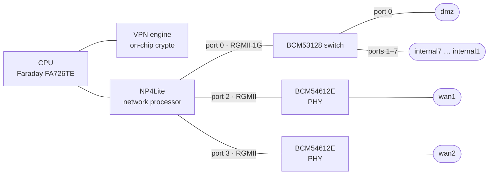
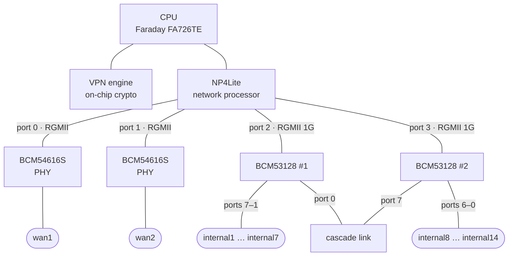
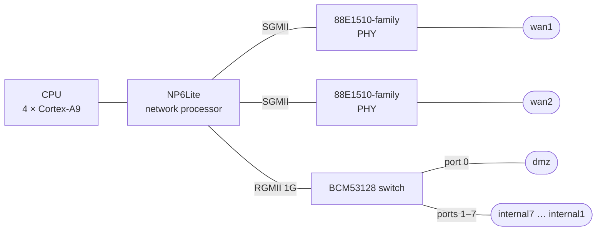
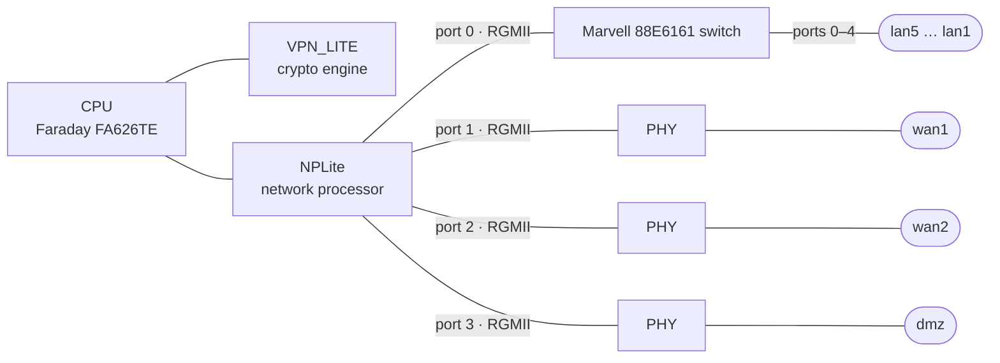
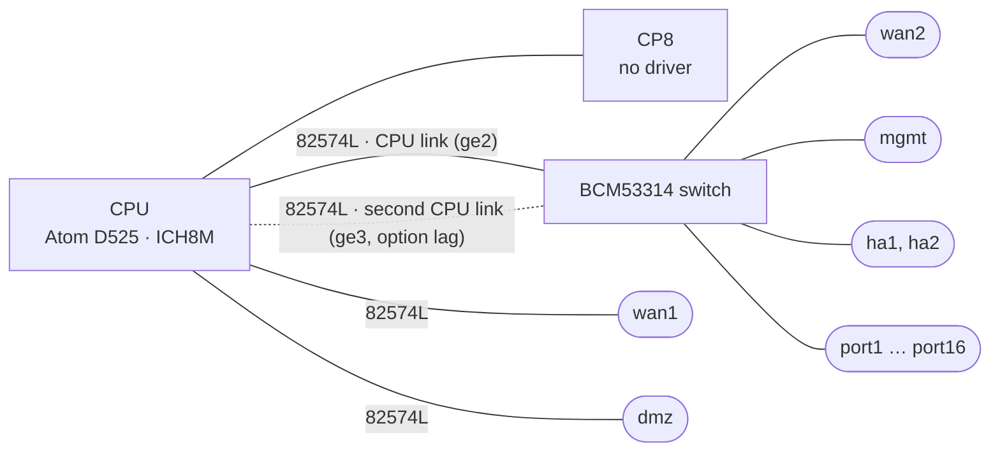
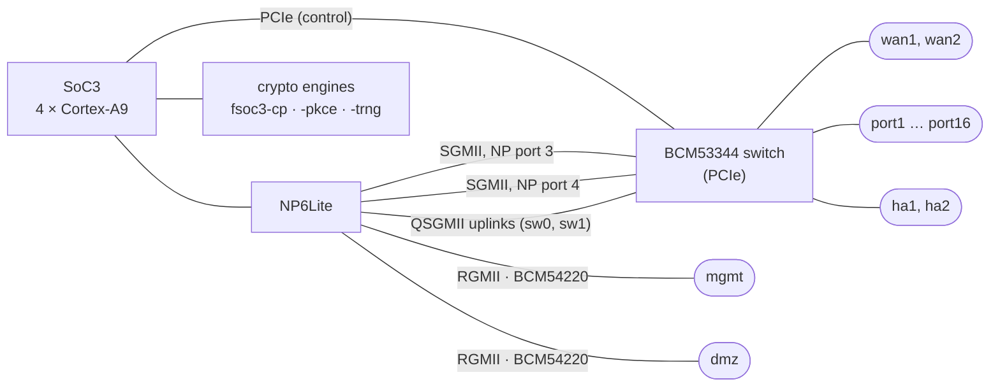

<h1 align="center">
  
</h1>

<p align="center">OpenWrt for decommissioned Fortinet FortiGate appliances, with their network and crypto accelerators</p>

> [!CAUTION]
> **Experimental software. Use at your own risk.**
>
> - This project is **very young** and still needs **a lot of testing**. Expect bugs.
> - A large part of the code was **written with the help of an LLM-based coding assistant**.
> - There is **no warranty** of any kind: it may not work on your unit, and it may leave it unable to boot.
> - Installing writes to the **internal boot disk** of the appliance (its boot sector and one firmware slot).
>   **Before you start, back up the configuration of the stock firmware and keep an official firmware image
>   (`.out`) for your model at hand**, so that you can reinstall the stock firmware if anything goes wrong.

*fgtWRT is not affiliated with or endorsed by Fortinet, Inc. or by the OpenWrt project.
Fortinet and FortiGate are trademarks of Fortinet, Inc.; they are used here only to name the hardware this project runs on.*

---

## Contents

- [About](#about)
- [Supported devices](#supported-devices)
- [Hardware acceleration](#hardware-acceleration)
- [Getting started](#getting-started)
- [Devices](#devices)
- [Known limitations](#known-limitations)
- [Benchmark methodology](#benchmark-methodology)
- [Contributing](#contributing)
- [License and credits](#license-and-credits)

## About

fgtWRT ports [OpenWrt](https://openwrt.org) to FortiGate appliances that have reached the end of their
service life. Its goal is to run a standard OpenWrt and still use **as much of the hardware as possible**:

- the **network processor** of the SoC, which forwards routed and NATed flows in hardware
  (NPLite, NP4Lite, NP6Lite) and, on the NP4Lite and the NP6Lite, encrypts outbound IPsec traffic;
- the **crypto engines** (VPN_LITE on SoC1, the VPN engine integrated in SoC2, the engines of SoC3 on the
  100E), exposed to the Linux crypto API (used by IPsec, for instance);
- the switches, PHYs, LEDs, buttons, RTC and storage of each board.

It adds a `fortisoc` target[^fortisoc-name] to OpenWrt for the Fortinet **FortiSOC** family of SoCs:

| SoC | CPU | CPU clock | Network processor | Crypto |
|---|---|---|---|---|
| SoC1 (FS1) | Faraday FA626TE (ARMv5) | 525 MHz (60C) | NPLite | VPN_LITE |
| SoC2 | Faraday FA726TE (ARMv5TE) | 800 MHz (60D), 900 MHz (90D) | NP4Lite | on-chip VPN engine |
| SoC3 | 4 × ARM Cortex-A9 (VFPv3-D16, no NEON) | 1008 MHz (60E), 1000 MHz (100E) | NP6Lite | on-chip engines (`fsoc3-*`, enabled on the 100E only) |

The CPU clock depends on the model: the 60D and the 90D share the same SoC2 but run at different clocks.

The **FortiGate 100D** is different: an x86 PC (Intel Atom, no Fortinet SoC, no network processor). It uses
the `fortigate` subtarget of OpenWrt's `x86` target, and the hardware it puts to work is the **Broadcom
BCM53314 switch** (bridging, address table, VLANs, link aggregation, QoS and more, see the
[FortiGate 100D section](#devices)), through a DSA driver, `bcm5331x-dsa`.

[^fortisoc-name]: The target name `fortisoc` and its subtargets (`fsoc1`, `fsoc2`, `fsoc3`) are historical,
    taken from the marking of the Fortinet ASICs; they have no connection with the Fortinet product currently
    sold under the FortiSOC name.

**How it works.**

1. The OpenWrt image is first **booted from RAM** through the stock boot loader (TFTP). Nothing is written,
   so you can try OpenWrt without touching the appliance.
2. From that RAM system, **`sysupgrade` installs the same image** into a firmware slot of the internal boot
   disk. The target slot becomes the default one and the rest of the slot is kept as persistent storage
   (overlay), on the 60D, the 90D and the 60E alike.
3. The stock firmware stays in its other slot. The boot loader menu (**[B]**) switches between slots at any
   time, so you can always go back to it.

The running kernel keeps the boot disk **read-only**, except for write windows declared in the device tree:
the persistent storage area, which the kernel keeps writable at all times, and the target slot plus
a few listed bytes of the boot sector, which the installer opens for the duration of the installation only.

## Supported devices

| Model | SoC | CPU clock | Network processor | Crypto | Switch | Status |
|---|---|---|---|---|---|---|
| FortiGate 60D | SoC2 | 800 MHz | NP4Lite | on-chip VPN engine | BCM53128 | ✅ **Available** |
| FortiGate 90D | SoC2 | 900 MHz | NP4Lite | on-chip VPN engine | 2 × BCM53128 | ✅ **Available** |
| FortiGate 60E | SoC3 | 1008 MHz | NP6Lite | on-chip engine (no driver) | BCM53128 | ✅ **Available** |
| FortiGate 60C | SoC1 (FS1) | 525 MHz | NPLite | VPN_LITE | Marvell 88E6161 | 📋 **Planned** |
| FortiGate 100D | x86 PC (no Fortinet SoC) | 1.8 GHz | none | CP8 (no driver) | BCM53314 | 🧪 **Preview** |
| FortiGate 100E | SoC3 | 1000 MHz | NP6Lite | on-chip engines (`fsoc3-*`) | BCM53344 | 🧪 **Preview, RAM boot only** |

- **Available**: image built from this repository, installable with persistent storage (60D, 90D, 60E).
  The published 60E image is built from revision `r0+37780-0b2480e6ba2` (commit `0b2480e6ba2`); the
  published 60D and 90D images from revision `r37432-59b1585d5e1` (commit `59b1585d5e1`). Read
  [Known limitations](#known-limitations) before building a 60D or 90D image from a later revision.
- **Preview** (100D): image built from this repository, installable with persistent storage and validated on
  one unit; no published revision yet, so no pinned revision to build from (see
  [Getting started](#getting-started)).
- **Preview, RAM boot only** (100E): image built from this repository and validated on one unit, booted from
  RAM only; no installation to the internal eMMC yet (see the 100E section in [Devices](#devices)).
- **Planned**: no OpenWrt profile in the tree yet.

## Hardware acceleration

Driver support for each accelerator, as implemented in this repository. The NPLite and VPN_LITE columns
describe the kernel drivers only: the 60C has no OpenWrt image yet (see [Supported devices](#supported-devices)).

**Legend.**
✅ supported and validated ·
🧪 implemented, validation in progress ·
❌ the hardware can do it, the driver does not (yet), or the feature is not enabled in the published images ·
— the hardware cannot do it.

Hardware flow offload uses the standard OpenWrt setting: *Network → Firewall → General Settings →
Routing/NAT Offloading → Hardware flow offloading* (`flow_offloading_hw` in `/etc/config/firewall`).

### Network processors

| Feature | NPLite<br>(SoC1) | NP4Lite<br>(SoC2) | NP6Lite<br>(SoC3) | Notes |
|---|:---:|:---:|:---:|---|
| **Routing / NAT offload** | | | | |
| IPv4 routing, TCP and UDP | 🧪 | ✅ | ✅ | line rate on the 60D and the 60E (see [Benchmarks](#benchmarks)). NP6Lite: UDP flows are offloaded by default |
| IPv4 SNAT / DNAT, with port translation | 🧪 | ✅ | ✅ | NP6Lite: 48440 concurrent IPv4 NAT connections, all offloaded, on the 60E |
| IPv6 routing, TCP and UDP | — | — | ✅ | NPLite and NP4Lite flow entries are IPv4 only: IPv6 is always forwarded by the CPU. NP6Lite: 928 Mbit/s each way on the published 60E image |
| IPv6 NAT | — | — | ✅ | NP6Lite: NAT66 of **one address per flow** (source or destination, NPTv6 included) is offloaded, `ft_nat66` parameter of `fortinet_np6lite` (1 by default; 0 = CPU); a flow with **both** source and destination NAT (SNAT and DNAT combined) stays in software. Validated on the published 60E image (masquerade: 929 / 928 Mbit/s, CPU about 0 %) |
| ICMP | ❌ | ❌ | ❌ | handled by the CPU: the three NPs can offload ICMP, but the Linux flow table used by the drivers carries TCP and UDP only. Left out on purpose: it would take a kernel patch for control traffic the CPU handles easily |
| GRE | — | — | — | handled by the CPU. NP6Lite: not supported by the hardware per Fortinet documentation; NP6XLite (FortiGate 40F) to be investigated |
| 802.1Q VLAN (one tag) | 🧪 | 🧪 | 🧪 | NP4Lite: needs `rx-vlan-offload` and `tx-vlan-offload`, off by default |
| QinQ / 802.1ad | — | — | ❌ | NPLite / NP4Lite flow entries carry a single tag. NP6Lite: not implemented, little use: the session key and the output tag hold one VLAN each, and the switch ports use that VLAN for tag_8021q; such traffic stays on the CPU |
| PPPoE | — | — | ❌ | NP6Lite: not supported by the hardware (Fortinet: PPPoE session frames are not accelerated by the NP6Lite) |
| Flows through the ports of the switch | ❌ | ✅ | 🧪 | NP4Lite: one logical interface per switch port in the device tree, validated on the 60D and the 90D; frames from the CPU to the switch ports are dropped when offloaded traffic saturates the NP–switch link (see [Known limitations](#known-limitations)). NP6Lite: `dmz`, single switch ports, bonds of switch ports and bridged switch ports; `dmz` and a bridge over `dmz` validated on the previous published 60E image, the other cases on test kernels and earlier images |
| Link aggregation (bonding) endpoints | ❌ | ✅ | 🧪 | NPLite / NP4Lite: no aggregation in the NP itself, the bond is handled by the driver. NPLite: driver code, not tested. NP4Lite: active-backup, balance-xor, 802.3ad (LACP validated on the 60D and the 90D); the switch chips aggregate their own ports (90D: groups within one switch chip, two groups at most for both chips). NP6Lite: bonds of switch ports; a bond of `wan1` + `wan2` is offloaded through the output trunk of the NP (`ft_trunk` parameter, 2 by default): in the published image, validated on our reference kernel builds, **not tested under OpenWrt yet** |
| Offloaded connections | 4096 connections (8192 flow entries) | **4096 connections** (8192 flow entries, one per direction) | 65536 connections | driver limit; further connections stay on the CPU. NP6Lite: also the default conntrack limit of OpenWrt |
| Per-flow byte / packet counters | 🧪 | 🧪 | 🧪 | NPLite: about a hundred counters only. NP4Lite: limited number of counters. NP6Lite: exact to 0.1 % on the 100E, sessions count windows of 2^24 bytes or 2^16 packets, the driver sums them and queries fast flows every 50 ms (`ft_cnt_ms`); needs `counter` on the flowtable and `nf_conntrack_acct` |
| L2 bridge / FDB offload in the NP | — | — | — | bridging is done by the switch chip |
| QoS / shaping offload | ❌ | — | ❌ | NP4Lite: no traffic shaping in the hardware |
| **Inline IPsec (ESP) in the NP** | | | | |
| ESP tunnel mode, IPv4 in IPv4 | — | ✅ | ✅ outbound | NPLite: IPsec goes through VPN_LITE (see below). NP4Lite: **outbound** packets are encrypted by the NP; **inbound** packets are decrypted by the NP and then forwarded by the CPU. Package `kmod-fortinet-np4lite-ipsec`, in the 60D and 90D images; validated on both. NP6Lite: **outbound only**: outbound packets are encrypted by the NP (about 727 Mbit/s), **inbound packets are decrypted in software** (inbound offload not written yet); package `kmod-fortinet-np6lite-ipsec`, in the 60E and 100E profiles; validated on the published 60E image and on a 100E |
| ESP ciphers | — | AES-CBC 128/192/256, 3DES-CBC | AES-CBC, 3DES-CBC (outbound) | as implemented in the drivers; measured with AES-128-CBC |
| ESP integrity | — | HMAC-MD5-96, HMAC-SHA1-96, HMAC-SHA256-128 | HMAC-MD5-96, HMAC-SHA1-96, HMAC-SHA256-128 (outbound) | as implemented in the drivers; measured with HMAC-SHA1-96 (NP4Lite) and HMAC-SHA256-128 (NP6Lite) |
| ESN, NAT-T, transport mode | — | ❌ | ❌ | handled in software |
| IPsec over IPv6 | — | — | ❌ | NP4Lite: software only (works, see [Benchmarks](#benchmarks)) |
| **Host interface** | | | | |
| RX/TX checksum offload | 🧪 | 🧪 | ✅ | NPLite / NP4Lite: IPv4 TCP/UDP, off by default (NP4Lite: with scatter-gather). NP6Lite: IPv4/IPv6 TCP/UDP |
| TSO | ❌ | ❌ | ❌ | NPLite / NP4Lite: hardware support not established |

NPLite and NP4Lite share one driver, but they are different chips:
the NP4Lite adds inline IPsec and switch-port offload. The IPsec limitations are listed in
[Known limitations](#known-limitations).

**FortiGate 100D.** The 100D has no network processor, so none of the columns above applies to it: routing,
NAT and crypto run on the CPU, and the CP8 crypto engine has no driver in the image. What it offloads is
**bridging** and the features around it, in its BCM53314 switch chip (see its section in
[Devices](#devices)).

### Crypto engines

| Feature (Linux crypto API) | VPN_LITE<br>(SoC1) | VPN engine<br>(SoC2) | crypto engines<br>(SoC3, 100E) | Notes |
|---|:---:|:---:|:---:|---|
| `cbc(aes)` 128/192/256 | 🧪 | ✅ | 🧪 | SoC1/SoC2: requests under 256 bytes go to software |
| `cbc(des3_ede)`, `cbc(des)` | 🧪 | 🧪 | 🧪 | |
| `authenc(hmac(sha1\|md5),cbc(aes\|des3_ede))` | 🧪 | ✅ | 🧪 | 96-bit ICV; SoC2: used by software IPsec with AES-128-CBC + HMAC-SHA1; SoC3: the ICV of a decryption is checked by encrypting the plaintext again on the engine |
| `authenc(hmac(sha256),…)`, `authenc(hmac(sha512),…)` | — | 🧪 | 🧪 | 128-bit and 256-bit ICV |
| HMAC-SHA384 | — | ❌ | 🧪 | SoC2: wrong ICVs in our tests, left to software; SoC3: right, as `authenc(hmac(sha384),…)` (192-bit ICV) |
| `rfc4106(gcm(aes))` (AES-GCM for IPsec) | — | — | 🧪 | SoC3: 128/192/256-bit keys, 8/12/16-byte tags, without ESN; the tag of a decryption is checked by encrypting the plaintext again on the engine; other cases go to software |
| `gcm(aes)` | — | — | 🧪 | SoC3: AD of up to 8 bytes, texts of any length up to 16 KiB, 4–16-byte tags (the OpenVPN data channel offload uses 8 bytes of AD); the engine takes the IPsec layout only, the driver fits the request into it and corrects the tag in software; other cases (TLS, MACsec, more AD) go to software |
| AES-CTR, AES-ECB, ChaCha20-Poly1305 | — | — | ❌ | software (generic C code); SoC3: CTR does not fit (the engine starts the GCM counter at 2, RFC 3686 needs 1); ECB and ChaCha20-Poly1305 not found |
| Hash only (ahash) | ❌ | ❌ | ❌ | hardware support not established; SoC3: the engine rejects the hash-only commands tried |

**Notes.**

- The Linux crypto driver is called `fortinet-cp7` (algorithms `*-cp7`); it drives the VPN_LITE engine
  of SoC1 and the VPN engine integrated in SoC2 (both possibly derived from Fortinet's CP7 design; no CP7 was
  available for comparison, so this is not confirmed).
- **SoC3 (FortiGate 100E)**: `fsoc3-cp` drives the symmetric engine (the CP7 descriptors, fed through host
  TX queue 16 of the NP6Lite queue fabric; algorithms `*-fsoc3`), `fsoc3-pkce` the public key engine
  (`rsa-fsoc3`, raw RSA up to 4064-bit moduli, decryption by the CRT; 4096-bit encryption goes to software)
  and `fsoc3-trng` the random number generator (`/dev/hwrng`). Packages `kmod-fortinet-fsoc3-*`
  (`package/kernel/fortinet-fsoc3`); their device tree nodes are in `fsoc3-crypto.dtsi`, which only the 100E
  device tree includes. Checked on a 100E against the software implementations, with ESP and with the
  OpenVPN data channel offload between two network namespaces.
  `/sys/bus/platform/drivers/fsoc3-cp/*/stats` counts the descriptors run on the engine and the requests
  left to software.
- **WireGuard** and **OpenVPN** have no hardware acceleration and run on the CPU. OpenVPN uses its kernel
  data channel (DCO, the mainline `ovpn` module) when the cipher allows it, ChaCha20-Poly1305 for instance;
  AES-256-CBC stays in user space. **SoC3:** with AES-GCM the OpenVPN data channel offload goes through
  `fsoc3-cp` (`gcm(aes)`); on the 100E, both tunnel ends on the same SoC, 114 Mbit/s against 43 Mbit/s
  with the software implementation and 58 Mbit/s with OpenVPN in user space.

## Getting started

The exact steps depend on the model: the boot loader menus and their keys differ between BIOS versions.
The procedure below is the common outline; read the **installation notes** of your model in
[Devices](#devices) before you start. The notes for the 60D, the 90D, the 60E and the 100D describe the
validated path; for the 60C they are _to be completed_.

### Requirements

- A **serial console** cable for the CONSOLE port, set to **9600 8N1**.
- A **TFTP server** on a computer wired to the appliance.
- The **official firmware image (`.out`)** for your model, and a **backup of the configuration of the stock firmware**.
- A Linux build host for OpenWrt (see the
  [OpenWrt build system documentation](https://openwrt.org/docs/guide-developer/toolchain/install-buildsystem)).

### 1. Build the image

Each model is built from a given revision of this repository (see the table below). The generic steps:

```sh
git clone https://github.com/Radeon24/fgtwrt.git
cd fgtwrt
git checkout <revision>
./scripts/feeds update -a
./scripts/feeds install -a
make menuconfig
```

In `make menuconfig`, select:

| Option | FortiGate 60D | FortiGate 90D | FortiGate 60E | FortiGate 100D | FortiGate 100E |
|---|---|---|---|---|---|
| Target System | `Fortinet FortiSOC` | `Fortinet FortiSOC` | `Fortinet FortiSOC` | `x86` | `Fortinet FortiSOC` |
| Subtarget | `FortiSOC2` | `FortiSOC2` | `FortiSOC3` | `Fortinet FortiGate (x86)` | `FortiSOC3` |
| Target Profile | `FortiGate 60D` | `FortiGate 90D` | `FortiGate 60E` | `FortiGate 100D` | `FortiGate 100E` |

The device profile brings the drivers, the firewall with hardware flow offload, IPsec (IPv4 and IPv6, with
the outbound offload of the NP: NP4Lite on the 60D and the 90D, NP6Lite on the 60E) and the installer. It
also **includes** the web interface and the VPN packages; nothing else has to be selected:

| Package (included in the 60D, 90D and 60E profiles) | For |
|---|---|
| `luci` | web interface |
| `kmod-wireguard`, `wireguard-tools` | WireGuard |
| `openvpn-openssl`, `kmod-ovpn-backports` | OpenVPN, with its kernel data channel (DCO) |
| `openssl-util` | the `openssl` command line tool |

The 60E profile also brings:

| Package (60E profile) | For |
|---|---|
| `kmod-fortinet-np6lite-ipsec` | outbound IPsec offload in the NP6Lite |
| `kmod-gpio-button-hotplug` | reset button |
| `r8a779x-usb3-firmware` | firmware of the xHCI controller (public R-Car v2 firmware, downloaded from linux-firmware and checked against its SHA-256) |
| `kmod-usb-storage`, `kmod-fs-vfat`, `kmod-nls-cp437`, `kmod-nls-iso8859-1` | USB disks |

The kernel support of the LEDs, the button, USB and the watchdog is built in. To leave the 60E packages out,
deselect them in `make menuconfig` (`Kernel modules` → `Network Devices`, `GPIO support`, `USB Support`,
`Filesystems`, `Native Language Support`, and `Firmware`); the kernel support stays built in.

On FortiSOC2, the ramdisk compression also defaults to gzip, which the boot loader requires (see
[Image layout](#image-layout)) and which the build checks. All the measurements below were made with these
packages built in.

The 100D profile is described in its own section ([Devices](#devices)): it brings the switch driver, the
tools of what the switch offloads, LuCI and the fan control, but neither WireGuard nor OpenVPN.
The 100E profile is that of the 60E without the installer, plus
the crypto engines and the hardware monitor ([Devices](#devices)).

**Which revision builds the published image.**

| Model | Revision to check out before `make menuconfig` | Notes |
|---|---|---|
| 60D, 90D | commit `59b1585d5e1` | see [Known limitations](#known-limitations) for later revisions |
| 60E | commit `0b2480e6ba2` (`r0+37780-0b2480e6ba2`) | exact recipe below |
| 100D | head of the `fgtwrt` branch | no image published and no revision pinned yet: this README describes the state of the branch |
| 100E | head of the `fgtwrt` branch | as the 100D |

Then build:

```sh
make -j"$(nproc)"
```

The image is `bin/targets/fortisoc/<subtarget>/openwrt-fortisoc-<subtarget>-<device>-initramfs-kernel.bin`;
for the 60D, `bin/targets/fortisoc/fsoc2/openwrt-fortisoc-fsoc2-fortinet_fg-60d-initramfs-kernel.bin`
(90D: `…-fortinet_fg-90d-initramfs-kernel.bin`; 60E:
`bin/targets/fortisoc/fsoc3/openwrt-fortisoc-fsoc3-fortinet_fg-60e-initramfs-kernel.bin`; 100D:
`bin/targets/x86/fortigate/openwrt-x86-fortigate-fortinet_fg-100d-initramfs-kernel.bin`).

This **single file** is used for both steps: the TFTP boot to RAM and the installation with `sysupgrade`.
On the 60D and the 90D, the build refuses a kernel file too large for the boot loader (see the 60D section);
the 100D build has the same kind of checks (see its section).

On the 100E, the three target lines are those of the 60E with the device
`CONFIG_TARGET_fortisoc_fsoc3_DEVICE_fortinet_fg-100e=y`; the image is
`bin/targets/fortisoc/fsoc3/openwrt-fortisoc-fsoc3-fortinet_fg-100e-initramfs-kernel.bin`.

On the 100D, `make menuconfig` can be replaced by the three target lines, without any other setting:

```sh
cat > .config <<'EOF'
CONFIG_TARGET_x86=y
CONFIG_TARGET_x86_fortigate=y
CONFIG_TARGET_x86_fortigate_DEVICE_fortinet_fg-100d=y
EOF
make defconfig
make -j"$(nproc)"
```

<details>
<summary><b>Exact recipe of the published 60E image</b></summary>

The published 60E image was built from commit `0b2480e6ba2`, with the package feeds pinned to the revisions
below, and a configuration made of the three target lines only, expanded by `make defconfig` (no other
option, no `files/` overlay):

```sh
git clone https://github.com/Radeon24/fgtwrt.git
cd fgtwrt
git checkout 0b2480e6ba2
cat > feeds.conf <<'EOF'
src-git packages https://git.openwrt.org/feed/packages.git^2a70ef94898443549229e15b38b3c20bfaf4895c
src-git luci https://git.openwrt.org/project/luci.git^aa3d48836e90ae0706c8d8f9b46b8371e45cfe1f
src-git routing https://git.openwrt.org/feed/routing.git^4b9891b9136259f93294a424507ed24c5e8c1cbd
src-git telephony https://git.openwrt.org/feed/telephony.git^5d68d53c160a325ea9d03fce393e051573bcc736
src-git video https://github.com/openwrt/video.git^816fa8fe0ca759cc5d1ba71af1a716405bf4dda4
EOF
./scripts/feeds update -a
./scripts/feeds install -a
cat > .config <<'EOF'
CONFIG_TARGET_fortisoc=y
CONFIG_TARGET_fortisoc_fsoc3=y
CONFIG_TARGET_fortisoc_fsoc3_DEVICE_fortinet_fg-60e=y
EOF
make defconfig
make -j"$(nproc)"
```

The image reports revision `r0+37780-0b2480e6ba2` in `/etc/openwrt_release`, with kernel 6.18.55 and
184 packages in its manifest. Our build of this recipe gave an
`openwrt-fortisoc-fsoc3-fortinet_fg-60e-initramfs-kernel.bin` with MD5 `5c6ec3183f84c3bdf6939ab4942f7861`; a
rebuild on another host is not expected to be bit-identical.

</details>

Pre-built images may be published later; until then, build from source.

### 2. Boot OpenWrt from RAM (test, nothing written)

1. Put the image on your TFTP server.
2. Connect the serial console, power the appliance on and interrupt the boot to enter the boot loader menu.
3. Set the TFTP server address, the local address and the image file name, then start the image boot.
   The menu keys and the Ethernet port used for TFTP differ between models and boot loader versions:
   see the installation notes of your model.
4. OpenWrt boots from RAM. Default network setup:

   | Interface | Ports | Setting |
   |---|---|---|
   | LAN | the `internal*` ports, bridged | `192.168.1.1`, DHCP server |
   | WAN | `wan1` | DHCP client |
   | — | `dmz`, `wan2` | not configured |

   Log in with `ssh root@192.168.1.1`, or with the web interface at `http://192.168.1.1` (LuCI is in the
   device profiles).

   The 100D has its own layout (`port1`…`port16` bridged as LAN, `wan1` as WAN and `wan2` as a second DHCP
   WAN; `dmz`, `mgmt`, `ha1` and `ha2` not configured): see its section. The 100E: `port1`…`port16`
   bridged as LAN, `wan1` as WAN; `dmz`, `wan2`, `mgmt`, `ha1` and `ha2` not configured.

Everything runs in RAM: **nothing is written to the appliance**, and all changes are lost at the next reboot.
(100D exception: this holds on a unit where OpenWrt was never installed. Once partition 2 holds OpenWrt, the
image mounts and writes its persistent storage; see the 100D installation notes.)
This is the recommended way to check that your unit works before installing.

### 3. Install with `sysupgrade` (persistent)

From OpenWrt running in RAM, copy the **same image** to the appliance and run `sysupgrade -n`:

```sh
scp -O openwrt-fortisoc-fsoc2-fortinet_fg-60d-initramfs-kernel.bin root@192.168.1.1:/tmp/
ssh root@192.168.1.1 sysupgrade -n /tmp/openwrt-fortisoc-fsoc2-fortinet_fg-60d-initramfs-kernel.bin
```

On every model the image goes into the OpenWrt firmware slot, which becomes the default boot, and the rest
of the slot becomes persistent storage (overlay); the stock firmware stays in the other slot, and **[B]** in
the boot loader menu switches between slots. The OpenWrt slot depends on the model: see its installation
notes.

**What the installer checks.** It refuses to write anything, with a message, unless:

- the boot disk is the expected internal disk: on USB boot disks, its vendor, model and size are checked;
  on eMMC, the expected devices must be present;
- the boot sector carries the stock header, and the **target partition** matches its MBR entry and the
  expected start and size;
- the write windows reported by the kernel match the expected ones;
- the slot it would overwrite is not a stock firmware set as the default boot, and the other slot still
  holds a firmware that **[B]** can bring back.

<details>
<summary><b>What it writes, in this order</b></summary>

1. **The firmware container** into the target slot. Only the start of the slot is used.
2. **The head of the persistent area**, the rest of the same slot: either your configuration archive, or a
   marker that asks for a clean format.
3. **A few bytes of the boot sector**: the image name and build number of that slot, and the boot flags
   that make it the default one. Every other byte is checked to be unchanged.

</details>

Each step is read back and verified. The write windows are then closed again, and the appliance reboots into
OpenWrt. On the first boot the persistent area is formatted (ext4) and your configuration is restored.

### 4. Update

Run `sysupgrade` again from the installed OpenWrt, with a newer image built the same way:

- `sysupgrade -n <image>` starts from a clean configuration — this is the path used for every reference
  image so far;
- `sysupgrade <image>` keeps the configuration: it is saved as an archive, the persistent area is
  formatted again, and the archive is restored at the first boot. As usual with OpenWrt, packages installed
  after the build are not kept. It has been exercised from an image to itself only (on the 60E, with an
  earlier image).

### 5. Go back to the stock firmware

- **Stock firmware still in its slot.** In the boot loader menu, choose **[B]** to switch the default
  boot partition back to it, then restore your configuration backup if needed. On the 100D the stock
  firmware is in partition 1 and OpenWrt in partition 2; **[B]** again brings OpenWrt back.
- **Otherwise.** Reinstall the official `.out` image with the Fortinet procedure for your model, then
  restore your configuration backup.

---

## Devices

<details open>
<summary><b>FortiGate 60D</b> — SoC2 · NP4Lite · on-chip VPN engine — ✅ Available</summary>

### Specifications

| Item | Value |
|---|---|
| SoC | SoC2 |
| CPU | Faraday FA726TE (ARMv5TE) @ 800 MHz, L2 cache enabled |
| RAM | 2 GiB (1813.7 MiB seen by the kernel) |
| Network processor | NP4Lite, 4 RGMII ports |
| Crypto | on-chip VPN engine |
| Switch | Broadcom BCM53128 |
| WAN PHYs | 2 × Broadcom BCM54612E |
| Ethernet ports | 10 × 1 GbE: `wan1`, `wan2`, `dmz`, `internal1`…`internal7` |
| Boot disk | internal USB flash disk, 4 GB |
| Other storage | second internal USB flash disk, 8 GB |
| Boot flash | SPI NOR Winbond W25X40CL, 512 KiB (read-only; holds the base MAC address) |
| USB | rear USB-A (host), rear MGMT (device) |
| Console | RJ-45 serial, 9600 8N1 |
| LEDs | STATUS and HA (bicolour); WAN link/activity and speed (driven by the PHYs) |
| Buttons | reset |
| RTC | on-chip |
| Power | 12 V DC input; about 11 W (see [Benchmarks](#benchmarks)) |

### Hardware topology



**Hardware offload scope.** Each switch port (`dmz`, `internal1`…`internal7`) has its own logical interface
on the NP, so hardware flow offload covers flows between `wan1`, `wan2` and the switch ports, bonds of switch
ports included. The offloaded directions through the switch ports follow the `switch_offload` parameter of
the NP driver (`full`, the default: both directions); see [Known limitations](#known-limitations) for the
behaviour when offloaded traffic saturates the link between the NP and the switch.

### Image layout

The boot loader of the 60D reads two files from the ext2 container of the firmware slot:

- the **kernel file**, which holds the compressed kernel and its device tree. The boot loader decompresses it
  at a fixed low address; a decompressed payload larger than about **7.76 MiB** overwrites the stack of the
  boot loader itself, and the appliance does not boot. The build refuses a kernel file above **7 MiB**;
- the **ramdisk file** (`rootfs.gz`), which the boot loader loads unchanged at 16 MiB.

An OpenWrt kernel with its root file system built in does not fit under that limit once LuCI and the VPN
packages are added. fgtWRT therefore builds the kernel and its device tree alone (about 3.2 MB), and ships
the OpenWrt root file system as a **separate ramdisk** in `rootfs.gz` (about 7.4 MB with the packages listed
above). Its address and size are written into the `/chosen` node of the device tree at build time
(`linux,initrd-start`, `linux,initrd-end`), since the boot loader passes no boot arguments; the build also
checks that the decompressed kernel stays below the ramdisk.

### Benchmarks

Measured on our test setup in October 2026, on lab images equivalent to the published profile (same kernel
drivers and packages), plus the early debug console of the kernel and a few test tools, which are not expected
to affect the throughputs (see [Benchmark methodology](#benchmark-methodology)).

**Firewall modes.** *hw*: hardware flow offloading (`flow_offloading_hw=1`, the default of our
configuration); *sw*: software flow offloading only (`flow_offloading=1`); *none*: no flow offloading.
**Directions.** *fwd*: from the `wan1` side to the `wan2` side; *rev*: the opposite (`iperf3 -R`).
For tunnels the appliance is a tunnel end point: *in* = the appliance receives and decrypts,
*out* = it encrypts and sends. Throughputs are TCP goodput in Mbit/s, median of 3 runs of 10 s,
one TCP stream unless noted. The CPU is at 100 % on every software path.

#### Routing and NAT, IPv4

| Test | hw (fwd / rev) | sw (fwd / rev) | none (fwd / rev) |
|---|---|---|---|
| Routing, TCP, 1 stream | **941.3 / 941.4** (CPU ≤ 0.7 %) | 356.2 / 287.5 | 292.6 / 213.3 |
| Routing, TCP, 8 streams | **941.0 / 941.1** | 338.9 / 274.0 | 265.2 / 189.2 |
| Routing, UDP, 940 Mbit/s offered | **940 / 940**, no loss | 374.1 / 371.6, 59.4 % / 58.5 % lost | 340.4 / 336.9, 63.1 % / 62.0 % lost |
| SNAT (masquerade), TCP | **941.3 / 941.4** | 352.2 / 283.1 | 287.4 / 208.2 |
| DNAT (port forward), TCP | **941.4 / 941.4** | 351.9 / 282.5 | 283.9 / 205.8 |

Through the switch ports, *hw* mode: routing between `wan2` and a two-port LACP bond of switch ports
(`internal1` + `internal2`), TCP, one stream, **939 / 939** Mbit/s, CPU about 99 % idle (30 s runs).

#### Routing and NAT, IPv6

The NP4Lite cannot offload IPv6: in *hw* mode, IPv6 flows use the software flowtable.

| Test | hw (fwd / rev) | sw (fwd / rev) | none (fwd / rev) |
|---|---|---|---|
| Routing, TCP, 1 stream | 353.9 / 289.7 | 351.2 / 286.2 | 289.1 / 213.8 |
| Routing, TCP, 8 streams | 337.5 / 276.3 | 334.1 / 274.1 | 258.8 / 192.4 |
| Routing, UDP, 940 Mbit/s offered | 388.9 / 387.2, 58.2 % / 57.0 % lost | 386.9 / 384.8, 58.0 % / 57.2 % lost | 365.3 / 363.2, 60.7 % / 59.4 % lost |
| SNAT (masquerade), TCP | 346.3 / 282.5 | 341.6 / 278.4 | 284.2 / 207.2 |

#### Packet rate, IPv4 routing

Highest lossless rate (kernel `pktgen`, binary search, one run), kpps (Mbit/s):

| Frame size | Line rate | hw | sw | none |
|---|---|---|---|---|
| 64 B | 1488.1 | **750.4** (384.2), CPU 0.3 % | 54.7 (28.0) | 53.3 (27.3) |
| 128 B | 844.6 | 706.2 (723.1) | 51.3 (52.5) | 49.6 (50.8) |
| 256 B | 452.9 | **452.9, line rate** (927.5) | 47.8 (97.8) | 46.0 (94.2) |
| 512 B | 235.0 | line rate (962.4) | 40.3 (165.1) | 39.4 (161.3) |
| 1518 B | 81.3 | line rate (987.0) | 32.4 (392.9) | 30.5 (370.1) |
| IMIX 7:4:1 | 332.6 | 133.1 (378.9) | 38.6 (109.8) | 30.8 (87.6) |

#### Latency through the appliance

`ping` at 10 ms interval through the appliance, p50 / p99, IPv4:

| Load | hw | sw | none |
|---|---|---|---|
| idle | 0.4 / 1.0 ms | 0.4 / 1.0 ms | 0.4 / 1.0 ms |
| saturated by one TCP stream | **1.6 / 2.3 ms** (941 Mbit/s) | 20.5 / 50.2 ms (353 Mbit/s) | 21.5 / 51.0 ms (297 Mbit/s) |

#### Connections

New TCP connections per second (8 client threads, 10 s, no failure; CPU at 100 % in every mode):

| Test | hw (IPv4 / IPv6) | sw (IPv4 / IPv6) | none (IPv4 / IPv6) |
|---|---|---|---|
| Routed | 2232 / 2857 | 3589 / 3544 | 3342 / 3330 |
| With SNAT (mean of 3) | 2143 / 2401 | 3354 / 2831 | 3186 / 2614 |

Highest number of concurrent NATed TCP connections held open without failure (the connection tracking table
holds 65536 entries):

| Mode | IPv4 | IPv6 | Of which offloaded to the NP |
|---|---|---|---|
| hw | 16384 | 16384 | **4096** at most (IPv4 only) |
| sw | 50386 (table limit) | 32768 | — |
| none | 32768 | 28627 (table limit) | — |

#### IPsec, IPv4, tunnel mode

| Cipher | Path | in / out (Mbit/s) | CPU |
|---|---|---|---|
| AES-128-CBC + HMAC-SHA1 | **NP offload** | 396.2 / **883.3** | in 100 %, out about 91 % |
| AES-128-CBC + HMAC-SHA1 | software, VPN engine (`fortinet-cp7`) | 123.2 / 105.0 | 100 % |
| AES-128-GCM | software (generic) | 41.3 / 35.1 | 100 % |
| ChaCha20-Poly1305 | software (generic) | 94.4 / 70.1 | 100 % |

Transport mode, software: AES-128-CBC + HMAC-SHA1 118.0 / 111.8, AES-128-GCM 39.3 / 41.8,
ChaCha20-Poly1305 91.6 / 87.9 Mbit/s. In the NP offload, AES-GCM and ChaCha20-Poly1305 tunnel tests, a counter on
the host saw no clear-text packet of the protected flows leave the appliance.

#### IPsec, IPv6, software

| Cipher | tunnel, in / out | transport, in / out |
|---|---|---|
| AES-128-CBC + HMAC-SHA1 | 96.9 / 81.0 | 72.9 / 59.8 |
| AES-128-GCM | 35.8 / 31.2 | 32.6 / 28.5 |
| ChaCha20-Poly1305 | 78.0 / 57.6 | 62.1 / 49.9 |

#### WireGuard and OpenVPN (appliance as tunnel end point)

| Tunnel | Outer IP | 1 stream, in / out | 8 streams, in / out |
|---|---|---|---|
| WireGuard | IPv4 | 69.4 / 53.8 | 64.9 / 52.3 |
| WireGuard | IPv6 | 68.6 / 52.6 | 63.5 / 50.8 |
| OpenVPN, ChaCha20-Poly1305, kernel data channel (DCO) | IPv4 | 78.5 / 56.2 | 74.6 / 54.3 |
| OpenVPN, ChaCha20-Poly1305, DCO | IPv6 | 76.6 / 53.9 | 70.7 / 52.2 |
| OpenVPN, AES-256-CBC + HMAC-SHA256, user space | IPv4 | 18.3 / 16.6 | 17.2 / 16.1 |
| OpenVPN, AES-256-CBC + HMAC-SHA256, user space | IPv6 | 16.8 / 14.7 | 15.5 / 14.2 |

CPU at 100 % in every case. The peer runs OpenVPN without DCO.

#### System

| Metric | Result |
|---|---|
| Power, idle | 11 W |
| Power, offloaded load (≈ 900 Mbit/s both ways) | 11 W |
| Power-on to first LuCI response | 71.6 s (one cold boot) |
| Kernel start to `/init` | 1.58 s |
| Available RAM after boot | 1707.6 MiB of 1813.7 MiB |

Power is read from a smart plug with a 1 W resolution: an order of magnitude only. About 58 s of the boot time
is spent in the boot loader, which reads the image from the boot disk with a 9600 baud console.

### OpenWrt features

| Feature | Status |
|---|---|
| All Ethernet ports (link, traffic) | ✅ Validated: all 10 ports, over RAM boots, cold boots and reboots |
| Switch bridging (`br-lan`) | 🧪 Partial: bridge on `internal1`–`internal7` by default; the bridge itself is never offloaded, and a fully loaded bridge has not been measured |
| VLANs on switch ports | ✅ Validated on a bond of switch ports (802.1Q) |
| Link aggregation (LACP) on switch ports (BCM53128 trunk) | ✅ Validated |
| Hardware flow offload (`wan1` ↔ `wan2`), IPv4 routing, SNAT, DNAT | ✅ Validated |
| Hardware flow offload through the switch ports (`dmz`, `internal*`, bonds of switch ports) | ✅ Validated, with the limitation under saturation listed in [Known limitations](#known-limitations) |
| IPsec offload in the NP (IPv4 tunnel mode) | ✅ Validated |
| IPsec in software (IPv4 and IPv6, tunnel and transport) | ✅ Validated |
| `fortinet-cp7` crypto | ✅ Validated with software IPsec (AES-CBC + HMAC-SHA1) |
| WireGuard, OpenVPN (with DCO) | ✅ Validated (packages included in the 60D profile) |
| STATUS LED (boot / running / upgrade) | 🧪 Partial: LED aliases declared and boot LED observed; the full cycle has not been re-tested |
| WAN speed and activity LEDs | ✅ Validated |
| Reset button / failsafe | ❓ Not tested |
| RTC | 🧪 Partial: driver in the image, not re-tested under OpenWrt |
| Rear USB-A port | ❓ Not tested under OpenWrt (works under earlier test kernels) |
| Persistent storage (overlay) | ✅ Validated: survives reboots and power cuts (a change saved with `sync` before the cut is kept) |
| `sysupgrade` (keep / `-n`) | 🧪 Partial: `-n` validated; keep exercised from an image to itself only |
| Back to stock with [B] | ✅ Validated |

### Installation notes

> [!WARNING]
> On the 60D, OpenWrt is always installed into **partition 1** (firmware image 0) of the internal boot disk,
> which then becomes the default boot partition. **Before installing, make sure the stock firmware runs from
> partition 2**: if needed, use **[B]** in the boot loader menu to switch to it, and check that it boots.
> Anything in partition 1 is overwritten.

- In the boot loader menu, **[R]** boots the image from RAM over TFTP and **[B]** switches the default
  boot partition; the other entries are left alone.
- Persistent storage is the rest of the 256 MiB firmware slot (about 240 MiB, ext4).

</details>

<details>
<summary><b>FortiGate 90D</b> — SoC2 · NP4Lite · on-chip VPN engine — ✅ Available</summary>

### Specifications

| Item | Value |
|---|---|
| SoC | SoC2 |
| CPU | Faraday FA726TE (ARMv5TE) @ 900 MHz, L2 cache enabled |
| RAM | 2 GiB (1813.7 MiB seen by the kernel) |
| Network processor | NP4Lite, 4 RGMII ports |
| Crypto | on-chip VPN engine |
| Switches | 2 × Broadcom BCM53128, cascaded, one DSA tree |
| WAN PHYs | 2 × Broadcom BCM54616S |
| Ethernet ports | 16 × 1 GbE: `wan1`, `wan2`, `internal1`…`internal14` |
| Boot disk | internal USB flash disk, 8 GB |
| Other storage | 32 GB disk-on-module in a mini-PCIe slot (PCIe-to-SATA bridge on the module); not usable yet: no driver for the SoC2 PCIe host |
| Boot flash | SPI NOR, 512 KiB (read-only; holds the base MAC address) |
| Console | RJ-45 serial, 9600 8N1 |
| LEDs / buttons | none supported yet |
| Power | 12 V DC input; to be measured |

### Hardware topology



**Hardware offload scope.** As on the 60D, each switch port has its own logical interface on the NP, so
hardware flow offload covers flows between `wan1`, `wan2` and the `internal*` ports of both switch chips,
bonds of switch ports included; each switch chip has its own link to the NP. The `switch_offload`
parameter and the limitation under saturation are the same as on the 60D (see
[Known limitations](#known-limitations)).

**Link aggregation.** A bond of ports of **one** switch chip is aggregated by that chip and can be bridged;
the two chips share two hardware aggregation groups. A bond spanning the two chips works as a routed
interface only: it is refused as a bridge port.

### Image layout

Same boot loader family and same image layout as the 60D (kernel file with its device tree, separate
`rootfs.gz` ramdisk loaded at 16 MiB, 7 MiB limit on the kernel file kept by the build): see the 60D section.

### Benchmarks

Measured on our test setup in October 2026, with the same protocol as the 60D, on lab images equivalent to
the published profile (see [Benchmark methodology](#benchmark-methodology)). Throughputs are TCP goodput in
Mbit/s, one stream, median of 3 runs; *fwd* / *rev* and *in* / *out* as for the 60D.

| Test | Result | CPU |
|---|---|---|
| Routing `wan1` ↔ `wan2`, hw (fwd / rev) | **941 / 941** | about 99 % idle |
| Bridged bond of switch ports (3 ports of one chip + 1 port of the other chip), switched by the chips | **941 / 941** | about 99 % idle |
| Routing through a two-port LACP bond of switch ports, hw | 937–940 | |
| IPsec, AES-128-CBC + HMAC-SHA1, NP offload (in / out) | 445.5 / **891.4** | in 100 %, out about 83 % |
| WireGuard (in / out) | 76.6 / 59.2 | 100 % |
| OpenVPN, ChaCha20-Poly1305, kernel data channel (DCO) (in / out) | 86.3 / 61.4 | 100 % |
| OpenVPN, ChaCha20-Poly1305, user space (in / out) | 27.8 / 27.8 | 100 % |
| OpenVPN, AES-256-CBC + HMAC-SHA256, user space (in / out) | 19.9 / 17.8 | 100 % |
| Power-on to first LuCI response | about 70 s (70 and 71 s, two cold boots) | |

The software paths scale with the CPU clock (900 / 800 MHz) against the 60D. Enabling the L2 cache of the
90D brought the IPsec offload from 278 / 664 to 423 / 894 Mbit/s (in / out, same test kernel, three
streams) and cut the fork/exec time by about a third.

### OpenWrt features

| Feature | Status |
|---|---|
| Ethernet ports (link, traffic) | ✅ Validated on the ports wired in our setup (`wan1`, `wan2`, 10 of the 14 `internal*` ports, on both chips) |
| Switch bridging (`br-lan`) over the two chips | 🧪 Partial: bridge on `internal1`–`internal14` by default; measured with earlier images only |
| VLANs | ✅ Validated: on `wan2` (offloaded) and on a bond of switch ports (802.1Q) |
| Link aggregation (LACP), ports of one switch chip | ✅ Validated, routed and bridged |
| Link aggregation spanning the two switch chips | 🧪 Routed only, in software; never bridged |
| Hardware flow offload (`wan1` ↔ `wan2`), IPv4 routing, SNAT, DNAT | ✅ Validated |
| Hardware flow offload through the switch ports | ✅ Validated, with the limitation under saturation listed in [Known limitations](#known-limitations) |
| IPsec offload in the NP (IPv4 tunnel mode) | ✅ Validated |
| WireGuard, OpenVPN (with DCO) | ✅ Validated (packages included in the 90D profile) |
| Persistent storage (overlay) | ✅ Validated: survives reboots and power cuts |
| `sysupgrade` (keep / `-n`), `sysupgrade -b`, `firstboot` | ✅ Validated (keep exercised from an image to itself only) |
| Back to stock with [B] | ✅ Validated: the overlay is left intact |
| LEDs, buttons | ❌ none described yet |
| RTC, rear USB-A port | ❓ Not tested on this model |
| PCIe disk-on-module | ❌ no PCIe host driver yet |

### Installation notes

> [!WARNING]
> On the 90D, OpenWrt is always installed into **partition 2** (firmware image 1) of the internal boot disk,
> which then becomes the default boot partition. **Before installing, make sure the stock firmware runs from
> partition 1**: if needed, use **[B]** in the boot loader menu to switch to it, and check that it boots.
> Anything in partition 2 is overwritten.

- In the boot loader menu, **[R]** boots the image from RAM over TFTP (through `wan1`) and **[B]** switches
  the default boot partition; the other entries are left alone.
- Install from OpenWrt booted from RAM with `sysupgrade -n` (see [Getting started](#getting-started)). The
  installer refuses to write if partition 2 is the default boot and does not hold OpenWrt, or if
  partition 1 holds no firmware.
- Persistent storage is the rest of the 256 MiB firmware slot (240 MiB, ext4).
- To go back to the stock firmware, choose **[B]** in the boot loader menu: OpenWrt and its overlay stay in
  partition 2, and **[B]** again brings them back.

</details>

<details>
<summary><b>FortiGate 60E</b> — SoC3 · NP6Lite — ✅ Available</summary>

### Specifications

| Item | Value |
|---|---|
| SoC | SoC3 |
| CPU | 4 × ARM Cortex-A9 @ 1008 MHz (measured), VFPv3-D16 (no NEON), 1 MiB L2 cache |
| RAM | 2 GiB (1862 MiB seen by the kernel) |
| Network processor | NP6Lite |
| Crypto | no driver yet |
| Switch | Broadcom BCM53128 |
| WAN PHYs | 2 × Marvell, 88E1510 family (SGMII) |
| Ethernet ports | 10 × 1 GbE: `wan1`, `wan2`, `dmz`, `internal1`…`internal7` |
| Boot disk | internal eMMC (Micron), 3.56 GiB: two firmware slots and a data partition |
| Boot flash | SPI NOR Macronix, 2 MiB (read-only; holds the base MAC address) |
| USB | one USB-A port (USB 2.0, xHCI) |
| Console | RJ-45 serial, 9600 8N1 |
| RTC | on-chip, battery-backed |
| LEDs | STATUS and HA (bicolour); WAN link/activity (driven by the PHYs) and speed (bicolour) |
| Buttons | reset |
| Power | 12 V DC input; about 7 W, idle and under load (smart plug, 1 W resolution) |

### Hardware topology



**Hardware offload scope.** Flows between `wan1`, `wan2` and the switch side are offloaded: `dmz`, a single
switch port, a bond of switch ports, or a bridge of switch ports (frames between the ports of a bridge are
switched by the BCM53128 itself). All switch ports share the one 1 Gbit/s link between the NP6Lite and the
switch. UDP flows are offloaded by default (`ft_udp` parameter of the `fortinet_np6lite` module).

With firewall4, only the ports of the **networks** of a zone are put in its flow table: a port listed as a
`device` of a zone is routed by the CPU, without any message. Declare the interface in the `network` list of
the zone.

### Image layout

The image is one container written into partition 2 of the eMMC (256 MiB slot): the kernel file with its
device tree, and a separate `rootfs.gz` ramdisk that the boot loader loads at 416 MiB. The container fills
the first 16 MiB of the slot; the rest of the slot (240 MiB) is the persistent storage, formatted as ext4 at
the first boot.

### Benchmarks

Measured on our test setup in October 2026 (see [Benchmark methodology](#benchmark-methodology)). Throughputs
are TCP goodput in Mbit/s, one stream. *Image*:

- **current** = lab image of the published revision (`r0+37780-0b2480e6ba2`), or of the revision just before
  it, which differs only by one USB (xHCI) fix: the published configuration plus a lab network setup, nothing
  else. On this image, each measurement is **one run of 20 s** (`iperf3`) on one boot, not the median of
  3 runs; IPv4 routing was measured on two boots, with the same result.
- **previous** = lab image of the previous published revision (`r37685-db82bd67325`, with the lab setup and test
  tools), median of 3 runs of 10 s; NAT66 and IPsec were not offloaded in that image.
- **earlier** = earlier OpenWrt lab image, before the dmz and bridge offload.

| Test | Result | CPU | Image |
|---|---|---|---|
| Routing `wan1` ↔ `wan2`, IPv4, hw (fwd / rev) | **941 / 941** | 100 % idle | current, 2 boots |
| Routing `wan1` ↔ `wan2`, IPv6, hw (fwd / rev) | **928 / 928** | 100 % idle | current |
| NAT66, masquerade on `wan2`, hw (fwd / rev) | **929 / 928** | 0.2–0.3 % | current |
| NAT66, masquerade **and** port forward on the same flow (fwd / rev) | 929 / 928, in software (not offloaded, by design) | about 25 % | current |
| IPsec, AES-128-CBC + HMAC-SHA256, tunnel mode, NP offload, **out** | **727** | about 75 % idle (the returning ACKs are decrypted in software) | current |
| `wan1` / `wan2` linked at 100 Mbit/s, routed (fwd / rev) | 94.1 / 94.2 (`wan1`), 94.1 / 94.1 (`wan2`) | | current |
| Routing `dmz` ↔ `wan2`, hw (fwd / rev) | **939 / 939** | about 0 % | previous, 3 boots |
| Bridge over `dmz` ↔ `wan2`, hw | **939** | | previous, 1 boot |
| Routing `wan1` ↔ `wan2`, IPv4, software flow offload | 941 / 941 | one core busy | earlier |
| Routing `wan1` ↔ `wan2`, IPv4, no offload | 940 / 772 | | earlier |
| Routing through an LACP bond of switch ports, hw | 939 | | earlier |
| VLAN on a bond of switch ports, hw | 936 / 937 | | earlier |
| Latency through the appliance, idle / line saturated | 0.28 / 1.5–1.9 ms | | earlier |
| New connections per second with SNAT, hw (IPv4 / IPv6) | 8717 / 7332 | | previous; IPv6: NAT66 was not offloaded in that image, so these IPv6 flows stayed on the CPU |
| New connections per second with SNAT, software flow offload (IPv4 / IPv6) | 8123 / 7584 | | previous |
| Concurrent NATed TCP connections, hw, IPv4 | **48440**, all offloaded to the NP (limit of the test host, not of the NP) | | previous |
| Power-on to first LuCI response | 32.4–32.5 s (three cold boots) | | previous |
| Power, idle / offloaded load (≈ 900 Mbit/s both ways) | about 7 W / 7 W (1 W resolution) | | previous |

How the current-image tests were run: hardware flow offloading enabled in firewall4, with `wan1`, `wan2` and the
other test interfaces in the flow table; UDP offload switched off (`ft_udp` 0) during the tests; *fwd* = from the
`wan1` side to the `wan2` side, *rev* = `iperf3 -R`. NAT66: the translation rule was put in a separate nftables
table (`masquerade` of IPv6 towards `wan2`; for the second row, the same masquerade plus a `dnat` of the `iperf3`
port), offload checked in the connection tracking table. IPsec: manual-keyed SAs, the appliance encrypts and
sends (*out*) towards the test host, which decrypts; the inbound SA of the appliance stays in software; a counter
on the test host saw no clear-text packet of the protected flow leave the appliance. 100 Mbit/s: speed forced
with `ethtool` on each WAN port in turn.

#### IPsec, software (60E)

Measured on the previous image; manual-keyed SAs, as on the 60D. *in* / *out* as for the 60D.

| Cipher | IPv4 tunnel, in / out | IPv4 transport, in / out | IPv6 tunnel, in / out | IPv6 transport, in / out |
|---|---|---|---|---|
| AES-128-CBC + HMAC-SHA1 | 103.2 / 95.9 | 96.2 / 95.1 | 100.9 / 93.0 | 93.4 / 93.5 |
| AES-128-CBC + HMAC-SHA256 | 91.4 / 84.9 | 85.5 / 85.1 | 88.4 / 82.3 | 83.6 / 83.6 |
| AES-128-GCM | 93.5 / 87.8 | 88.0 / 86.6 | 90.5 / 84.5 | 85.3 / 84.4 |
| ChaCha20-Poly1305 | 220.2 / 198.2 | 184.1 / 186.5 | 212.6 / 188.6 | 179.2 / 177.7 |

One flow of ESP is handled by one CPU core: one of the four cores is fully busy (about 25 % of the total CPU,
up to 38 % in transport mode). The Cortex-A9 of the 60E has no NEON and no AES instructions, and the on-chip
crypto engine has no driver: ChaCha20-Poly1305 runs about twice as fast as AES. In the tunnel tests, a counter
on the host saw no clear-text packet of the protected flows leave the appliance.

#### WireGuard and OpenVPN (60E, appliance as tunnel end point)

Measured on the previous image.

| Tunnel | Outer IP | 1 stream, in / out | 8 streams, in / out | CPU (total of 4 cores) |
|---|---|---|---|---|
| WireGuard | IPv4 | 550.8 / 524.1 | 599.3 / 535.6 | 82–94 % |
| WireGuard | IPv6 | 537.0 / 504.2 | 582.9 / 511.5 | 84–94 % |
| OpenVPN, ChaCha20-Poly1305, kernel data channel (DCO) | IPv4 | 268.3 / 195.9 | 227.4 / 178.5 | about 25 % (one core) |
| OpenVPN, ChaCha20-Poly1305, DCO | IPv6 | 259.4 / 180.8 | 213.9 / 165.9 | about 25 % (one core) |
| OpenVPN, AES-256-CBC + HMAC-SHA256, user space | IPv4 | 45.4 / 43.6 | 44.8 / 42.1 | about 25 % (one core) |
| OpenVPN, AES-256-CBC + HMAC-SHA256, user space | IPv6 | 42.5 / 39.8 | 41.9 / 38.7 | about 25 % (one core) |

WireGuard spreads over the four cores; OpenVPN, with or without DCO, runs on one core. The peer runs OpenVPN
without DCO.

### OpenWrt features

| Feature | Status |
|---|---|
| Ethernet ports `wan1`, `wan2`, `dmz` (link, traffic) | ✅ Validated |
| Ethernet ports `internal1`…`internal7` | 🧪 Partial: used in bonds of switch ports on an earlier image; a single port offloaded on test kernels only |
| Hardware flow offload (`wan1` ↔ `wan2`), IPv4 routing | ✅ Validated |
| SNAT, DNAT offloaded | ✅ Validated: 48440 concurrent IPv4 NAT connections, all offloaded, on the previous image |
| IPv6 routing offload | ✅ Validated: 928 Mbit/s each way, CPU idle |
| NAT66 offload | ✅ Validated: one translated address per flow (masquerade: 929 / 928 Mbit/s, CPU about 0 %); a flow with both SNAT and DNAT stays in software, by design |
| Hardware flow offload through `dmz` | ✅ Validated (previous image) |
| Switch bridging (`br-lan`) offloaded | 🧪 Partial: a bridge over `dmz` validated; `dmz` + one internal port on test kernels; the default bridge over `internal1`–`internal7` not measured |
| VLANs, link aggregation (LACP, BCM53128 trunk) | 🧪 Partial: validated on an earlier image |
| Bond of `wan1` + `wan2` offloaded (NP trunk) | 🧪 Partial: in the image; validated on our reference kernel builds (802.3ad, 939 Mbit/s each way, each member alone, CPU about 0 %), **not tested under OpenWrt yet**; the balancing over the two ports needs more work |
| `wan1`, `wan2` at 100 and 1000 Mbit/s (SGMII) | ✅ Validated: 94.1–94.2 Mbit/s at 100 Mbit/s and 941 Mbit/s at 1000 Mbit/s on both ports; 10 Mbit/s not tested |
| UDP offload (default) | ⚠️ Partial: validated on test kernels booted from RAM; rare freezes of offloaded UDP flows seen on the lab unit, cause not found (see [Known limitations](#known-limitations)) |
| IPsec offload in the NP (IPv4 tunnel mode) | ✅ Validated, **outbound only** (about 727 Mbit/s, `kmod-fortinet-np6lite-ipsec`); inbound traffic is decrypted in software (inbound offload not written yet) |
| IPsec in software (IPv4 and IPv6, tunnel and transport) | ✅ Validated (previous image) |
| WireGuard, OpenVPN (with DCO) | ✅ Validated (packages included in the 60E profile) |
| Persistent storage (overlay) | ✅ Validated: survives reboots and power cuts |
| `sysupgrade -n` | ✅ Validated |
| `sysupgrade` (keep), `sysupgrade -b`, `firstboot` | 🧪 Partial: validated on an earlier image |
| Back to stock with [B] and back to OpenWrt | 🧪 Partial: validated on an earlier image |
| STATUS and HA LEDs | 🧪 Partial: both colours of both LEDs checked on the front panel with the driver (reference kernel); under OpenWrt, STATUS steady green once running and HA off checked; the boot, failsafe and upgrade patterns not observed yet |
| WAN link/activity and speed LEDs | ✅ Validated on `wan1` and `wan2`: link/activity green, blinking with traffic; speed green at 1000 Mbit/s, **orange at 100 Mbit/s** |
| Reset button | 🧪 Partial: a short press (released before 1 s) reboots cleanly; the button is polled every 100 ms, so hold it **about 0.3 s or more** — a very brief tap can be missed. A press of **5 s or more** triggers the OpenWrt factory reset (standard OpenWrt behaviour, not tested on this unit); failsafe not tested |
| USB-A port (USB disk) | 🧪 Partial, **needs more testing**: xHCI with the public R-Car v2 firmware and quirks for this board, including a fix for a stale-dequeue bug of the 6.18 xHCI driver; a USB disk is enumerated about 6 s after the driver loads and read correctly on 3 boots out of 3 (one cold), also after 11 minutes idle; read-only tests only (no write, no mount); on earlier test kernels, a software re-enumeration without a power cycle of the port sometimes failed |
| Watchdog | ❌ driver in the image, **disabled** in the device tree (no `/dev/watchdog`) until a clean restart on expiry is shown on three boots |
| Crypto engine | ❌ no driver yet |
| RTC | ❓ read only, not re-tested under OpenWrt |

### Installation notes

> [!WARNING]
> On the 60E, OpenWrt is always installed into **partition 2** (firmware image 1) of the internal eMMC,
> which then becomes the default boot partition. **Before installing, make sure the stock firmware runs from
> partition 1**: if needed, use **[B]** in the boot loader menu to switch to it, and check that it boots.
> Anything in partition 2 is overwritten.

- In the boot loader menu, **[R]** boots the image from RAM over TFTP (through `wan1`) and **[B]** switches
  the default boot partition; the other entries are left alone.
- Install from OpenWrt booted from RAM with `sysupgrade -n` (see [Getting started](#getting-started)). The
  installer refuses to write if partition 2 is the default boot and does not hold OpenWrt, or if
  partition 1 holds no firmware.
- Once partition 2 holds OpenWrt, do not boot an OpenWrt image from RAM with **[R]** any more: it would
  mount and change the persistent storage of partition 2. Update from the installed OpenWrt with
  `sysupgrade`.
- Persistent storage is the rest of the 256 MiB firmware slot (240 MiB, ext4).
- To go back to the stock firmware, choose **[B]** in the boot loader menu: OpenWrt and its overlay stay in
  partition 2, and **[B]** again brings them back.

</details>

<details>
<summary><b>FortiGate 60C</b> — SoC1 (FS1) · NPLite · VPN_LITE — 📋 Planned</summary>

### Specifications

| Item | Value |
|---|---|
| SoC | SoC1 (FS1) |
| CPU | Faraday FA626TE (ARMv5) @ 525 MHz |
| RAM | 1 GiB |
| Network processor | NPLite (first generation) |
| Crypto | VPN_LITE engine |
| Switch | Marvell 88E6161 |
| Ethernet ports | `wan1`, `wan2`, `dmz`, `lan1`…`lan5` |
| Boot disk | internal disk on module, behind a USB 2.0 hub |
| USB | front USB port, ExpressCard slot (USB side), through the same hub |
| LEDs | STATUS, ALARM (bicolour); WAN1, WAN2, DMZ speed (100 / 1000) |
| Buttons | reset |
| RTC | on-chip |
| Power | 12 V DC input; to be measured |

### Hardware topology



### Benchmarks

_To be measured._

### OpenWrt features

Not started: no profile in the tree yet.

### Installation notes

_To be completed._

</details>

<details>
<summary><b>FortiGate 100D</b> — x86 PC · no network processor · BCM53314 switch — 🧪 Preview</summary>

An x86 PC rather than a Fortinet SoC appliance. The image is built from the `fortigate` subtarget of the `x86`
target; the boot loader runs a kernel file from a firmware container, as on the other models.

### Specifications

| Item | Value |
|---|---|
| Platform | x86 PC, Intel ICH8M chipset (no Fortinet SoC); no ACPI, no device tree |
| CPU | Intel Atom D525 (x86-64, 2 cores / 4 threads) @ 1.8 GHz |
| RAM | 4 GiB |
| Network processor | none |
| Crypto | Fortinet CP8 (PCI); no driver in the image |
| Switch | Broadcom BCM53314 (PCI), 20 ports, driven by the DSA driver `bcm5331x-dsa` |
| Direct NICs | 4 × Intel 82574L (`e1000e`): `wan1`, `dmz`, and two that are the links to the switch (the second one is used only by option `lag`) |
| Ethernet ports | 22 × 1 GbE: `wan1`, `dmz` (Intel NICs); `wan2`, `mgmt`, `ha1`, `ha2`, `port1`…`port16` (switch) |
| Boot disk | internal SATA SSD, 16 GB |
| Boot flash | SPI flash, 512 KiB, holds the boot loader (read-only) |
| USB | host controllers (EHCI, UHCI); USB management port on a NetChip NET2282 (device side) |
| Console | serial (COM1), 9600 8N1 |
| Hardware monitoring | Winbond W83627DHG-P super-I/O: fan speed and temperatures; the fan is regulated by the chip itself: from the table of the boot firmware by default, from a table written by the `fgtwrt-base` package with a profile |
| LEDs | STATUS; link speed and activity LEDs of `port1`…`port16` set up through their PHYs |
| RTC | CMOS; never written by our kernels |
| Power | about 28–30 W under the stock firmware (smart plug reading) |

### Hardware topology



**Default layout.** `wan1` is the WAN (DHCP client) and `wan2` a second WAN (DHCP client, metric 10, in no
firewall zone: add it to the `wan` zone to use it). `port1`…`port16` are bridged in `br-lan`, with no VLAN
filtering by default. `dmz`, `mgmt`, `ha1` and `ha2` are **independent interfaces, left unconfigured**: no
address is given to a port nobody asked for (the stock address of MGMT would overlap the LAN). On an image built
without the switch package (`kmod-bcm5331x-dsa`), `dmz` becomes the LAN port; with the package, nothing replaces
`br-lan` if the driver does not load (see [Switch driver and options](#switch-driver-and-options)).

### Image layout

Same principle as the other models: the boot loader reads two files from the firmware container, the **kernel
file** (the kernel alone, behind a small entry stub) and the **ramdisk file** (`rootfs.gz`, loaded unchanged at
16 MiB), which holds OpenWrt's root file system. The container fills the first 32 MiB of the firmware slot;
the rest of the 256 MiB slot is the persistent storage. The build refuses a gzip-less ramdisk, a
`rootfs.gz` above **25 404 233 bytes** (the largest one that was relayed and unpacked) and a kernel payload
ending beyond the highest address known to boot.

### Switch driver and options

The BCM53314 is set up at boot by `/etc/init.d/fg100d-switch` (before the network), then driven by the DSA driver
`bcm5331x-dsa`: **one 802.1Q VLAN per front port**, a VLAN-based tagger that carries the port in the VID, and
**bridges, address tables, link aggregation and more left to the switch** wherever the driver can offload them.
What the driver does not offload is forwarded by the CPU (software bridge). Every write to the switch is volatile
(lost at the next reset of the switch) and read back; if a step fails, the later ones are not tried and the
driver is not loaded.

The options live in `/etc/config/fg100d-switch`, are read **at the next boot**, and a combination the
driver refuses loads nothing (and is logged; **see the warning below the table**). Defaults:

| Option | Default | What it does |
|---|---|---|
| `enabled` | 1 | 0 = nothing is loaded; the switch is left as found and the front ports have no network device |
| `phyled` | 1 | LED set-up of the PHYs of `port1`…`port16` |
| `qinq` | 1 | double tagging (802.1ad outer tag on the CPU link): user VLANs on the front ports and VLAN-aware bridges; 0 refuses VLAN filtering |
| `hwbridge` | 1 | VLAN-unaware bridges of front ports are forwarded by the switch |
| `fdb` | 1 | address table of the offloaded bridges (needs `hwbridge`) |
| `vlanbr` | 1 | the first VLAN-aware bridge of front ports is offloaded too (needs `hwbridge` and `qinq`; at most 16 user VIDs) |
| `lagf` | 2 | hardware link aggregation of front ports in an offloaded bridge: 1 = trunk group, 2 = + LACP frames; 0 = software LAG (needs `hwbridge`) |
| `mgmt` | 1 | MGMT as a DSA user port (`mgmt`, an interface of its own) |
| `ledram` | 0 | hands the LEDs of `wan2`, MGMT, `ha1` and `ha2` to the LED processor of the switch (start from the disk only; they then stay lit) |
| `lag` | **0** | `ge3` as a second CPU link and LAG of the CPU links; **not with `mgmt`**; the bond of the two NICs is left to the network configuration (bonding driver) |
| `llproto` | **0** | link-local protocols of the members of offloaded bridges, mask: 1 = STP, 2 = LLDP, 4 = EAPOL; 0 = dropped in the bridge VLAN (needs `hwbridge`) |
| `mdb` | **0** | multicast groups of offloaded bridges forwarded by the switch (needs `fdb`); IGMP/MLD frames are always flooded to the host |
| `mirror` | **0** | offload of `tc matchall` mirred between front ports |
| `stats`, `stats_ms` | 0 | hardware statistics of the front ports from the MIB (reads only); 0 = software counters of DSA; period 1000–30000 ms |
| `link` | 0 | 1 = the link of the front ports follows the port state; 2 = + real port PHYs for `ethtool -s` and the MAC speed, duplex and pause |
| `vid_base` | 100 | first VID of the block used for the front ports (21–3976) |
| `qos` | **0** | QoS offloaded to the switch: DCB, `tc ets`, `tc tbf`, flower storm control of the front ports |
| `fp` | **0** | `tc flower`, matchall police and `ethtool ntuple` rules of the front ports, on the field processor |
| `ptp` | **0** | time stamping: 1 = read only, 2 = + PTP clock on the CMIC timer, 3 = + ingress stamping armed on the CPU link; `ptp_tick_ps` sets the tick |
| `cmic` | **0** | packet DMA of the CMIC, **a test-only option** (0 or 2; `cmic_stage` and the `cmic_tx_*`, `cmic_rx_*` and `cmic_cpu_vlan` values apply to 2); see [Known limitations](#known-limitations) |

> [!WARNING]
> **A refused value leaves no network access.** If the driver is not loaded (a value out of range, a refused
> combination, `enabled` set to 0, a failed step), the front ports have no network device: `br-lan` is empty, `dmz`
> is not configured and `wan1` rejects incoming connections. Only the serial console is left. To recover, log in
> there, remove the option (`uci delete fg100d-switch.switch.<option>`, `uci commit fg100d-switch`) and reboot;
> the kernel log names the refused value. The `cmic_*` values are checked only when `cmic` is 2.

The options in bold are **off by default** and available in the shipped image. `qos`, `fp` and `mirror` can also be
changed at run time (`/sys/module/bcm5331x_dsa/parameters/`). Example:

```sh
uci set fg100d-switch.switch.qos=1
uci commit fg100d-switch
reboot
```

(`lag`, `llproto`, `mdb`, `mirror`, `ptp` and `cmic` are set the same way; the file lists every option with its
limits.) Read [Known limitations](#known-limitations) before turning on `llproto=4`, `lag` or `cmic`.

### Packages of the profile

The profile brings the drivers, the switch driver, `luci` and the fan control, and the tools of what the switch
offloads:

| Package (100D profile) | For |
|---|---|
| `kmod-bcm5331x-dsa` | the switch driver and its boot script |
| `kmod-leds-fg100d`, `kmod-hwmon-w83627ehf`, `kmod-i2c-i801` | LEDs, super-I/O (fan, temperatures), SMBus |
| `fgtwrt-base`, `luci`, `luci-app-fgtwrt` | fan profiles, web interface |
| `fortigate-dualslot`, `e2fsprogs`, `blockdev`, `kmod-fs-vfat` | installer, persistent storage, FAT32 USB sticks |
| `kmod-usb-net2280`, `usbgadget-acm`, `usbgadget-ncm` | USB management port (device side) |
| `ip-full`, `ip-bridge`, `tc-full`, `ethtool-full`, `dcb`, `kmod-sched-core`, `kmod-sched-ets`, `kmod-sched-flower`, `kmod-sched-act-police`, `kmod-sched-act-pedit` | tools and `tc` modules of what the switch offloads |
| `kmod-bonding` | bonding (hardware LAG) |
| `lldpd`, `hostapd-mbedtls` | LLDP and 802.1X (full `hostapd`); **installed but disabled at the first boot** and again after a `sysupgrade` that keeps the configuration: enable them yourself |

### Benchmarks

Only one figure is published: **941 Mbit/s between two front ports forwarded by the switch** (hardware bridge,
measured on three boots of earlier test images of this driver, not on the current one; the CPU link carries no such
traffic). No routing, NAT or crypto benchmark yet.

### OpenWrt features

Most features were validated on test images built from the same sources. Those images carry a test overlay: static
addresses, no DHCP client or server, no router advertisement, MGMT down, STP frames filtered on the front ports, fan
profile `quiet`. The default network configuration above was then booted as such: an image built from the three target lines, from RAM on a unit with an empty partition 2, installed with `sysupgrade -n`, then from the disk (3 boots, one from cold). For that run the image was copied in by `wan1`, not from the LAN. The test
image of the current driver was checked on the disk (3 boots, one from cold), and with `qos`, `fp`, `llproto=4`,
`ptp=2` and `cmic=2` switched on alone, once each, before the driver took its present name (`qos` again after). That
is a loading check only: see [Known limitations](#known-limitations).

| Feature | Status |
|---|---|
| Boot from RAM of a test image without the description of the persistent area, installation with `sysupgrade`, boot from the disk, back to the stock firmware with [B] | ✅ Validated |
| First installation from the image built here: boot from RAM, `sysupgrade -n`, default network | ✅ Validated |
| Persistent storage (overlay, ext4) | ✅ Validated |
| Switch set-up at boot, front ports as DSA ports (`port1`…`port16`, `wan2`, `ha1`, `ha2`) | ✅ Validated |
| Hardware bridge `br-lan`, address table, VLAN-aware bridge (`hwbridge`, `fdb`, `vlanbr`) | ✅ Validated |
| Double tagging (`qinq`) | ✅ Validated |
| Hardware LAG of front ports with LACP (`lagf`) | ✅ Validated |
| Multicast groups (`mdb`), port mirroring (`mirror`) | ✅ Validated on test images; off in the shipped image |
| LLDP frames through offloaded bridges (`llproto`, mask 2) | ✅ Validated on test images; off in the shipped image |
| EAPOL / 802.1X (`llproto` mask 4) | ❌ Not demonstrated (see [Known limitations](#known-limitations)) |
| QoS and field processor rules (`qos`, `fp`) | 🧪 Partial: validated on test images; the shipped image was only loaded with them |
| LAG of the CPU links (`lag`) | 🧪 Partial: validated on test images; off in the shipped image, excludes `mgmt` |
| PTP clock (`ptp`) | 🧪 Partial: clock and time stamping hardware read and armed; no PTP frame reaches the host |
| Packet DMA of the CMIC (`cmic`) | 🧪 Test-only option: frames received by the DMA, nothing reaches the network stack |
| MGMT as a DSA port (`mgmt`) | ✅ Validated from the disk |
| Link LEDs of `port1`…`port16`, STATUS LED | ✅ Validated by a visual check |
| LEDs of `wan2` and `ha1` | ❌ Speed LED off; link/activity LED off, flashing on activity only |
| Fan control (`fgtwrt-base`, profile `default`: table of the boot firmware) | 🧪 Partial: CPU temperature calibration provisional |
| USB management port (device side, serial console) | ✅ Validated |
| USB host ports | 🧪 Partial: read-only tests of a USB stick |
| Crypto engine (CP8) | ❌ No driver in the image |

### Installation notes

> [!WARNING]
> On the 100D, OpenWrt is always installed into **partition 2** of the internal SATA SSD, which then becomes the
> default boot partition. **Before installing, make sure the stock firmware runs from partition 1**: if needed, use
> **[B]** in the boot loader menu to switch to it, and check that it boots. Anything in partition 2 is overwritten.
> The installer checks that the disk is the expected one (model, size and AHCI port).

- The boot loader menu is the one of the 60C family. **[G]** fetches the image by TFTP and boots it from RAM; **[B]**
  switches the default boot partition. **TFTP goes through MGMT only** (the boot loader says
  `Valid link is not established!` otherwise). `mgmt` stays unconfigured under OpenWrt: after the boot from RAM,
  move your cable to one of `port1`…`port16` to reach `192.168.1.1`. **Do not press Enter at the menu** (it would
  choose **[G]**).
  **Never touch the other entries**: **[F]** formats the disk, and the **[I]** sub-menu is persistent boot loader
  configuration, in which **[S]** (console speed) is stored and can leave the console silent for good.
- Give the image a short name on the TFTP server (such as `image.out`): only names of that form were tried with
  this boot loader, not the long name of the build.
- Boot from RAM first, then install from that RAM system with `sysupgrade -n` (see
  [Getting started](#getting-started)). The installer refuses to write if partition 2 is the default boot and does
  not hold OpenWrt, or if partition 1 holds no firmware.
- Once partition 2 holds OpenWrt, **do not boot an OpenWrt image from RAM any more**: the image carries the
  description of the persistent area in its command line, so it mounts and writes the persistent storage of
  partition 2 (this happened on our test setup with a test image). Update from the installed OpenWrt with
  `sysupgrade`. Booting the image built here from RAM on a unit never installed, and installing from that system,
  was exercised once, on a unit whose partition 2 had been erased.
- The first boot after `sysupgrade -n` formats the persistent area (ext4, 224 MiB) and generates new SSH host keys.
- Boot time: on the image built here, the console prompt came about 67 s after a `reboot`. The kernel part took
  about 40 s on each of the 3 boots from the disk, cold start included. The network was not timed.
- The console is very verbose during and after the boot: the kernel messages stay on at 9600 baud. On the first boot
  after `sysupgrade -n`, `dmesg -n 1` sent to the console had not returned after 120 s; on the next two boots it
  returned 42 s and 55 s after the end of the boot messages. Wait for it, or use the network.
- The stock firmware stays in partition 1. To go back, choose **[B]** in the boot loader menu: OpenWrt and its overlay
  stay in partition 2, and **[B]** again brings them back.

</details>

<details>
<summary><b>FortiGate 100E</b> — SoC3 · NP6Lite · BCM53344 switch — 🧪 Preview, RAM boot only</summary>

The SoC, the network processor and the image format are those of the 60E. The 100E adds a Broadcom BCM53344
switch on PCIe for sixteen of its front ports and `ha1`/`ha2`, and has drivers for the crypto engines of the
SoC3. **The image has only been booted from RAM**: there is no installation path to the internal eMMC yet, and
nothing in the image writes to it.

### Specifications

| Item | Value |
|---|---|
| SoC | Fortinet SoC3, ARM Cortex-A9, 4 cores @ 1000 MHz |
| RAM | 4 GiB DDR3L (4 × Micron `D9SDN`, 8 Gbit each); the CPU (no LPAE) uses 2912 MiB below the peripherals, the NP6Lite tables lie in between |
| Network processor | NP6Lite (in the SoC) |
| Crypto | symmetric engine, public key engine and random number generator of the SoC3; drivers `fsoc3-cp`, `fsoc3-pkce`, `fsoc3-trng` |
| Switch | Broadcom BCM53344 (Hurricane 2) on PCIe, driver `bcm53344` with DSA tagger `bcm53344-8021q`; links to the NP6Lite over SGMII/QSGMII |
| PHYs | 3 × Broadcom BCM54220 (B50220, dual port): `mgmt` and `dmz` (RGMII to the NP6Lite), `port13`…`port16` (SGMII to the switch); `port1`…`port12`, `ha1`, `ha2`, `wan1`, `wan2` on the internal PHYs of the switch |
| Ethernet ports | 22 × 1 GbE: `mgmt`, `dmz` (NP6Lite); `wan1`, `wan2` (through the switch, each on an NP port of its own); `ha1`, `ha2`, `port1`…`port16` (switch, DSA ports); `port15`/`port16` shared with SFP1/SFP2 (1000BASE-X; the SFP has priority) |
| Boot disk | eMMC, 3.56 GiB, same partition layout as the 60E (not written by this image) |
| Boot flash | Macronix MX25L1605E SPI NOR, 2 MiB: boot loader and base MAC address (read-only) |
| USB | 1 × USB-A (USB 2 tested), port power on an NP GPIO |
| Console | RJ45 (Cisco pinout), 9600 8N1 |
| Hardware monitoring | Nuvoton NCT7802Y on I2C (`nct7802`): temperatures, voltages, fan speeds; the chip regulates the fans itself; `fan-profile` sets its curve |
| LEDs | link and activity LEDs of all front ports (switch LED processor and PHY LED modes) |
| Watchdog | SoC watchdog |
| Power | about 21 W idle and 21.3 W with offloaded TCP both ways (smart plug, order of magnitude) |

### Hardware topology



`wan1` and `wan2` cross the switch on fixed paths of their own (one internal PHY, one uplink to the NP each) and
are plain NP6Lite ports for Linux. `port1`…`port16` and `ha1`/`ha2` are DSA user ports of two switch instances
(`sw0`, `sw1`), each on its own uplink to the NP; the tagger carries the port in a tag_8021q VID.

**Default layout.** As on the 60E: `port1`…`port16` bridged in `br-lan` (`192.168.1.1`, DHCP server), the bridge
offloaded to the switch (VLAN-unaware), `wan1` the WAN (DHCP client). `dmz`, `wan2`, `mgmt`, `ha1` and `ha2` are
left unconfigured. There is no STP: before cabling several LAN ports to one switch, take them out of `br-lan`.
Hardware flow offload is on by default.

### Image layout

As on the 60E (see its section): one container with the kernel (device tree appended) and `rootfs.gz`, booted from
RAM by [T] in the boot loader menu. The boot loader checks the model: the gzip name of the ramdisk must be
`FG100E`, which the image profile sets.

### Switch driver

The switch is set up from reset by the kernel driver (no firmware of the switch is used; its own Cortex-A9 stays
unused). Security properties of the configuration, checked by negative tests on the shipped image (crafted VLAN,
link-local, flood, malformed and storm frames at a front port, also while the driver is unbound and bound again):

- The forwarding of every port is limited by an egress mask, written through a shadow copy and read back; a
  mismatch closes all ports. `wan1`/`wan2` and the two DSA instances are isolated from each other.
- Front ports do not parse VLAN tags, except the CPU uplinks, the ports of the one VLAN-aware bridge and standalone
  ports with 802.1Q devices (see below); ingress VLAN filtering on all ports. VIDs 3072–4095 are reserved for
  tag_8021q.
- The switch stays in reset until the driver has set it up, and goes back to reset on unbind, shutdown or a failed
  step: it never forwards without the driver. No frame is copied to the switch CPU port.
- Learning is limited per port (excess frames dropped).
- The tagger drops frames without a valid tag_8021q VID, or with the standalone VID of a bridged port.

Offloaded: VLAN-unaware bridges and one VLAN-aware bridge of DSA ports, hardware address learning and aging, fast
ageing, link speed 10/100/1000 through phylink. Flow offload of the NP6Lite works for DSA ports (the NP keys the
flow on the uplink and the tag_8021q VID), also for a bond of DSA ports of one switch instance (for instance
`port15` + `port16` with LACP): one NP session per member on ingress, and on output the member the bond's own hash
picks, moved to another member when one fails. Not offloaded yet: bonds with members on both switch instances or
with other ports, and 802.1Q devices on bridged ports or bond members.

**802.1Q devices on DSA ports** (`port1.10`). The switch translates the VLAN of such a device to an internal VLAN
of its own (VIDs from 3071 down, one per device, the port and its CPU uplink as members), so that the frame reaches
the NP6Lite with one tag, and gives the frame its VID back when it leaves the port. The NP6Lite then offloads the
flows of the device like those of the port; the same VID may be used on several ports. A port with 802.1Q devices
parses tags: a tagged frame with a VID it has no device for (an internal VID included) is dropped by the switch,
untagged and priority-tagged frames go to the port as before. While the port is in a bridge or a bond, its 802.1Q
devices are not translated (the bridge VLANs apply); the internal VIDs in use cannot be added to the VLAN-aware
bridge. `/sys/kernel/debug/bcm53344/xlt` lists the translations.

**Address learning.** All DSA ports, `ha1` and `ha2` included, learn source addresses in the switch, also outside a
bridge: in a small office the HA ports are often used as plain ports. Linux DSA expects standalone ports not to
learn; to get that on some ports, name them in the `nolearn` parameter of the switch driver (built into the
kernel, so it is set at run time):

```
echo "ha1 ha2" > /sys/module/bcm53344/parameters/nolearn   # at once, until the next boot
echo "" > /sys/module/bcm53344/parameters/nolearn          # all ports learn again
```

For every boot, put the first line into `/etc/rc.local`. A port in a bridge also follows the learning flag of the
bridge (`bridge link set dev ha1 learning off`); a port named in `nolearn` never learns. Turning learning off clears
what the port learned; frames to unknown destinations are then flooded within the VLAN of the port. A device that
sends with the MAC address of the FortiGate port back into it (for instance a cable between `ha1` and `ha2`, which
share one MAC address) loses frames with or without learning: give one side its own MAC address.

### Packages of the profile

The packages of the 60E profile (LuCI, IPsec, WireGuard, OpenVPN with DCO, `fgtwrt-base`, `luci-app-fgtwrt`),
but not the installer, and:

| Package (100E profile) | For |
|---|---|
| `kmod-fortinet-fsoc3-trng`, `kmod-fortinet-fsoc3-pkce`, `kmod-fortinet-fsoc3-cp` | crypto engines (see [Crypto engines](#crypto-engines)) |
| `kmod-hwmon-nct7802`, `i2c-tools` | hardware monitor, fan control (`fan-profile`; `fgtwrt-base` has no fan entry for the 100E) |
| `r8a779x-usb3-firmware`, `kmod-usb-storage`, `kmod-fs-vfat`, `kmod-nls-cp437`, `kmod-nls-iso8859-1` | USB |

The switch driver, the tagger, the PCIe root port and the BCM54220 PHY support are built into the kernel.

### Benchmarks

One unit, booted from RAM, fan profile `performance`, method of [Benchmark methodology](#benchmark-methodology)
(median of three runs). A host on `port1`, the device routes and NATs to the same host through `mgmt`.

| Test | hw offload | sw flowtable | no offload |
|---|---|---|---|
| TCP, one stream, → / ← (Mbit/s) | 939 / 934 | 923 / 854 | 935 / 932 |
| TCP, 8 streams, → / ← (Mbit/s) | 938 / 934 | 537 / 583 | 743 / 738 |
| UDP 900 Mbit/s offered, → / ← | 899 / 900 | 900 / 899 | 899 / 899 |
| New connections per second (SNAT + DNAT) | 6160 | 5014 | 5765 |

64000 concurrent connections were all offloaded (driver limit 65536). Offloaded TCP leaves the CPU about idle.
Latency to the device: 1.4 ms idle, 6.1 ms with offloaded TCP at line rate. Single CPS runs dipped to
3000–3600/s, cause not known. The packet rate limit of the NP was not measured (it needs an external generator).

ESP and WireGuard were measured with both tunnel ends on the device, so the figures are ratios, not gateway
throughput: ESP transport mode AES-GCM 92 Mbit/s and CBC + HMAC-SHA256 95 Mbit/s on `fsoc3-cp`, against
77 Mbit/s for AES-GCM in software. ESP tunnel mode AES-128-CBC + HMAC-SHA256 from `wan2` to `port15`, the
outbound SA offloaded to the NP6Lite: 147 Mbit/s, against 90 Mbit/s with the same SA in software; both are
limited by the receiving end, which decrypts on `fsoc3-cp` on the same CPU.

### OpenWrt features

| Feature | Status |
|---|---|
| Boot from RAM, default network | ✅ Validated |
| `mgmt`, `dmz`, `wan1`, `wan2` | ✅ Validated |
| `port1`…`port16` (DSA), bridge offload, VLAN-aware bridge | ✅ Validated |
| `ha1`, `ha2` | ✅ Validated over a cable between both: link 1000/full, ping, TCP and UDP through the host path, link toggles, no frames towards the LAN ports. They learn addresses like the other ports; see "Address learning" to turn that off |
| SFP1, SFP2 | 🧪 Partial: copper SFP modules (1000BASE-X) in both cages, link 1000/full as `port15`/`port16` (`Port: FIBRE` in `ethtool`), ping and the isolation tests; fiber modules, SGMII-only modules and a link on both the SFP and the RJ45 jack of the same port (the SFP wins) not tested; no access to the module EEPROM (`ethtool -m`) |
| NP6Lite flow offload, also between DSA ports and `wan1` | ✅ Validated |
| 802.1Q devices on DSA ports, NP6Lite flow offload of their flows | ✅ Validated: `port13.20` routed to `ha1`, offloaded both ways (437 / 456 Mbit/s with both ends on the device); on the wire, tagged replies from `port1.30`, no reply to other VIDs, internal VIDs or tag stacks; leaving a bridge turns the translation back on; negative tests (including internal VIDs and tag stacks at a port with 802.1Q devices) without leak |
| NP6Lite flow offload of a bond of DSA ports (LACP) | ✅ Validated: `port15` + `port16` routed to `ha1`, both directions, a member failing and coming back; 654 Mbit/s against 304 Mbit/s with the software flow table, with both ends on the device |
| Per-flow counters of offloaded flows | ✅ Validated (0.1 %) |
| Crypto engines (`fsoc3-cp`, `fsoc3-pkce`, `fsoc3-trng`) | ✅ Validated against the software implementations, also under load |
| IPsec offload in the NP (IPv4 tunnel mode) | ✅ Validated, **outbound only** as on the 60E (`kmod-fortinet-np6lite-ipsec`), together with `fsoc3-cp`: inbound ESP is decrypted in software on `fsoc3-cp`; the `fsoc3-cp` tests pass while the NP encrypts |
| Hardware monitor, fan profiles (`fan-profile`: `silent`, `performance`) | ✅ Validated (`silent`: both fans on the same curve, minimum speed below 40 °C) |
| USB host port | 🧪 USB 2 storage only |
| Watchdog | ✅ Validated |
| LEDs of the front ports | ✅ Validated by a visual check |
| STATUS, ALARM, HA LEDs | ✅ Validated by a visual check: STATUS green blinking while booting, green once running, red blinking in failsafe and during an upgrade; ALARM red blinks on a kernel panic, STATUS then goes dark; a failed fan (below 1000 rpm, `fan-monitor`) turns ALARM orange and STATUS red, both fans failed turn ALARM red; HA is off, without a trigger (no HA cluster), free for the LED configuration |
| Installation to the eMMC, persistent storage | ❌ Not available |
| Continuous operation (24 h) | ❓ Not run yet |

### Installation notes

There is no installation yet: boot the image from RAM with [T], as below. Nothing is written to the eMMC or the
boot flash, and the next power cycle brings the stock firmware back.

- The boot loader menu (BIOS `05000008`): press a key at
  `Please wait for OS to boot, or press any key to display configuration menu.`, then **[C]** to set the TFTP
  server, the local address and the file name (once), and **[T]** to fetch the image. **TFTP goes through MGMT**
  (`Please connect TFTP server to Ethernet port 'MGMT'.`). After `Checking image... OK`, answer
  `Save as Default firmware/Backup firmware/Run image without saving:[D/B/R]?` with **[R]** only:
  **[D]** and **[B]** write the image to the eMMC.
- **Never use [F]** (formats the boot device), **[B]** in the main menu, or the **[I]** sub-menu (persistent
  boot loader settings).
- `mgmt` stays unconfigured under OpenWrt: after the boot, move your cable to one of `port1`…`port16` to reach
  `192.168.1.1`.
- The console prompt comes before the end of the boot: wait for `procd: - init complete -` in the log before
  changing the network.
- The fans start in the profile `silent` (`fan-profile` shows and changes it; `performance` for sustained load).

</details>

---

## Known limitations

**60D and 90D, network processor.**

- **At most 4096 connections are offloaded to the NP at a time** (8192 flow entries, one per direction).
  This is a limit of the driver, not of the hardware; further connections are forwarded by the CPU
  (software flowtable). Raising it is planned.
- **IPv6 is never offloaded**: the NP4Lite does not parse IPv6 headers. IPv6 routing and NAT run on the CPU
  (about 350 / 290 Mbit/s).
- **Switch port offload limitation (60D and 90D).** When offloaded traffic from the WAN ports to the built-in
  switch ports saturates the single 1 Gbit/s link between the NP4Lite and the switch, frames sent by the CPU
  to the switch ports share the same queue and are dropped (31–54 % in our tests: ping, ARP, LACPDUs). With a
  LACP partner using a short timeout, aggregated switch ports can then lose members (up to 5 times per 120 s
  at 960 Mbit/s UDP, gaps up to 3 s), and the failover of such a bond is slower: up to 1.4 s when a member
  goes down, one gap of 6.3 s in 5 tests when it comes back, and isolated gaps of about 0.5 s on a saturated
  offloaded bond. The NP rate limiter has no effect on this path, so this is a hardware architecture limit.
  Workaround: `echo oneway > /sys/module/fortinet_np4lite/parameters/switch_offload` keeps the switch → WAN
  direction offloaded and routes WAN → switch through the CPU (no CPU-frame loss, about 340 Mbit/s
  WAN → switch); it can be changed at run time.
  **On the 90D**, each switch chip has its own link to the NP, and the same behaviour was measured on the
  link of the second chip (`internal8`…`internal14`), with the L2 cache disabled: 30–54 % of the frames sent
  by the CPU lost, 23–49 % of the LACPDUs, up to 4 member losses per 120 s at 960 Mbit/s UDP, no loss in the
  switch → WAN direction; with `oneway`, about 280–300 Mbit/s WAN → switch and no CPU-frame loss.
- With hardware offload, fewer new connections per second are accepted than with software offload
  (about 2100–2300/s instead of 3300–3600/s), and the lossless IMIX rate (133 kpps) is below what the
  single-size results suggest. Both are being investigated.

**60D and 90D, IPsec offload.**

- IPv4 **tunnel mode only**, with the AES-CBC / 3DES-CBC and HMAC ciphers listed above. Transport mode,
  ESN, NAT-T, AES-GCM, ChaCha20-Poly1305 and all IPv6 IPsec run in software.
- **Inbound** traffic is decrypted by the NP but forwarded by the CPU: about 396 Mbit/s (60D) and
  445 Mbit/s (90D), against about 883 / 891 Mbit/s outbound.
- An ESP packet **fragmented on the outside** (an inner packet larger than the path MTU, encrypted by the
  peer and then fragmented) is dropped by the NP. The image clamps the TCP MSS of IPsec flows (1398 bytes) in
  the firewall, so TCP is not affected; large non-TCP packets can be lost.
- **Inbound anti-replay is disabled** on offloaded SAs.
- The NP checks that decrypted packets match the selector of their SA; an SA installed with an
  any-to-any (`0.0.0.0/0`) selector, as some IKE daemons do, is not restricted by this check.

**60D and 90D, other.**

- **WireGuard and OpenVPN run on the CPU** (about 50–90 Mbit/s). OpenVPN uses its kernel data channel for
  ChaCha20-Poly1305 only; AES-256-CBC stays in user space (about 17–20 Mbit/s).
- LuCI, WireGuard and OpenVPN are **in the default device profiles** of the 60D, the 90D and the 60E.
- **90D**: a bond spanning the two switch chips cannot be bridged (routed only), and the two chips share two
  hardware aggregation groups. LEDs, buttons and the PCIe disk-on-module are not supported yet.
- **Clock**: without a reachable NTP server, the clock was found days behind after reboots; the RTC driver
  has not been re-tested under OpenWrt. Keep NTP (the OpenWrt default) enabled, and check the time before
  relying on certificates.
- **Boot time**: about 70 s from power-on to the web interface, most of it in the boot loader (60D and 90D).

**60D and 90D, revisions.**

- The published 60D and 90D images (revision `r37432-59b1585d5e1`) are built from the device profile alone and
  **have not been booted yet** on our units; the lab images validated on both models differ from them by
  their debug console and test tools, and on the 60D by the L2 cache and cross-chip aggregation code, which
  stays inactive on that model.
- Later revisions of the `fgtwrt` branch are rebased on a newer OpenWrt. They also change the user space
  shared by all models (installer, overlay driver) and bring an upstream change to the DSA core of the kernel
  (police flow actions), which is built for the 60D and the 90D. Neither has been validated on these two models
  yet: until it is, build them from commit `59b1585d5e1`.

**60E.**

- **Traffic sent by the appliance itself** (not routed) on `wan1` and on a bond of switch ports at the same
  time: `wan1` is limited to about 210 Mbit/s, with many retransmissions, while the CPU core that handles both
  outputs is fully busy. Alone, `wan1` reaches 911–934 Mbit/s. Routed and offloaded traffic is not affected.
- UDP flows are offloaded by default. **Possible instability**: on the lab unit, offloaded UDP flows stopped
  being forwarded in rare power cycles (all freezes seen within 1 of 11 observed power cycles), on test kernels
  and under OpenWrt alike; the cause is not found yet. If UDP traffic stalls, keep UDP on the CPU:
  `echo 0 > /sys/module/fortinet_np6lite/parameters/ft_udp`.
- **NAT66**: only flows with **one** translated address (source or destination) are offloaded; a flow with both
  SNAT and DNAT is forwarded in software. Set `ft_nat66` to 0 to keep all NAT66 on the CPU.
- **IPsec offload is outbound only**: inbound ESP is decrypted in software (one CPU core). The outbound offload
  (about 727 Mbit/s) is below the NP4Lite of the 60D and the 90D; only IPv4 tunnel mode with the AES-CBC / 3DES-CBC
  and HMAC ciphers listed above is offloaded, the rest runs in software.
- **Bond of `wan1` + `wan2`** (NP trunk): validated on our reference kernel builds, not tested under OpenWrt yet;
  the balancing of flows over the two ports needs more work.
- **USB needs more testing**: read-only tests on one USB disk only (no write, no mount); a software
  re-enumeration without a power cycle of the port sometimes failed on earlier test kernels.
- **Reset button**: polled every 100 ms; hold it about 0.3 s or more for a reboot (released before 1 s);
  5 s or more triggers a factory reset.
- **Watchdog**: the driver is in the image but the watchdog is disabled in the device tree: a frozen appliance
  does not restart by itself.
- **WAN ports**: 100 and 1000 Mbit/s validated; 10 Mbit/s not tested.
- **Not supported yet**: the crypto engine (software crypto only), GRE offload (not supported by the NP6Lite),
  inbound IPsec offload.
- The behaviour under saturation of the link between the NP6Lite and the switch, described above for the 60D
  and the 90D, has not been measured on the 60E yet.
- **Boot time**: about 33 s from power-on to the web interface.

**100D.**

- **Preview, one unit.** No image is published and no revision is pinned. Everything below was observed on one
  unit, behind one test switch. Routing, NAT and crypto run on the CPU (no network processor; the CP8 has no
  driver in the image). No routing or NAT benchmark is published for this model yet.
- **Options are off by default, and most of them are test-grade.** `qos`, `fp`, `ptp`, `llproto`, `mdb`, `mirror`,
  `lag` and `cmic` are in the image so that they can be switched on later with UCI; the shipped image was checked
  once with each of `qos`, `fp`, `llproto=4`, `ptp=2` and `cmic=2` switched on alone (the driver loads, the
  bridge answers ping, the default comes back when the option is removed). That is a loading check, not a
  functional validation of the feature on that image.
- **The CMIC is a test-only option, not a network path.** `cmic=2` exercises the packet DMA of the switch's CMIC:
  test frames are sent and received, but **nothing it receives reaches the network stack**, and no feature
  depends on it. A broadcast reaches it only if the CPU port is a member of the VLAN of the frame: a test entry
  that catches an unicast or multicast address does not catch a broadcast, whatever the VLAN of the entry. Stages 3
  and 4 (`cmic_stage`) require `hwbridge` set to 0 and `link` 0, and are for test sessions only: `cmic_stage` 4 has no time
  limit, the option replays it at each boot, and with the default `cmic_rx_act` it drops the broadcasts of `port1`.
  After `not stopped` or `memory left` in the kernel log, cut the power: a channel that did not stop can still
  write to RAM.
- **802.1X / EAPOL (`llproto=4`) is not demonstrated.** The test switch we have does not relay frames to
  `01:80:c2:00:00:03`, so no EAPOL frame reached the unit and the option was not judged; `hostapd` is in the image
  without any integration into netifd, and there is **no port authorization**: the bridge port flag
  `BR_PORT_LOCKED` cannot be used on these ports, so a port that has not authenticated keeps switching.
  `lldpd` and `hostapd` are installed but disabled at the first boot; enable them yourself
  (`/etc/init.d/lldpd enable`, `/etc/init.d/wpad enable`) if you want them. A `sysupgrade` that keeps the
  configuration disables them again. If you enable `radius`, change its clients first: the package default is
  `0.0.0.0/0` with the public secret of the package.
- **`lag` excludes `mgmt`.** The CPU-link aggregation (`lag`, ge3 as a second CPU link) is not available with
  MGMT as a DSA port (`mgmt` is on by default: set it to 0 to use `lag`). The hardware LAG of front ports in an
  offloaded bridge (`lagf`, on by default) is a different option and does not have this restriction.
- **LEDs of `wan2` and `ha1`.** The speed LED stays off and the link/activity LED is off and only flashes on
  activity, instead of the stock behaviour; the cause is being investigated. The LEDs of `port1`…`port16` and the
  STATUS LED were found conforming in a visual check on the front panel. Option `ledram` (off by default) hands the LEDs of `wan2`, MGMT, `ha1` and `ha2`
  to the LED processor of the switch, which does not run after a start from the disk: they stay lit.
- **Fan control.** The `default` profile writes nothing: the chip keeps the table of the boot firmware. Our tests
  ran with `uci set fgtwrt.fan.profile=quiet`, then `uci commit fgtwrt` and `/etc/init.d/fgtwrt restart`, which writes
  the table of that profile. The CPU temperature input of the super-I/O is
  corrected by a provisional offset (+22.5 degrees C, gain 1) that was not checked against a reference
  thermometer; calibration is per appliance, in UCI (`fgtwrt.cputin`).
- **Clock.** The kernels never write the CMOS clock, which the boot loader and the stock firmware share:
  keep NTP (the OpenWrt default) enabled.
- **TFTP boot is by MGMT only** (the boot loader offers no other port).
- **No PTP frame reaches the host**, even with `ptp` on: the option reads and arms the timestamp hardware
  (`ptp` 1-3) and exposes a PTP clock on the CMIC timer (`ptp` 2-3) only.

**Other models.** The 60C has no OpenWrt image.

## Benchmark methodology

The same protocol is used on every model, so that results can be compared. It runs on a home-grown
harness: the numbers in [Devices](#devices) come from it.

**Test setup.**

- **One Linux host** with gigabit NICs, wired to the appliance on both sides: a separate network
  namespace plays the second host. CPU and NIC are therefore shared — fine at 1 Gbit/s, but it has to be
  kept in mind when reading software-path numbers.
- The appliance runs a build of this repository with the packages of the device profile and a test network
  configuration (static addresses, no DHCP); each test then sets only what it needs, without saving it, and
  restores the configuration afterwards.
- Each test is run **three times**, and the median is reported, unless noted otherwise.
- The measured 60D and 90D images, and the earlier 60E images, were built with the low-level early debug console of the kernel enabled (`DEBUG_LL`,
  `EARLY_PRINTK`, options of the local build configuration), and with a few test tools from the same
  configuration (`iperf3`, the `devmem`, `blockdev` and `od` applets of BusyBox, `/dev/mem`). That console only
  prints boot messages before the serial driver starts; no effect on the throughputs is expected. The published
  image is built from the device profile alone: it has neither that console nor these tools (the generic
  `earlycon` of the kernel command line is the same in both). The current 60E lab image is the published
  configuration with a lab network setup only: no debug console, no test tools.
- Model caveat: on the 60D, the benchmark tables are measured between `wan1` and `wan2`; flows through the
  switch ports are offloaded too (one bond measurement is given); on the 90D, the same tests were run on a
  subset (routing, bonds of switch ports, IPsec offload, VPN); on the 60E, the switch side is `dmz`, a
  bridge or a bond of switch ports; the results of the current 60E image are single 20 s runs, and some results
  come from previous or earlier images (marked in its table).

| Test | Tool / method | Variants |
|---|---|---|
| Throughput | `iperf3`, 10 s | TCP (1 and 8 streams) and UDP, both directions |
| Packet rate | kernel `pktgen`, lossless rate search | 64 to 1518-byte frames, plus IMIX |
| Routing vs NAT | firewall zone with and without masquerade, port forward | IPv4 and IPv6 |
| Hardware vs software | `flow_offloading_hw` / `flow_offloading` / no offloading | same traffic |
| New connections per second | home-grown connection sink, many short TCP connections | routed, with SNAT |
| Max concurrent connections | connection sink, rising steps until a step fails; counts conntrack and hardware-offloaded entries | TCP, with SNAT |
| IPsec | manual-keyed SAs, `iperf3` through the tunnel; a counter on the host checks that no clear-text packet of the protected flows leaves the appliance | AES-128-CBC + HMAC-SHA1, AES-GCM, ChaCha20-Poly1305; tunnel and transport; NP offload or software |
| WireGuard, OpenVPN | appliance as tunnel end point, `iperf3` through the tunnel | 1 and 8 streams, IPv4 and IPv6 outer |
| Latency under load | `ping` at 10 ms interval, percentiles, while the line is saturated | |
| CPU load | two `/proc/stat` reads around each measurement | |
| Power | smart plug — **order of magnitude only**, no calibrated meter | idle, full routing load |
| System | time from power-on to the first ping, SSH and LuCI response; free RAM after boot | |

## Contributing

Feedback is very welcome:

- **Report problems and suggestions** in the [GitHub issues](https://github.com/Radeon24/fgtwrt/issues).
  Please include:
  - the model;
  - the image version;
  - the serial console log;
  - the output of `logread` and `dmesg`.
- **Other FortiGate models** built on **SoC1, SoC2 or SoC3** are good candidates: if you own
  one, open an issue with its model name and boot log.
- **SoC4-based models** have not been tested at all yet.
- **x86-based FortiGates** need hands-on access to the hardware; proposals are welcome and will be studied
  case by case.
- **Help with models built on different hardware** is welcome too: get in touch through an issue.

Please never post serial numbers, MAC addresses or real configurations in public issues.

## License and credits

fgtWRT is based on [OpenWrt](https://openwrt.org), and is distributed under the same terms: GPL-2.0 for the
OpenWrt build system and for the code added by this project, unless a file states otherwise. The fgtWRT logos
in `docs/` are licensed under CC BY-SA 4.0.

Many thanks to the OpenWrt and Linux kernel communities, whose work this project builds on.
